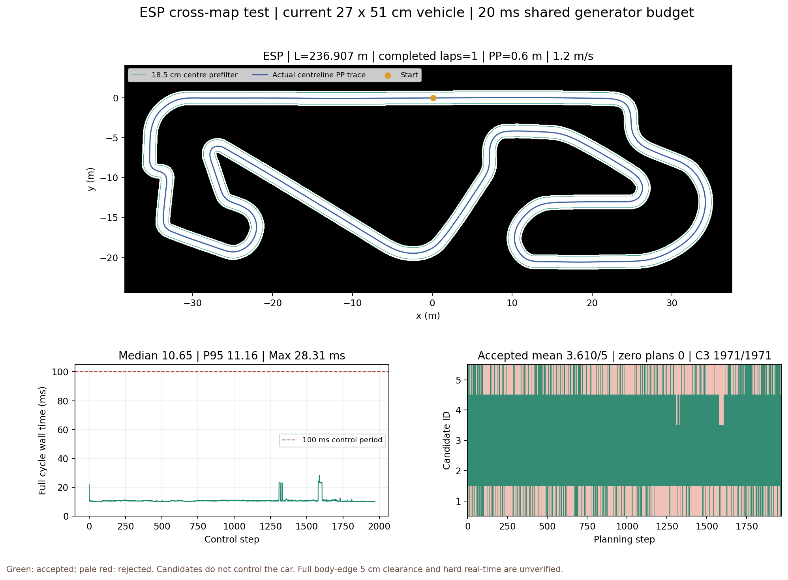
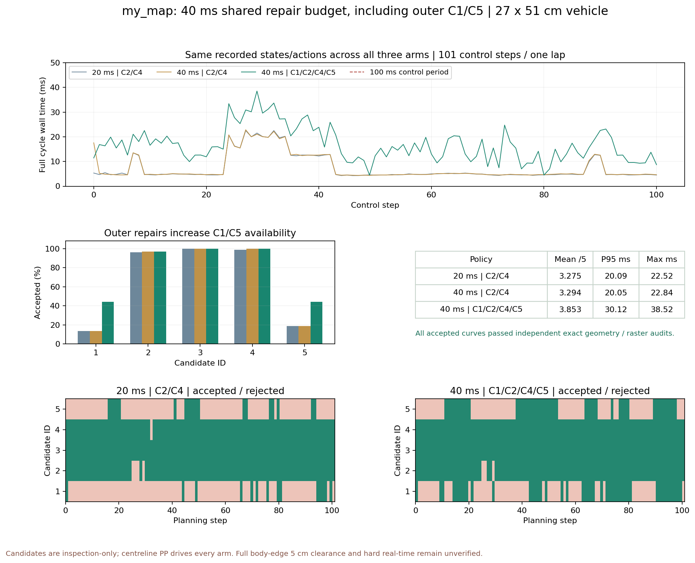
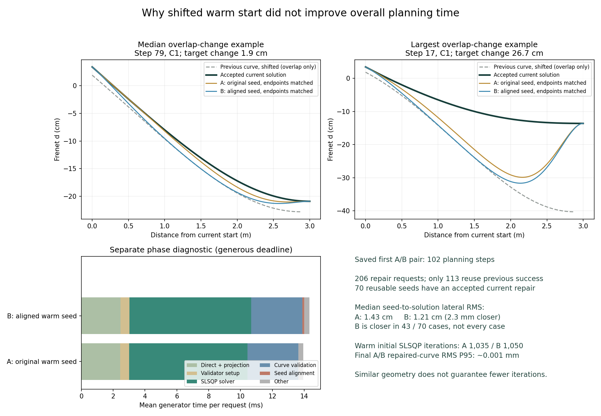

# 專案修改過程與結果紀錄

## 2026-11-05：原單車候選發布加入三圓車體檢查

依使用者要求回到單車路線生成；本步不擴充雙車功能。
在 `overtaking/session.py::make_plan` 的來源姿態／C3 契約檢查後，
預設呼叫新增 `footprint_validation.py`。直接生成、一般 B-spline 與
40 ms 修正候選都由原始 spline 重建位置／切線朝向，每參考 s 1 cm
檢查三圓加 5 cm 牆面餘量；包含終點及當前實際車體姿態。
使用規劃器原始 trinary map 的像素方格，未知與圖外皆拒絕。
三圓長寬／餘量由 SessionConfig 讀取 simulator YAML 預設並保存到 metadata。
原中心路徑域、曲率及契約檢查保持作為前置條件，並未重建離線域。
三圓失敗會更新候選有效旗標、有效 ID、fallback 與零候選狀態，記錄
第一個不合格位置／朝向。原中心路徑通過不再足以讓候選發布為有效。

限制：沿解析曲線的有限姿態取樣，不是連續車體掃掠或控制追蹤誤差證明；
`footprint_sampled_valid` 是新增結果，`footprint_verified` 與 `planning_allowed`
維持 false。底層生成器直接呼叫不含此發布關卡。三圓失敗後本步直接拒絕，
尚未把三圓約束納入最佳化器再求解。原 PP 中線控制、單車物理四角碰撞方法與
8768 歷史回放未修改；`requires_stop` 是候選結果，尚不接管 PP。

驗證：新增 9 個測試案例及相關 session／reference／mm repair 回歸共
47 passed（18 個既有棄用警告）。使用既有 my_map 18.5 cm 安全域、40 ms
修正 C1／2／4／5，執行原單車 `run_session` 一圈，資料保存於
`Data/research/overtaking/single_car_three_disc_20261105_001/`。
共 102 次規劃，250 條候選通過、143 條被新增三圓關卡拒絕、117 條已由
原安全域拒絕；零無候選步、C3 通過 102／102；中線實際行車完成一圈，
既有模擬碰撞旗標為 false。規劃耗時 88.35～203.06 ms，100／102 次超過
100 ms，三圓檢查在 40 ms 生成修正預算以外；本版未達 10 Hz 即時要求。
未以此宣稱全部研究測試或完整安全／即時驗收完成。

## 2026-11-05：三圓車體與雙車基本運行

本步依使用者收斂範圍，只建立三圓車體／牆面檢查與可運行的雙車入口。
唯讀參考 `/home/kimi/Downloads/corner-main.zip` 的 `Main/90_central.py`
（FastCollisionDetector、前後車獨立狀態）及 `lattice_planner.py`；
該兩檔使用單圓或車心距離近似，未直接移植其全尺寸車輛參數與超車策略。

新增 `research/collision/discs.py`、`multi_car.py` 及 `research.run_two_car`。
三圓等分車長，圓心縱向 −17／0／17 cm，半徑 15.953 cm，覆蓋 51×27 cm 矩形。
5 cm 牆面／車間餘量分開設定，車間只加一次。車體參考點仍是幾何中心假設。
三圓屬保守近似，圓突出矩形，圓碰撞不必然代表矩形接觸。
每台車有獨立原版動力學、轉向延遲 buffer、PP 與 LiDAR（含對方三圓）。
同步 10 ms 物理步、100 ms 控制步；每物理步檢查插值掃掠，接觸／餘量事件即停止。
插值掃掠不是連續 ODE 解的保證；未接入五候選決策或碰撞後反作用力。
舊 Continuous 實際在 `_advance` 完整控制步後由 `_inspect` 檢查四角，
本步未變更它，也未覆寫舊單車實驗與安全域。

驗證：新增 8 項測試全通過，涵蓋旋轉矩形覆蓋、像素面積／地圖外界、
車間餘量、跨步穿越、對車光束、獨立步進／重設、初始重疊、追近停止。
`Data/research/overtaking/two_car_three_disc_20261105_001/` 保存 my_map 雙車
12 秒／120 控制步結果，兩車速度命令各 1.2 m/s、起始沿路距離 1.5 m，事件為空。
本次未重跑完整研究測試。預覽、狀態記錄與報告隨結果目錄保存；執行方式見 usage.md。
本次僅為雙車可運行驗證，未進行完整效能／安全評估；首次控制週期含 JIT 編譯成本。

更新日期：2026-11-05（Asia/Taipei）。本文件是唯一持續維護的修改／實驗紀錄。下列為目前快照；後續各節按時間保留歷史設定與決策，不把早期 20 ms 數字當作最新展示組。

| 目前項目 | 狀態／設定 |
|---|---|
| 最新已測試及 8768 播放 | my_map／ESP，1 mm 安全域＋直接 Hermite＋40 ms 共用預算修正 C1／2／4／5；C3 是 d=0 中線 |
| 車輛與頻率 | 寬 27 cm、長 51 cm、軸距 33 cm、最大前輪轉角 ±29.5°；速度 1.2 m/s，控制／規劃週期 100 ms（10 Hz），規劃前方 3 m |
| PP 與安全預篩 | my_map 前視 0.3 m，ESP 0.6 m；中心預篩 18.5 cm，非旋轉車體與掃掠外緣 5 cm 保證 |
| 精度 | s／d 安全格 1 mm；實際車位與曲線保持浮點連續值，地圖 5 cm/pixel；my_map PGM＋YAML，ESP 原始 PNG＋YAML |
| 最新完整週期 P95／最大 | my_map 30.12／38.52 ms；ESP 46.87／48.93 ms，均是本機 Docker 單圈結果 |
| 歷史基準 | 20 ms 僅修二／四號，保留作比較與歷史 GIF；不再是 8768 最新播放組 |
| 程式預設 | 一般 CLI 仍為 esp／exact／optimized；`BudgetedDomainGenerator` 預設 40 ms、僅二／四號；最新全候選實驗須明確指定 1／2／4／5 |
| Warm start | 預設仍直接重用成功係數；位移對齊版只作可選實驗，平均變慢約 3%，未採用；見第 12～13 節 |
| 算力比較 | 本機固定工作量實測為單執行緒生成器；Ryzen／Jetson 公開單核倍率僅估算，未完成 Jetson 或完整 ROS2 實測；見第 11 節 |
| 實車／控制範圍 | PP 固定追蹤中線，其他候選只生成／驗證；尚未驗證候選切換閉迴路、完整車體餘量及硬即時 |

可攜式設定與結果快照見 `reports/latest_experiments/manifest.json` 及同目錄 JSON；完整重跑與資料依賴見[操作指南](usage.md)。大型原始 session／安全域留在本機，沒有把原始資料全數納入 Git。

計算時間相對早期流程已大幅下降：工作由線上反覆幾何查詢與多初值最佳化，移至離線道路安全域、線上區間查表與選擇性修正。歷史 20 ms 組完整週期中位數 **4.77 ms**、P95 **20.09 ms**、最大 **22.52 ms**；最新 40 ms 全候選結果見上表與第 8～9 節。不同候選覆蓋政策不能直接當作等價輸出的純加速倍率。

## 修改過程與決策順序

| 階段 | 問題／修改 | 結果與後續決策 |
|---|---|---|
| 基礎整合（10/21～22） | 建立連續圈、中線 PP、五候選來源與播放／重播 | 保留原動力學；ESP 多圈及歷史 40 m 資料為整合證據，不當作目前即時結果 |
| 精確查詢去重（10/27） | 共用同一規劃中的幾何量，減少五條候選重複查詢 | P0／P1 九案例輸出一致；有規劃工作的案例約 3.43～4.48 倍，限該批條件 |
| 道路快取（10/27～28） | 精確 s 道路表、跨次快取、不確定時回退 | 冷／熱／移動成本分開計量，快取命中不能直接沿用新曲線有效旗標 |
| 生成與密度對照（10/28～29） | 直接 Hermite 後修正；比較寬度比例、粗密度、固定網格 | 寬度比例與粗密度未取得等價接受政策；保留失敗結果，沒有用減量冒充等價加速 |
| 固定定位重用（10/29） | 保留原候選取樣、批次反解與定位重用 | 同版規劃＋JSON 中位數 157.66→120.56 ms，減少 23.5%；當批仍有 75／100 步 >100 ms |
| 1 mm 離線域（10/30） | 在 my_map 全圈先判定安全格與道路上下界，再公式生成、外側向內檢查 | 首批完整週期中位數降至 3.87 ms，但當時仍有兩次無候選；速度與覆蓋一起呈現 |
| PP 與三號契約修正（10/30） | my_map 前視 0.6→0.3 m；三號改為整段 d=0 參考，實際偏差由 PP 處理 | 消除將純中線強行當成實際起點 Hermite 的契約混用；其他候選仍匹配實際起點／方向 |
| 選擇性 B-spline（10/30） | 只修正失敗 C2／C4，解析梯度、前次係數初值、整格極值及協作式截止 | 舊 20 cm 車寬 20 ms 已補回 43／45 次，問題第 34、35 步都有 2／3／4 號；沒有放寬門檻 |
| 新車體重驗（10/30） | 寬 27 cm、長 51 cm、軸距 33 cm、轉角 29.5°；重建 margin=18.5 cm 安全域 | 0／20／40 ms 各跑一圈及獨立重驗；20 ms 補回 30／35 次，40 ms 為 32／35 次 |
| 現行選擇（10/30） | 使用者選定 20 ms；8768 換為該組全部 102 筆實驗，新增逐步計算、離線說明與 GIF | 40 ms 僅保留對照；橙色平滑牆線只是新增顯示層，不改寫前次實驗安全判定 |
| 文件清理（10/30） | 集中本文件，舊報告／圖形壓縮，核對副本後刪除暫存，更新引用 | 不改目前規劃演算法、原地圖、正在使用的 session／安全域與驗證輸入 |

## 1. 現行設定與入口

此節保留最初選定的 20 ms 基準設定；最新展示、可選實驗與程式預設的區別以上方快照及第 8～13 節為準。

| 項目 | 目前標準 |
|---|---|
| 地圖 | my_map，PGM＋YAML，174×128 pixels，0.05 m/pixel，8.7×6.4 m，中線約 11.930 m |
| 車體 | 寬 27 cm、長 51 cm、軸距 33 cm、前輪最大轉角 29.5°；規劃／研究 PP／物理模型已核對一致 |
| 控制 | 中線 PP，前視 0.3 m、速度 1.2 m/s、控制週期 0.1 s；ESP 自動前視仍為 0.6 m |
| 候選 | 前視 3 m、ID 1～5；三號為整段 d=0 參考中線，其餘候選匹配實際起點與方向 |
| 安全帶 | 中心路徑預篩距 18.5 cm＝半車寬 13.5 cm＋要求餘量 5 cm；整格保守距離與 ±2.5 cm 內縮包絡；尚非完整車體證明 |
| 索引與曲線 | s／d 格 1 mm，實際定位與曲線保留浮點連續值，不強迫起點落格；原 PGM 精度仍為 5 cm |
| 修正 | 僅失敗的二／四號，五次 B-spline、8 係數、單起始解及前次係數初值；每次重新驗證；共享 20 ms 協作式截止 |
| 目前研究入口 | `research.run_mm_bspline_comparison --budgets-ms 0 20`，0 為相同新參數直接生成基準；需指定匹配的新安全域 |
| 預設入口 | `research.run_centerline_candidates` 仍為 exact／optimized，地圖預設 esp；不會自動採用本研究方案 |

完整命令見[操作指南](usage.md#my_map-有預算的-b-spline-修正實驗)，契約見[介面規格](interfaces.md#候選生成與-session-契約)。原始 PGM／YAML、幾何及歷史實驗未覆寫。

## 2. 相較 V5.2 型流程的核心改進

此處 V5.2 型對照是目前工作樹保留的 exact＋optimized 多初值流程，沒有 checkout 最初歷史版本。

| 環節 | 已實作的改進 | 實際意義／限制 |
|---|---|---|
| 道路資料 | 離線枚舉 1 mm s／d 格，存整格安全位元與每列上下界 | 候選驗證改查表，減少每條曲線重複 PGM 射線與反投影；實際車位仍須 Frenet 定位 |
| 邊界整理 | ±2.5 cm 保守向內包絡，避免短尺度寬度突起 | 不把道路向外擴張；不是已批准的全域平滑邊界 spline |
| 快速生成 | 三次 Hermite 公式直接生成，記錄解析曲線與獨立重建起點 | 避免每條都先進多初值最佳化，減少密集 XY 輸出 |
| 邊界檢查 | 直接候選由外向內，利用同族包覆；每格端點與真正極值檢查 | 只繼承道路邊界結論，曲率仍獨立；變形後 B-spline 不能沿用該推論 |
| 三號定義 | 整段 d=0 的參考中線，與實際起點軌跡分開驗證 | 修正先前強行 Hermite 接回造成中線候選被誤拒的契約；三號仍須自行通過道路域、曲率與追蹤範圍 |
| 修正策略 | 僅失敗的 C2／C4 做有預算 B-spline，前次係數只當初值 | 補回部分直接失敗曲線，超時／不合格就丟棄；不是每條都重做完整最佳化 |
| 車模與控制 | 尺寸、軸距與轉角限制同步；my_map PP 前視 0.6→0.3 m | 配合小地圖及實際模型；不直接強制當下 d=0，亦未完成重心與後軸參考點的實車校準 |
| 驗證與展示 | 保存來源／參數／hash、逐步控制與候選、獨立重播／幾何複查、8768 及 GIF | 可追查每步輸入、判定、修正與耗時；顯示取樣不替代原安全驗證 |

先前的精確查詢共用、道路快取、固定定位批次反解仍保留為對照工具；本次不是刪除檢查後沿用舊有「安全」標記。歷史細節原文已收入第 7 節所列 ZIP，本文件保留主要演進與判定界線。

## 3. 計算時間：分清歷史演進與目前量測

### 早期同輸入完整圈對照（20 cm 車寬、PP 0.6 m）

三組保存相同車況與控制，各為 99 個完整控制週期；包含記錄、規劃、PP、物理模擬、scan 與 tracker，排除初始化、離線建表及事後稽核。

| 流程 | 完整週期中位數 | P95 | 最大值 | >100 ms |
|---|---:|---:|---:|---:|
| V5.2 型 exact＋optimized | 588.27 ms | 837.17 ms | 875.74 ms | 99／99 |
| 固定定位查詢優化＋失敗修正 | 118.84 ms | 167.93 ms | 215.29 ms | 78／99 |
| 初版 1 mm 查表＋直接公式 | 3.87 ms | 4.28 ms | 15.10 ms | 0／99 |

這批證明整個流程的工作量與耗時已大幅降低，但新模式當時有 2／100 次規劃無候選，終點、接受政策及輸出量也不同，**不能把相除結果稱為等價輸出的純加速倍率**。原始數據保留於 `Data/research/overtaking/mm_full_lap_20261030_001/report.json`；對照原文已歸檔。10/29 更早的固定定位同版本比較中位數改善 23.5%，其數據與原始 session 仍保留。

### 目前新車體同版本對照（27×51 cm、PP 0.3 m）

三組各實際一圈、101 個非終止控制週期／102 次規劃；各組 states／actions 一致，未修正候選資料與基準一致。這張表不是新車體與 V5.2 型流程的重新對跑，不能與上表直接計算純加速倍率。

| 生成預算 | 完整週期中位數 | P95 | 最大值 | 平均可用／5 | 補回候選 |
|---|---:|---:|---:|---:|---:|
| 0 ms，直接生成 | 4.74 ms | 5.30 ms | 16.63 ms | 2.980 | 0／35 |
| **20 ms，目前選定** | **4.77 ms** | **20.09 ms** | **22.52 ms** | **3.275** | **30／35** |
| 40 ms，保留對照 | 4.82 ms | 20.29 ms | 22.89 ms | 3.294 | 32／35 |

選定 20 ms 組：三號有效 102／102，零候選步數為 0，無碰撞，完整控制週期 >100 ms 為 0／101；兩次候選因生成截止丟棄，仍保留其他通過候選。第 34、35 步均有 2／3／4 號。規劃本身 P95 18.63 ms、最大 21.13 ms；20 ms 是協作式檢查預算，不是原生運算硬中斷或完整週期的硬上限。

新車體報告初步曾建議 40 ms，使用者後續明確選定 **20 ms**；現行選擇以本文件與 8768 為準，歷史報告保留原建議及數據。原始結果見[新車體結果 JSON](reports/my_map_vehicle27_51_20261030.json)，本機逐步圖表見 [8768](http://127.0.0.1:8768/)。

## 4. 離線成本與專案資料分工

新安全域一次建立約 12.14 秒：枚舉 25,401,099 格，向內包絡前保守安全格 7,228,498 個，11,931 個 s 區間有可用帶；NPZ 約 908.10 KiB，展開陣列約 4.40 MiB。版本、來源地圖與 margin 不符時拒絕混用舊表。這不是每個控制週期重付的成本，也沒有把 5 cm/pixel 的 PGM 變成毫米量測。

| 類別 | 現有位置／用途 |
|---|---|
| 車輛設定 | `params/simulator_params.yaml`、`vehicle_params.yaml`、`GlobalPurePursuit.yaml` |
| 共用幾何與模擬 | `research/core/geometry/`、`research/core/`；既有 Continuous／六圖成果沿用 |
| 規劃與驗證 | `research/overtaking/millimetre_domain.py`、`mm_bspline_repair.py`、`reference_path.py`、`session.py`、`verify_session.py` |
| 實驗入口 | `research/run_mm_bspline_comparison.py`；歷史入口保留作對照 |
| 地圖查詢網頁 | 8765，六圖幾何與截面查詢 |
| 原始 session 播放器 | 8766，依啟動時選定的 session 播放，不保證自動載入最新資料 |
| 目前實驗頁面 | 8768，20 ms 組全部 102 次規劃、逐步計算、離線結果、GIF；`/data/f1tenth/sites/my-map-lab-20261029/` |
| 網頁資料匯出 | `research/export_mm_dashboard.py`；顯示用曲線每 1 cm 取樣；橙色 σ=5 cm 平滑牆線僅顯示，綠色內縮包絡才是實驗使用的安全帶 |
| 可閱讀紀錄／證據 | 本文件為唯一修改紀錄；`docs/project/reports/` 保留程式依賴的 JSON 與現行代表圖，歷史原文在 ZIP |
| 原始大型資料 | 本機 `Data/research/overtaking/`：states／actions／plans、domain 與驗證；保持原路徑供 hash／重播使用 |

新車體原始批次為 `mm_bspline_width27_length51_20261030_001`；安全域為 `mm_domain_width27_length51_20261030_001/domain`，均位於 `Data/research/overtaking/`。沒有為整理而搬移、刪除原始資料，也沒有變更既有規劃預設或控制來源。

## 5. 已有驗證與本次整理範圍

| 驗證 | 證據範圍 |
|---|---|
| 10/30 相關回歸 | 已記錄 54 passed：安全域、B-spline、三號契約、session；不是全專案重新回歸 |
| 新車體三組完整圈 | session／控制／物理／Frenet／來源與索引驗證通過；無碰撞 |
| 原始密度獨立核驗 | 基準 304 條、20 ms 新增 30 條、40 ms 新增 32 條全部通過 |
| 1 mm 獨立複查 | 第 34、35 步：20 ms 組新增 3 條、40 ms 組新增 3 條全部通過 |
| 網頁與 GIF | 原始來源 hash、102 畫格／五 ID／三號 d=0／30 次修正／2 次截止、101 筆 PP 公式重算一致；播放、單步、圖層與終點行為已檢查 |
| 10/29 歷史完整回歸 | 420 passed、1 deselected；屬當日版本，未以此宣稱目前完整工作區全部通過 |

本次改為只維護這一份修改過程與結果紀錄；分散的進度、工作計畫與階段報告已壓縮歸檔。操作／介面指南保留其技術用途。未重跑大型模擬、未變更控制或接受規則，也沒有 commit／push。

## 6. 下一步與尚未完成項目

1. **完整車體安全距**：把 51 cm 車長、方向、車頭車尾與連續掃掠納入，驗證外緣 5 cm；目前中心距 18.5 cm 預篩不能代替這項。
2. **實際跟隨候選**：先驗證 PP 追蹤生成曲線、二／四號切換與回正，再處理超車決策；目前 PP 仍追蹤三號參考中線。
3. **動態與即時**：轉向速率、重心／後軸參考點、側滑與速度限制、長時間及多圈壓力測試、非同步調度與硬截止、Jetson Orin NX 實測。

原 20 ms 組仍有五次修正需求未補回（其中兩次截止），不把求解失敗寫成永久道路無效，也不保證每一步五條全可用。尚未取得全曲線連續曲率／全域 Frenet 唯一性證明；`candidate_control_enabled`、`planning_allowed`、`footprint_verified` 維持 false。ROS2 實車接線與部署尚未完成，TF 適配不是完整 ROS2 節點。LMPC 保留為獨立研究分支。

後續工作以本文件第 6 節為準；歷史詳細文本與圖形的取回方式見下方清理紀錄。

## 7. 實際清理結果與資料取回

現在只有本文件維護「修改過程＋決策＋結果＋後續工作」。操作指南、介面、地圖說明與測試屬必要技術文件，仍保留；JSON／session 是機器驗證證據，不是另一份人工進度紀錄。

| 清理項目 | 實際處理 |
|---|---|
| 分散報告／進度／工作計畫 | 28 份 Markdown 合併重點到本文件；原文逐檔 SHA256 驗證後移入單一 ZIP，原位置移除 |
| 非現行圖形 | 9 組圖形目錄歸檔；保留新車體第 34／35 步代表圖與目前 8768／GIF |
| 探測與舊輸出 | B-spline probe、兩份舊 PDF、舊 10/29 單檔網頁歸檔，不再散放在工作目錄 |
| 重複匯出 | 6 個 web_export 檔案，確認與目前網站或歸檔內容 SHA256 相同後移除 |
| Python 暫存 | 30 個研究程式／測試 .pyc 暫存移除，可由 Python 重建；未動依賴環境 |
| 保留的證據 | 所有成功完整圈原始 session／安全域、JSON 輸入及結果、地圖、程式、測試、目前 8768 靜態資源；歷史 6.2 GiB 的 ESP 40 m 原始圈也未刪除 |

共歸檔 79 個檔案；ZIP 大小 12.38 MiB。刪去原位置與可重建副本後，計入 ZIP 的淨釋放約 14.33 MiB。目標主要是減少散落檔案，沒有為節省容量而丟棄原始實驗。

歸檔位置：`docs/project/archive/experiments_through_20261030.zip`。ZIP 內 `MANIFEST.json` 保存原 workspace 相對路徑、檔案大小與 SHA256；壓縮後先解讀逐檔核對，才移除原件。

ZIP SHA256：`d40c8273604dcbfed39570617908ad890435cf092b09e245fa8697ac496c0015`。

若需恢復某個舊檔，從 ZIP 選取對應項目解到一個新暫存目錄檢視，再依 MANIFEST 的原路徑還原，避免覆蓋目前文件。不要把 ZIP 全部直接覆蓋解壓到現行專案。

細項機器清單：`Data/research/overtaking/cleanup_20261030.json`；它記錄歸檔與刪除清單，供後續稽核。分散報告的歷史名稱如下，其內容均已歸檔，本文件上方已整理主要演進與成果：

- `2026-10-22_807步10m路線五震盪與追蹤驗證.md`
- `2026-10-22_路線生成方案與模擬器驗證.md`
- `algorithm_p01_20261027.md`
- `algorithm_p2_20261027.md`
- `centerline_baseline_confirmation_20261021.md`
- `centerline_candidates_stage2_20261021.md`
- `daily_progress_20261021.md`
- `density_20261029.md`
- `fixed_grid_trial_20261028.md`
- `fixed_lookup_20261029.md`
- `generator_abc_20261029.md`
- `hybrid_direct_repair_20261028.md`
- `manual_run_001_report.md`
- `millimetre_domain_20261030.md`
- `millimetre_full_lap_20261030.md`
- `millimetre_v52_comparison_20261030.md`
- `my_map_3m_20261029.md`
- `my_map_bspline_budget_20261030.md`
- `my_map_pp03_centerline_c3_20261030.md`
- `my_map_reference_c3_20261030.md`
- `my_map_vehicle27_51_20261030.md`
- `playback_stage3_20261021.md`
- `pp_lookahead_my_map_20261030.md`
- `pp_step807_candidate1_3s_20261022.md`
- `project_status_20261029.md`
- `short_horizon_baseline_20261028.md`

## 8. ESP 跨圖測試（2026-10-30）

此節延續同一修改紀錄，不另建人工報告。使用相同車體 27×51 cm、軸距 33 cm、轉角 29.5°、中心預篩 18.5 cm；速度 1.2 m/s、規劃距離 3 m、控制週期 0.1 s。ESP 沿用既有 PP 前視 0.6 m；my_map 是 0.3 m，跨圖數字不可當作純算法倍率。

### 已完成：原 20 ms、僅修二／四號

ESP 中線長 236.9075 m，原圖 1520×570 pixels、0.05 m/pixel。使用原本相同建表方法，離線約 342.21 秒，枚舉 505,561,672 格、保守安全格 342,134,717 個，236,908 個 s 區間全有可用帶。NPZ 約 15.35 MiB，展開陣列 87.44 MiB。離線建置不計入控制週期。

完成一圈，1,970 控制步／1,971 次規劃，無碰撞、零無候選步。完整週期中位數 10.65 ms、P95 11.16 ms、最大 28.31 ms，>100 ms 為 0／1,970；平均可用 3.610／5，二／三號皆 1,971／1,971 有效。中線追蹤最大 |d| 約 8.15 cm，最大方向誤差約 10.93°。

37 次四號修正需求全部因 20 ms 截止丟棄，不代表道路／軌跡無解。全程 7,115 條接受曲線的原始密度幾何／光柵複查，以及 5 個代表步的 15 條接受曲線每 1 mm 複查，全數通過；物理、控制、Frenet 與來源重播也通過。

事後唯讀剖析：相同約 6,003 個局部曲率點，my_map 查表中位數約 0.322 ms、ESP 約 5.078 ms；修正驗證器建置約 0.521／5.597 ms。`reference()` 使用的 NumPy 週期插值每次都重新排序／擴展整圈資料，`segment_grid()` 也建立／掃描全圈陣列，這是大圖下的重要額外成本。此剖析未計入行車時間，並非求解可行性證明；本次未為提高通過率改寫此查表演算法。

### ESP 40 ms 附加對照與測試結束

新增可選修正 ID 1／2／4／5，三號永遠保持參考中線；優先二／四號，再使用剩餘預算修一／五號，每對交替次序。40 ms 是所有修正共用的生成器總預算，不是每條 40 ms。修正後各自做端點、整格極值、J、斜率與曲率檢查，不能沿用外側推論；超時或不合格維持拒絕。新增三個外側契約測試，本次相關回歸為 36 passed。

使用者後續澄清：一／五號的測試目標是 **my_map**。ESP 已執行的附加對照保留證據，至此結束，不再追加 ESP 調校或測試。

ESP 40 ms 僅二／四號修正 31／37 次，完整週期 P95／最大為 11.11／43.52 ms；包含一／二／四／五號修正 1,188／2,740 次，一／五號有效次數為 1,217／1,179，完整週期 P95／最大為 46.87／48.93 ms。兩組都完成一圈，無碰撞、零無候選步；包含原 20 ms 的三組 states／actions SHA256 相同。兩組接受曲線各 7,146／8,303 條事後幾何／光柵複查全通過，5 個診斷步共 32 條曲線的每 1 mm 複查也全通過。40 ms 並非硬即時的完整週期上限。

原始證據統一放在 `Data/research/overtaking/esp_mm_20ms_20261030_001/` 及 `esp_mm40_outer_20261030_001/`，沿用前者 ESP 安全域，不建立重複表。原始曲線、控制、來源、獨立驗證與時間紀錄均保留；目前 8768 的 my_map 20 ms 播放不被 ESP 實驗取代。

## 9. my_map：40 ms 納入一／五號修正（2026-10-30）

本節才是使用者指定的一／五號測試。沿用 my_map 原始 PGM＋YAML、既有 1 mm 安全域、27×51 cm 車體、33 cm 軸距、29.5° 最大轉角、18.5 cm 中心預篩、PP 前視 0.3 m、速度 1.2 m/s、控制週期 100 ms 與規劃距離 3 m，沒有重新建表或放寬通過門檻。比較既有 20 ms 僅修二／四號，以及新跑的兩種 40 ms 策略。

| 指標 | 既有 20 ms：二／四號 | 40 ms：二／四號 | 40 ms：一／二／四／五號 |
|---|---:|---:|---:|
| 一號有效次數／102 | 14 | 14 | 45 |
| 二號有效次數／102 | 98 | 99 | 99 |
| 三號有效次數／102 | 102 | 102 | 102 |
| 四號有效次數／102 | 101 | 102 | 102 |
| 五號有效次數／102 | 19 | 19 | 45 |
| 平均有效候選／5 | 3.275 | 3.294 | 3.853 |
| 修正成功／需求 | 30／35 | 32／35 | 89／206 |
| 修正逾時次數 | 2 | 0 | 0 |
| 完整週期中位數 ms | 4.77 | 4.81 | 15.59 |
| 完整週期 P95 ms | 20.09 | 20.05 | 30.12 |
| 完整週期最大 ms | 22.52 | 22.84 | 38.52 |

每組皆完成 1 圈、101 控制步／102 次規劃，無碰撞、零無候選步、完整週期超過 100 ms 次數為零。三組 `states.jsonl` SHA256 均為 `5f4f115a044404f567e4e235324fa99544b0c27367210a36dcf88ddda0127f7f`，`actions.jsonl` 均為 `8c3f38d4a61a9894c4d3a8ffa51c117f26ab424b74ed71122b5f4c10646a03cd`；代表本次控制條件相同。20 ms 為既有批次，時間數字是單圈實測，並非多次統計或 Jetson 性能保證。

新增外側修正：一號需求 88 次、成功 31 次；五號需求 83 次、成功 26 次，合計多救回 57 條。二號成功 21／24、四號成功 11／11；共 89／206。最終仍拒絕的 117 條候選是原曲線未通過安全域且修正未成功，不能據此斷言道路無解。一／五號並非每一步都能使用，也不以外側通過直接免檢內側。

兩組新測試接受曲線共 336＋393＝729 條，事後原始密度幾何／光柵獨立複查全部通過；第 34／35 步兩組修正曲線共 6 條每 1 mm 複查也全通過。第 14 步一／五號均修正成功、五條候選全可用；第 34／35 步仍只有二／三／四號可用，外側維持拒絕，沒有為湊齊五條而放寬限制。

代表圖：[第 14 步：一／五號修正成功](reports/figures/my_map_mm40_outer_20261030/cases/step_14.png)、[第 34 步](reports/figures/my_map_mm40_outer_20261030/cases/step_34.png)、[第 35 步](reports/figures/my_map_mm40_outer_20261030/cases/step_35.png)。圖使用錄下的實際 B-spline，紅色標記指出拒絕曲線的邊界或曲率問題。

結論：40 ms 共用生成預算納入一／五號，在這次 my_map 固定中線行車條件下可提高候選可用率，但計算量也上升。40 ms 是合作式截止，包含基礎生成、不含後續 session 檢查／控制，不是硬即時完整週期保證。這次所有組別仍由中線 PP 控制，候選僅檢查，未驗證切換候選後的追蹤行為；18.5 cm 仍是半車寬加 5 cm 的中心路徑預篩，尚非車體角點及掃掠足跡的 5 cm 保證。**8768 與預設選擇維持原 20 ms，不因本次測試自動切換。**

原始證據：`Data/research/overtaking/my_map_mm40_outer_20261030_001/validation/report.json`、`budget_40ms_c24/`、`budget_40ms_c1245/`；沿用 `mm_domain_width27_length51_20261030_001/domain/`。既有 20 ms 來源為 `mm_bspline_width27_length51_20261030_001/report.json` 的 `budget_20ms`。本節沿用單一修改紀錄，不另建人工報告。

## 10. 8768 更新為雙賽道最新實驗檢視（2026-10-30）

依使用者要求，8768 現在可切換 my_map／ESP，兩者皆播放已完成的 40 ms 修正一／二／四／五號組，並列出各自 20 ms 與 40 ms 僅二／四號的對照。這是檢視頁選擇更新，沒有修改規劃器預設參數，也沒有重跑 ESP 或行車實驗。

保留 my_map 全部 102 筆、ESP 全部 1,971 筆紀錄，逐步呈現實際 B-spline、接受／拒絕原因、共享預算、修正嘗試、PP 目標與計算、控制命令，以及各賽道離線建表結果與來源 SHA256。橙線依然是顯示用平滑牆面；綠帶才是實驗實際使用的安全域。ESP 原始 YAML 指向 PNG，本次忠實使用原圖，my_map 使用 PGM＋YAML；沒有把顯示 PNG 當成新的規劃地圖。

新增跟車放大、賽道專屬觀察步與動態終點／步數。my_map 候選顯示間距 1 cm，ESP 3 cm；僅減少畫圖資料，不省略任何控制步、不改原始驗證精度。每組完整週期、候選可用率、建表量與獨立稽核均取自對應原始紀錄；匯出時比對三組狀態及控制雜湊。既有 GIF 明確標成歷史 my_map 20 ms，沒有冒充最新 40 ms 回放。

本階段結論仍為：固定中線行車下，查表＋直接生成＋選擇性 B-spline 修正可運作，兩圖接受曲線皆通過已執行的幾何／光柵複查。仍待驗證候選切換追蹤、旋轉車體與掃掠餘量，以及 Jetson 實車硬即時性能，不能把本階段結果當作全部控制與安全需求已完成。

## 11. Docker 單核性能基準核對（2026-11-05）

本次只核對資源並量測已錄輸入，不重跑行車或 ESP 調校，不改算法、參數及容器資源設定。主機為 AMD Ryzen 9 9950X，16 實體核／32 邏輯 CPU；容器 `f1tenth-algorithm-p01` 的 `cpu.max=max 100000`、有效 CPU 集合 `0-31`、`memory.max=max`，容器本身沒有 CPU 配額、綁核或記憶體上限。容器內實際查得 `OPENBLAS_NUM_THREADS=1`，匯入 NumPy 後原生執行緒數為 1。Python 3.9.25、NumPy 1.22.0、SciPy 1.11.1。

新增可重用量測入口 `research.run_cpu_baseline`。以既有 40 ms C1／2／4／5 組的錄製車位，對相同生成器比較「可使用 32 邏輯 CPU」與「僅此量測程序綁定 CPU 0」。兩組均明確使用 OpenBLAS／OMP／MKL 單執行緒；先暖機 5 次，每個模式重複 2 批，每批重設生成器。my_map 使用全部 102 筆（每模式 204 次），ESP 使用均勻取樣加診斷步共 35 筆（每模式 70 次），不是新的 ESP 完整圈。

為避免硬體較慢就少算修正而失去比較基準，本次將量測程序的修正截止設為寬裕的 60 秒；全部呼叫都沒有逾時。不改既有 40 ms 實驗或實際預設，也不放寬道路、曲率或求解迭代限制。數字只包括生成器，排除讀檔／初始化／暖機、獨立 session 起點檢查、PP、物理模擬、scan 及記錄，因此不能替換 8768 的完整週期時間。

| 地圖／模式 | 單次生成中位數 ms | P95 ms | CPU 時間／經過時間 | 實際消耗 CPU 的執行緒數 |
|---|---:|---:|---:|---:|
| my_map，不綁核 | 12.98 | 27.18 | 0.9991 核 | 1 |
| my_map，綁 CPU 0 | 13.10 | 27.67 | 0.9997 核 | 1 |
| ESP，不綁核 | 31.22 | 47.99 | 0.9997 核 | 1 |
| ESP，綁 CPU 0 | 31.17 | 48.69 | 0.9997 核 | 1 |

四組量測的程序內只有 1 個原生執行緒，主執行緒佔觀測到的 CPU ticks 100%。整批經過時間綁核與不綁核相差約 0.70%（my_map）及 0.37%（ESP），同圖兩種模式的接受旗標與輸出 spline SHA256 相同。支持目前線上生成器為單執行緒 CPU 工作；沒有多核心平行生成五條路線，也未使用 GPU 加速這段工作。這不是通用 Geekbench 分數，亦不是所有模擬器／ROS2 節點的核心需求證明。

峰值 RSS 約 166 MiB（my_map 階段）與 384 MiB（載入 ESP 後）是整個量測程序的累計高水位，含錄製資料與幾何，不是規劃器獨佔記憶體需求，不能據此直接訂實車容器記憶體上限。綁核測試只是短測，未控制 CPU boost、溫度與背景負載；其小幅差異不當作顯著加速／退化。

後續與 Jetson 比較，應使用相同版本、相同輸入、相同選取步數及單執行緒數值庫，記錄 Jetson 功耗／時脈／溫度，先重跑此固定工作量，再另測 40 ms 內的有效候選率。單核效能相當的假設仍須實測，不能用桌機核心總數或 Jetson AI TOPS 換算。原始機器結果：`Data/research/overtaking/cpu_baseline_20261105/report.json`。量測程序恢復原 affinity，研究容器恢復量測前的停止狀態；8768 獨立容器未動。

### Ryzen／Jetson 公開單核分數與初步推估（2026-11-05 查詢）

針對目前單執行緒生成器，先比較 Geekbench 6 的 Single-Core，不把 Ryzen 單核與 Jetson 多核總分相除。以下是個別使用者上傳的公開樣本，非本機 Docker 或目標 Jetson 跑出的分數，也不是所有同型設備的平均值。

| 硬體樣本 | 單核分數 | 版本／系統與來源 |
|---|---:|---|
| AMD Ryzen 9 9950X | 3,438 | Geekbench 6.3.0 Linux AVX2、Ubuntu 24.04.1；[原始結果](https://browser.geekbench.com/v6/cpu/8474032) |
| NVIDIA Orin NX Engineering Reference Developer Kit | 863 | Geekbench 6.3.0 Preview Linux AArch64、Ubuntu 22.04.4、15.29 GB 記憶體；[原始結果](https://browser.geekbench.com/v6/cpu/7489126) |
| 另一筆 NVIDIA Orin NX Engineering Reference Developer Kit | 869 | Geekbench 6.4.0 Preview Linux AArch64、Ubuntu 22.04.5、8 核、15.29 GB 記憶體；[原始結果](https://browser.geekbench.com/v6/cpu/10489182) |

兩筆 Jetson 記憶體容量符合 16GB 組態，但未提供本專案目標板的型號核對與功耗設定；Preview／正式版與小版本也不完全一致。先前另查得 Ryzen 9950X Linux Geekbench 6.3.0 樣本為 3,001（[原始結果](https://browser.geekbench.com/v6/cpu/10439100)），因此對這些樣本作「約 3.5～4 倍單核差距」的初步評估，而不是宣稱設備固定存在這個倍率。所選 3,438／863 兩筆相除約 3.98；採 4 倍只是方便定義性能風險的假設，未執行本機 Geekbench，也沒有測得規劃器在 Jetson 上的實際倍率。

同工作量粗估式：`Jetson 耗時 ≈ Ryzen 耗時 × (Ryzen 單核分數 / Jetson 單核分數)`。若先採 4 倍假設，桌機 10／20／40 ms 的工作量對應約 40／80／160 ms；要評估 Jetson 40 ms，可先以桌機約 10 ms 為研究目標，再實測校準。這不是硬即時承諾，亦不能直接把目前 40 ms 限時修正的時間乘四：在較慢硬體上，合作式截止可能讓修正提早放棄，候選完成率也會改變。

ROS2 整套系統的多核容量另行評估。定位、感知、規劃、控制與訊息／記錄可以消耗不同核心；節點數不等於核心數，Executor 與 callback group 決定回呼能否並行，多執行緒 Executor 不會自動把單次規劃內部拆成平行工作。[ROS2 官方 callback group 說明](https://github.com/ros2/ros2_documentation/blob/rolling/source/ROS-Framework/nodes/Working-with-nodes/Using-callback-groups.rst)。第 11 節單執行緒量測僅適用這段生成器，未啟動完整 ROS2 節點組合；上車後還要量測車況到達、排程等待、規劃計算、訊息傳遞至控制使用的端到端延遲。

Docker 的 `--cpuset-cpus` 是綁定邏輯 CPU、`--cpus` 是 CPU 時間配額、`--memory` 是容量上限，無法直接模擬 Jetson 的 ARM 架構、快取與頻寬。[Docker 官方資源限制說明](https://docs.docker.com/engine/containers/resource_constraints/)。僅限一核或依 Geekbench 比例降低配額，不能視為已校準成等效 Jetson。正式比較仍採相同規劃工作量實測，再看 40 ms 內候選完成率及完整 ROS2 負載下延遲。

## 12. my_map：僅增加舊曲線對齊的 warm start 對照（2026-11-05）

使用者提出對齊前一時間步曲線的 warm start 實驗。本次基準本來就有 warm start，並非 cold start：A 組保留原本直接重用舊成功係數，B 組只增加依前進距離對齊後重新擬合初值。預設仍為 A，不自動套用實驗組，也不追加 ESP 實驗或更換 8768 播放組。

共同設定：原 my_map 40 ms C1／2／4／5 組的全部 102 筆錄製車位；沿用同一安全域、27×51 cm 車體、0.185 m 中心預篩、3 m 規劃距離、曲率／斜率／端點與起點契約、二／四優先再一／五、迭代與細化上限。兩組均共用 40 ms 合作式生成預算，並以相同單執行緒 OpenBLAS／OMP／MKL 運行。沒有新跑行車或候選閉迴路：每步車況由原紀錄固定提供，時間只計生成及 session 檢查，不含 PP、物理模擬、scan、寫檔或事後稽核。

B 組初值：沿用 A 組原有「同候選、相同長度、前進小於 0.5 m」快取條件，將前次 d 曲線按 Δs 位移；舊曲線未覆蓋的新尾段以舊終點 d 常值作為猜測，於 61 個點重新擬合到相同五次、8 係數 B-spline，再投影匹配本步 d／d′ 起點與目標 d／零終點斜率。這只是求解初值，不是發布曲線或舊有效性旗標；仍做原求解及整格／曲率驗證。對齊與擬合時間包含在 40 ms 內。A／B 都只快取修正成功曲線，並保留既有細化初值流程。

先做不計時的 5 步暖機，再以空歷史開始每批。順序 A→B、B→A、A→B，共 3 組配對、612 次規劃；沒有挑選最快的一輪。下表時間由每組全部 306 次規劃合併計算，不是舊完整控制週期。

| 指標 | A：原係數 warm start | B：位移對齊 warm start |
|---|---:|---:|
| 規劃中位數 ms | 13.94 | 14.45 |
| 規劃 P95 ms | 28.29 | 27.91 |
| 規劃最大 ms | 36.77 | 41.03 |
| 規劃平均 ms | 14.86 | 15.30 |
| 每輪成功修正／206 次需求 | 89、89、89 | 89、88、89 |
| 每輪截止丟棄候選 | 0、0、0 | 0、1、0 |
| 已記錄求解迭代數合計 | 8,091 | 8,153 |
| 每輪零可用路線步數 | 0、0、0 | 0、0、0 |

B 的第 2 輪在第 90 步五號逾時，該步從 A 的二／三／四／五變為二／三／四；其他兩輪所有步的可用 ID 集合與 A 一致。B 該筆生成器耗時約 40.011 ms，加 session 檢查後約 41.029 ms，符合合作式截止可能略超時的既有限制。迭代數只計完整記錄的嘗試，不含逾時中斷而未回傳的迭代，不應當作所有求解工作的精確總量。

判定：此版位移對齊初值沒有顯示整體加速；平均規劃時間約增加 3%，已記錄迭代數也未降低。P95 略降不足以抵銷平均／中位數與候選覆蓋的結果，不採用為預設。這不證明 warm start 無效，因為 A 已經有係數 warm start；只代表本次增加的常值補尾、最小平方擬合與端點投影方式沒有展現進一步收益。三輪短測未控制所有頻率與背景負載，不宣稱統計顯著差異。

新增端點／快取不變與不能繞過安全驗證的測試；修正模組回歸 12 passed。兩組三號曲線與雙方未修正的直接候選逐步相同。六批全部接受曲線共 2,357 條次的原密度獨立幾何／光柵複查全通過，本次實驗完成；此數字包含跨輪重複曲線，不代表 2,357 條不同曲線，也不構成完整車體或閉迴路驗證。

重跑入口：`python -m f1tenth_benchmarks.research.run_aligned_warm_start --output <新的空輸出路徑>`。原始結果集中 `Data/research/overtaking/aligned_warm_start_20261105_001/`：一份 `report.json`、六份逐步 trial JSONL，含輸入／程式／安全域 SHA256，不另建人工報告。算法只增加可選 `warm_start_mode='aligned'`，預設 `coefficients` 與原驗證門檻均保留。

## 13. 對齊 warm start 收益有限的原因診斷（2026-11-05）

讀取第 12 節第一組無逾時的 A／B 配對，重建實際初值與成功歷史，再做獨立階段成本剖析。此處沒有改算法或安全條件，沒有重跑行車。原始分析為同目錄 `diagnosis.json`，入口為 `research.diagnose_aligned_warm_start`。

**先前與本步曲線多數接近，但不是只差一個前進位移。** 113 次有可用成功歷史的初次求解中，73 次快取來自前一步、其餘 40 次來自前 2～4 步；不是每步都一定有新的成功 B-spline。對其中本步也修正成功的 70 次，在相同全域 s 的重疊區間比較舊曲線與新解，d 的 RMS 中位數為 1.85 cm、P95 6.71 cm、最大 16.25 cm。這是選定成功子集的幾何統計，不是全部候選的通過率或整車誤差。

目前候選目標依「本步前方 3 m 終點」的安全帶重新選取。相同候選 ID 不代表相同的全域軌跡。113 次可重用初值的目標 d 變化中位數為 1.9 cm、P95 10.6 cm、最大 29 cm。例如相鄰第 16→17 步，一號目標從 -40.3 cm 變成 -13.6 cm，相差 26.7 cm；此例舊／新重疊曲線 RMS 為 16.25 cm。位移後只補平尾、再做端點投影，仍留下與新解不同的中段形狀。前方道路約 96% 重疊，不等於終點目標與最優曲線也相同。

**原係數初值本來已經接近答案。** 在上述 70 次本步成功案例中，依兩組各自歷史重建並匹配本步端點後，A 初值到本步 A 接受解的 RMS 中位數為 1.4345 cm，B 為 1.2062 cm，只改善約 2.28 mm；B 在 43／70 次較接近，並非一致改善。RMS 是橫向位置誤差，沒有直接衡量 d″／d‴ 平滑成本或道路／曲率約束；不能把 RMS 小一點當成 SLSQP 一定少迭代。以 A 解為距離參考可能偏向 A，但兩組 89 條成功修正解的相互 RMS P95 僅約 0.00101 mm、最大 0.00447 mm，兩者收斂結果實際極為接近。

**可受益的求解有限，且實測沒有省迭代。** 206 次修正需求只有 113 次（54.9%）能用前次成功初值，另外 93 次的 cold 初次求解完全相同。第一配對：93 次 cold 求解皆為 1,037 次迭代；113 次前次 warm 初次求解為 A 1,035／B 1,050 次；85 次格內檢查後細化為 A 625／B 629 次。原模型只有 8 係數、4 個端點等式，原 warm 初次求解平均已約 9.16 次迭代，這版對齊沒有進一步降低。

**重驗成本沒有減少，對齊還有新增成本。** 另外以寬裕 60 秒截止對相同 102 步做一次只記時的剖析，避免 40 ms 截止改變工作量；不是原正式實驗數字。A 生成器約 1.422 s 中，直接生成與定位約 17.6%、驗證器建立 4.0%、SLSQP 53.3%、曲線驗證 22.9%，其餘約 2.3%。B 的 113 次對齊初值合計約 12.32 ms，每次約 0.109 ms；SLSQP 本身也沒有變快。舊曲線通過旗標不會重用，因此驗證工作仍需付出。此剖析為單次帶量測包裝的成本拆解，不能把各階段的小幅時間差當成統計顯著因果。

結論：多數曲線確實接近，並不是軌跡完全不同；主要是原本已有 warm start、對齊只小幅改善初值且有時更差、終點目標可能突變，以及沒有減少實際迭代與重驗。只增加位移擬合因此沒有展現淨收益。保留原預設，下一步若繼續研究應先評估目標變化與初值品質，不能直接沿用舊曲線有效性。

## 14. 版本保存與提交前驗證（2026-11-05）

本次版本保存涵蓋目前 OVERTAKING 核心、實驗工具、回歸測試、車輛參數、最新文件、選定代表圖及報告歸檔。主專案沿用目前 `docs/route-generation-validation-20261022` 分支；8768 在獨立 repository 保存完整靜態檢視頁與兩圖匯出資料，對應網站 commit 記於 `reports/latest_experiments/manifest.json`。建立本地提交，不包含推送或雲端部署。

新增 `reports/latest_experiments/` 保存 my_map 40 ms、ESP 20／40 ms、CPU、warm start 及診斷 JSON 的原樣副本；manifest 記錄各檔原始路徑、SHA256 與驗證摘要。所有大型原始 states／actions／plans、安全域 NPZ、歷史完整圈仍保留本機並受 Git 忽略，不隨 clone 取得。這是程式與精簡證據快照，不是完整原始資料備份。操作指南已說明新建安全域／完整圈以及依賴本機錄製資料的量測入口。

提交前驗證：完整 `tests/research` 為 **461 passed、1 deselected**，另有 18 個既有 Matplotlib／Pyparsing 棄用警告。排除項由原 `pytest.ini` 的 `not local_archive` 設定決定，並非本次為通過而移除測試。Node 原播放器測試通過；8768 的可攜式 `--assets-only` 與完整來源核對均通過，含原 20 ms GIF、兩圖全部最新回放、C3、曲線與 PP 計算。主要文件的本地連結與 `git diff --check` 也通過。

README、功能表、介面、操作指南及原始資料 README 已明確區分最新 40 ms 全候選展示、歷史 20 ms 基準，以及仍未切換的一般 CLI／生成器預設。位移對齊 warm start 仍為可選實驗，沒有因保存版本而改成預設。候選不接管、完整車體餘量／Jetson／ROS2 即時驗收尚未完成的界線維持不變。

## 15. PR #7 合併後 CI 的浮點比較修正（2026-11-05）

PR #7 的 push 與 pull_request 檢查都成功，但合併至 master 的 [Actions run 41990363762](https://github.com/Ihave2brush/f1tenth_benchmarks/actions/runs/41990363762) 為 460 passed、1 failed、1 deselected。失敗的是已發布 MCO 截面測試：`boundary.left_xy[1]` 及重用該座標的 `road_range.left_xy[1]`，由保存值 `-2.1499999999999995` 重算成 `-2.149999999999999`，相差約 4.44e-16 m；其他 20 個頂層欄位相同。原測試用巢狀資料完全相等比較，因此把跨環境浮點尾差判成失敗。

修正只在 `test_published_tracks.py`：遞迴保持字典鍵、清單長度、整數計數、布林安全旗標、分類與來源字串完全一致；浮點欄位採絕對 1e-12 容差、相對容差為零。此數值遠小於 1 mm 規劃格與 0.1 mm 截面轉換容差，不改地圖檔、雜湊核驗、規劃或安全門檻。新增實際 CI 尾差可接受案例，以及毫米變動、較大浮點偏差、旗標／分類／計數／結構變更與 NaN 必須失敗的回歸案例。

修正放在獨立 `fix/pr7-section-numeric-comparison` 分支，避免改動目前主工作目錄的碰撞研究。PR #7 已合併，本修正需要另外的後續提交／PR；本機測試通過不代表遠端失敗 run 已恢復，遠端須在收到修正後重新執行 CI。

獨立唯讀 Docker 工作目錄執行 `pytest -p no:cacheprovider tests/research/test_published_tracks.py -q`：**17 passed**，含六張發布地圖、精確檔案雜湊與數值／結構比較回歸。`git diff --check` 通過；未重跑或變更行車實驗。

## my_map 無光達雙車候選跟隨（2026-11-11）

新增 `research.run_two_car_candidates`。兩車從同一物理快照更新 Frenet 狀態，前車沿中線，後車每個控制步生成五個候選欄位並跟隨通過靜態三圓檢查的候選。無可用候選或開放 PP 無法取得前視點時，後車下達零目標速度。三圓掃掠仍負責模擬中的牆面及車間終止事件。

在 my_map 以原生 Numba 跑正式入口，初始間距 2 m。等速 1.2 m/s 跑完 12 秒、120 步，均選 C3，無事件。前車改為 0.9 m/s 後，於 4.40 秒觸發 `vehicle_clearance` 並停止。等速且 C2 優先時跑完 12 秒，C2 選中 71 步，C3 選中 49 步，無事件。結果位於 `Data/research/overtaking/two_car_candidates_my_map_{equal,catchup,lateral}_jit_20261111/`。雙車、車體驗證、B-spline、session 及 PP 相關回歸共 54 項通過。本次驗收為功能驗證，完整控制步耗時留待獨立評估。

## 雙車 Phase 2 規則式超車（2026-11-12）

新增 `--phase 2`。由前車真值推算約兩秒內的 Frenet 進度，後車用當前動力狀態、轉向延遲與候選 PP 預演路徑及速度。預測的車間與牆面門檻分別在物理餘量外保留 4 cm、2 cm。候選沿用既有靜態檢查，側向終點相對原始中心域邊緣內縮 12 cm。中線受阻時先比較可行側向的最小車間距與相對前進量，已開始超車時維持側別。側向不足時以通過篩選的較低速度跟車。超越並拉開至少 1 m 沿線差後，用符合實際起點姿態的 C3 回中線。

my_map 後車 1.2／前車 0.9 m/s、起始間距 2 m。2.70 秒開始降至 0.90 m/s 跟車，12 秒無事件，兩步下達零目標速度。ESP 後車 1.35／前車 0.85 m/s、起始間距 2 m，6.50 秒開始回中線，9.20 秒完成一次超車，18 秒無事件。原始結果在 `Data/research/overtaking/two_car_phase2_{my_map,esp}_final_20261112/`，兩組均已匯入本機 8768。相關回歸 76 項通過。本次驗證規則式基準，完整加權成本與即時性能留待後續評估。

## my_map 超車可行性對照（2026-11-12）

兩筆紀錄請分開查：網站「my_map 減速跟車」來自 `two_car_phase2_my_map_final_20261112`（120 步中 118 步選 C3、2 步未選；STEP 69、70 都是 C3）。未上網站的 `two_car_phase2_my_map_catchup` 才是在 STEP 70 從 C2 退回 C3 跟車。兩趟都沒有完成超車。

1 cm 的全圈並排截面掃描，在前車位於中線、兩車同切向、預測車間淨距門檻 9 cm 的條件下，右側最長可並排區段約為 s＝7.23～7.99 m。既有 Phase 2 於寬段前嘗試三組出生位置／速度，均未完成超車。

以離線右側路線檢查場地可行性，後車 0.75 m/s、前車 0.08 m/s、控制週期 100 ms 時，5.40 秒完成超越並回中線，沿線領先 1.11 m，控制樣本最小三圓車間淨距 7.74 cm，無掃掠事件。50 ms 週期重播也通過。這條固定路線以 0.25～0.9 m/s 的前車速度重跑，測試組合未完成超車。結果、路線和重播腳本位於 `Data/research/overtaking/my_map_overtake_feasibility_20261112/`。

## ESP 原版轉向節奏與彎道超車驗收（2026-11-12）

以 `--original-esp-control` 在 ESP 恢復速度連動前視及 40 ms 轉向，保留 100 ms 候選重規劃、10 ms 物理步與原三圓門檻。前車單跑中線以 3.2 m/s 完成一圈，用時 74.5 秒，未觸發餘量事件。雙車彎道案例前車 3.2、後車 4.0 m/s，後車於 2.90 秒、s≈45.28 m 處沿線進度超過前車（中線曲率約 −0.147 /m），5.80 秒完成回中線，6 秒無事件。受阻案例前車 3.2、後車目標 3.6 m/s，開始時巡航中線的預測車間不足，側向選項也未通過。後車用 C3 降至約 2.98 m/s，持續跟車至 0.80 秒才切出，8 秒內無事件。紀錄位於 `Data/research/overtaking/esp_original_control_{solo,bend_final2,blocked_bend}_20261112/`。

## ESP 雙車三圈、跟車判定與彎道限速（2026-11-12）

固定速度對照在 5.80 秒完成一次超車，但已領先的 Car 0 仍可能因中線巡航選項未通過預演而進入跟車分支。後段 s≈195.11 m 的中線追蹤偏差超出候選契約；Car 0 停等後被 Car 1 追上，49.69 秒觸發車間餘量。修正後，只在對車位於前方時用其速度與距離做跟車；對車在後方時改以路線預演選擇可行速度。另一組逐步診斷發現，開放式 PP 曾漏掉靠近共用頂點的前視交點，造成兩次誤發零速；加入精確線段交點備援並重算確認。確實沒有安全路線時仍可停等。

用原版速度連動前視和 40 ms 轉向，以每級 0.1 m/s 掃描過彎速度，按中線偏差 0.25 m、朝向偏差 0.5 rad 及三圓事件檢查。s=151–166 m 的最高通過級為 3.9 m/s，s=184–202 m 為 3.8 m/s；兩者皆套用至 Car 0 的目標速度並提前減速。Car 1 保持 3.2 m/s，Car 0 巡航上限為 4.0 m/s。

兩車分別從各自的起點累計三圈，Car 0 於 64.50、128.70、193.00 秒完成各圈；Car 1 於 74.20、148.40、222.60 秒完成各圈。Car 0 在 6.00 秒完成唯一一次超越並回中線。2,226 個決策步無跟車、停等、PP 備援控制或三圓終止事件，40 ms 轉向更新也沒有零速命令。完整週期 P95 為 101.45 ms；此為離線模擬功能驗收。原始資料在 `Data/research/overtaking/esp_three_laps_measured_20261112/`，另保留固定速度對照及 `esp_bend_speed_sweep_20261112.json`。本機 8768 以三圈驗收為首頁回放，舊紀錄歸入「開發對照」和「歷史基準」。

## ESP 完整測試：起點出發與套圈（2026-11-12）

兩車靜止起跑，Car 0 在 s=0、Car 1 在前方 1.5 m，Car 1 中線目標 2.5 m/s。
Car 0 完成超車及回中線後切至既有 ESP `mu60_closed` 最佳化線（巡航上限 5.5 m/s），
對車位於相鄰圈前方 7 m 內時切回候選超車。使用週期有號車距判斷相對位置，
保留累積進度計圈、三圓掃掠與牆面／車間預演。

Car 0 在 3.80 秒完成首度超車，3.90 秒切至最佳化線；92.70、188.30 秒
追近一整圈，分別在 99.40、195.20 秒完成兩次套圈。283.90 秒再次切回超車，
但 Car 1 在 284.00 秒達到三圈終點，因此不計為第四次超車。Car 0 在 143.10 秒
達到三圈，終點累計約 5.98 圈。全程無碰撞、餘量事件或零速控制命令。
相關回歸 61 項通過。資料位於 `Data/research/overtaking/esp_complete_raceline_20261112/`，
本機 8768 首頁「01 · 完整測試」以 `#esp_complete_test` 回放，保留前次三圈對照。

## ESP 完整測試：8 m/s、急彎先跟車、持續生成候選（2026-11-12）

先前 5.5 m/s 是最佳化線測試的指定上限。放到 8 m/s 後，不限制急彎切出的
對照於 171.89 秒、Car 0 的 s≈195.31 m 觸發車間 5 cm 餘量；當時套圈回線
候選的平滑度或預測淨距未通過。新測試在 ESP s=170–202 m 不啟動新的側向
超車，保留通過預演的中線跟車，出區後恢復側向候選評估。已在超車時仍由
原有側向／回線預演決定。區間是手動設定；預演門檻與先比淨距、再比前進量的
候選排名維持原規則，沒有新增加權成本函數。

正式測試 284.00 秒達成雙車三圈，Car 0 實測峰值 8.00 m/s，4 次完成超車
（3.80、87.90、178.90、261.80 秒），無碰撞或餘量事件。257.20 秒有 1 個
規劃步因同側／回線選項未通過檢查而下達零目標速度，下一步恢復。
2,840 個控制步各生成五個候選欄位，包含最佳化線巡航時段。完整週期 P95 98.35 ms，
最大 267.35 ms。相關回歸 61 項通過。原始資料位於
`Data/research/overtaking/esp_complete_continuous_8_wait_20261112/`。
本機 8768 主回放提供峰值速度、急彎跟車與套圈跳轉，地圖可跟隨任一台車、雙車或全圖。

## PR #9：規劃相容性與回放匯出

單車候選預設在幾何提供 raster 時啟用三圓取樣；無 raster 的輕量幾何可保留中心線檢查結果，明確要求三圓時則回報缺少 raster。雙車入口明確要求三圓檢查。固定網格與寬度比例的純幾何回歸獨立檢驗中心路徑，不把車體拒絕混入各自的候選數量。

三圓回放匯出使用對應地圖的底圖及安全域；舊安全域不相容時，可用 `--domain-dir` 提供核對過的同圖安全域。雙車中線新錄製保存每步實測控制週期，舊錄製只顯示已有的整體統計；不以整體統計反推逐步耗時。
