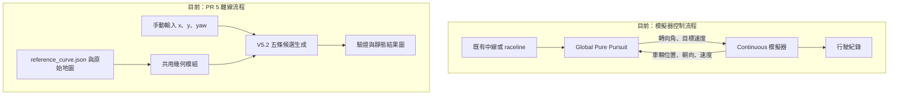
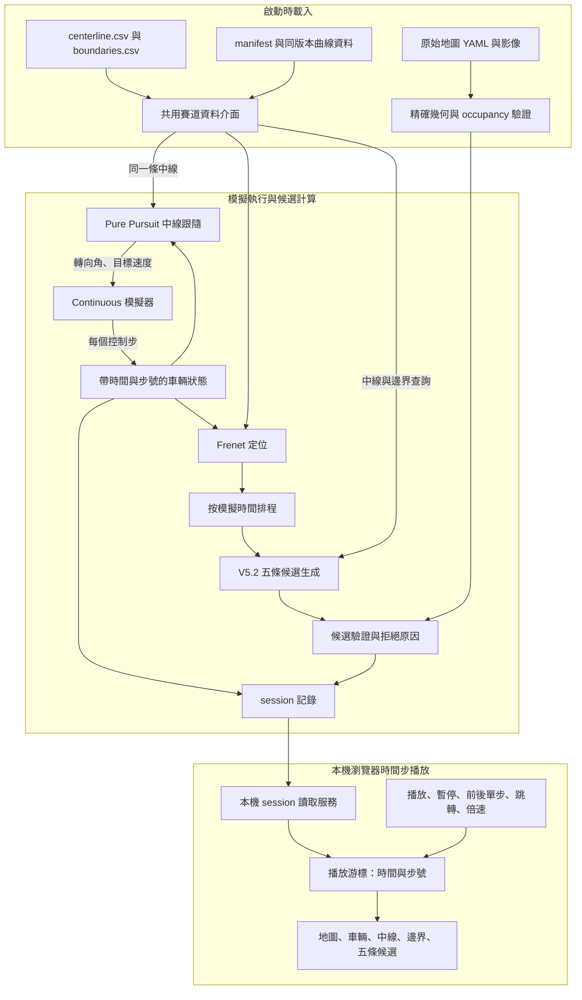

# 中線跟隨、五條候選路線與時間步播放整合計畫

更新：2026-10-22。狀態：A 階段共用資料入口已完成首批核對；B 階段既有中線行駛已重新驗證通過；C 階段候選排程與 session 記錄已實作並完成同場一圈核對；D 播放介面已完成；正式 40 m／每控制步完整圈生成已完成，播放已切換該資料，E 的獨立重播與完整操作驗收仍待完成。超車候選工作與 LMPC 分開，不更動 LMPC。實測與形狀問題詳見[算法及案例分析](reports/2026-10-22_路線生成方案與模擬器驗證.md)。

本日成果與待辦見[進度交接](reports/daily_progress_20261021.md)。後續效能方向已確認採用[Frenet 優先驗證方案](frenet_runtime_validation_plan.md)，尚未實作；下述「第一版原圖精確查詢」描述現有行為，後續道路表與快速流程須經獨立驗收，不能視為已切換完成。

## 1. 本次目標與範圍

在 ESP 模擬器內，車輛以 Pure Pursuit 跟隨我們生成的中線行駛；候選生成器持續依最新車況產生五條前方路線；本機瀏覽器以模擬時間步播放車輛與候選結果，支援暫停、前後單步、時間軸跳轉及倍速。

本階段車輛跟隨中線，五條候選只供觀察與驗證。候選選擇、候選路徑控制、對手預測、超車決策與實車部署不列入本次驗收。

第一版採「完成模擬與候選計算、保存 session，再於瀏覽器回放」。每份候選必須在執行期間以對應車況產生；回放不重新計算候選。這能先確保時間對齊及可重現性。執行中的即時監看可在同一資料格式穩定後擴充。

## 2. 現況與缺口

以下已對照目前工作樹與 PR #5 合併版本（fef5946，V5.2 實作 1040465），與本次新增功能分開標示。

| 元件 | 現況 | 本次要補的部分 |
|---|---|---|
| Continuous 模擬器 | 已有連續行駛、車況輸出與 session 記錄；另有同版本 Frenet 中線 PP 兩圈基礎 | 沿用已驗證生命週期，接入候選排程及記錄 |
| Pure Pursuit | GlobalPurePursuit 預設連續圈入口使用 raceline；既有 CentrelinePurePursuit 已用本次 Frenet CSV 中線跑完兩圈 | 沿用已驗證中線控制器，讓新整合入口共享 TrackData，無須重建控制器 |
| 幾何模組 | 已有座標轉換；讀 reference_curve.json，邊界由原圖射線查詢 | 新增 TrackData 共用入口；CSV 樣本 + 同版本 JSON，不做另一套曲線重建 |
| PR 5 V5.2 | 獨立離線生成五條候選，直接引用既有幾何模組 | 接收模擬器更新車況與規劃排程 |
| Frenet viewer | 已有靜態地圖、幾何查詢與診斷 | 新增 session 時間軸與動態圖層 |
| 候選結果圖 | 顯示中線、邊界散點與候選 | 改為與車況時間對齊的播放 |

PR 5 並非重新複製座標公式：它匯入並呼叫原本的 load_geometry、to_frenet、to_cartesian 與 boundaries。現行生成主要使用 JSON 中線與原圖邊界查詢，CSV 座標列尚未作為其直接生成輸入；載入時的檔案校驗不等於以 CSV 數值生成候選。

### 2.1 現行架構



原先兩條流程分開；目前新增 run_centerline_candidates.py，已以模擬器車況同步呼叫 V5.2 並保存 session，瀏覽器播放亦已完成。另已存在獨立的中線 PP 兩圈流程（research/lmpc/run_initialization.py），使用同一 geometry_id、中線 CSV 與 core Frenet 進度，尚未接五條候選。此流程執行的是固定速度 Pure Pursuit，沒有啟動 LMPC 學習或候選控制。2026-10-21 已重新驗證並將所需 PP／追蹤抽至 master，不能把它誤列為尚未完成的中線基礎。

## 3. 目標架構



已實作元件名稱與 schema 見 8.4，其餘元件名稱為設計概念。優先重用既有模擬器、幾何核心、Pure Pursuit 與 viewer，透過介面接軌。

## 4. CSV 與座標資料契約

### 4.1 輸入資料

ESP 初始資料來源為 maps/frenet/esp/geometry/：

| 檔案 | 用途 |
|---|---|
| centerline.csv | x_m、y_m、s_m、psi_rad、kappa_inv_m；提供跟隨與幾何參考樣本 |
| boundaries.csv | 以 s_m 對應左右 x/y、d_left_m、d_right_m、種類及有效狀態 |
| manifest.json | 幾何識別、圈長、來源與檔案雜湊 |
| reference_curve.json | 同版本平滑曲線輔助；使用時須明列用途與核對結果 |
| maps/esp.yaml 與對應影像 | 座標、occupancy 及獨立驗證依據 |

**第一版唯一資料方案：CSV 樣本 + 同版本 JSON 曲線輔助 + 原圖精確邊界查詢。** CSV x/y 提供 Pure Pursuit 控制折線與繪圖；reference_curve.json 提供連續 reference、Frenet 定位、曲率及 V5.2 使用的導數。boundaries.csv 供展示散點與來源核對，候選的任意 s 邊界固定使用原圖 exact_grid_ray，不使用 CSV 邊界插值。這不是純 CSV 曲線重建；另行重建曲線不列入第一版範圍。

新增入口為 research/overtaking/track_data.py 的 TrackData；對外提供 control_path、centerline、boundary_samples、geometry、provenance、audit。閉合 control_path 在最後補首點，避免控制折線漏掉最後接縫段；原始 CSV 不變。geometry 仍為 inspect 模式，資料契約通過不授予規劃權限。

CSV 啟動時載入一次；控制迴圈不可反覆讀檔。跟隨、定位、候選與繪圖都使用同一版本、同一起點與同一正向。

### 4.2 任意 s 查詢與驗證

CSV 是離散樣本，不能只換讀檔格式就宣稱已接軌。資料層必須明確定義中線重建、方向展開、曲率與導數計算、邊界查詢、接縫處理及無效資料行為。

- 已有樣本位置須能核對 CSV 數值；樣本間須與同版本精確幾何比較。
- 邊界 CSV 是截面法線命中點；圖上保留散點，不直接當成可任意連接的物理牆線。
- 急彎及命中牆段切換處，不能預設線性插值正確。未通過核對的區間標為不可用，或明確記錄精確查詢回退，不能悄悄替換來源。
- 中線位置、方向、曲率及導數必須彼此一致，供 V5.2 的平滑度與曲率約束使用。若需要同版本 JSON 曲線輔助，必須核對 CSV 並記錄來源；不能將其描述為純 CSV 重建。
- 第一版匯出一致性門檻預設位置／方向／曲率各 1e-8（m、rad、1/m），邊界座標／距離 1e-7 m，寫入 audit 報告；這些是同源數值核對門檻，不是車輛安全距離。另保存 CSV 中點弦誤差、全數區間中點（含最後接縫）精確邊界查詢與原始 spline 首尾位置／方向／曲率誤差。區間中點檢查不是連續域證明；任意 runtime 查詢仍須自行檢查 valid，不得因 audit 通過而省略。
- 原有 planning_allowed、domain_verified、continuous_verified 等旗標不因接上 viewer 而改為 true。

### 4.3 車況與進度

車況至少包含 control_step、sim_time_s、x_m、y_m、yaw_rad、speed_mps，以及該步有效狀態。Frenet 結果另含 s_wrapped_m、s_unwrapped_m、d_m、e_psi_rad、geometry_id、valid 與 reason。

map x/y 與 s/d 使用公尺，角度使用弧度，左側 d 為正。倒車或定位失敗不得強迫進度遞增。原本圈追蹤折線、raceline 與 Frenet 中線各自的 s 必須分開命名，不可直接互換。跟隨與候選皆以本次共用中線為準。

### 4.4 候選起點契約（已核對 V5.2）

整合時必傳 S_k 的實際 x/y/yaw，不能只傳中線進度。V5.2 以實際 x/y 投影取得 s0、d0，起點約束為 d(0)=d0 與 d′(0)=(1−κ(s0)d0)tan(e_psi)，因此有效解可對齊實際車位與 yaw；不是從中線 d=0 或中線切線重新出發。省略 yaw 的舊離線入口會假設 e_psi=0；整合入口禁止省略。

限制：目前不是任意姿態都可生成。定位失敗、起點邊界不足、車頭未朝前（|e_psi|≥π/2−0.001）、斜率或曲率等硬限制均可能拒絕。這是幾何延伸驗證，尚未匹配車輛當下曲率、轉向狀態或完整動力學。每條有診斷點的候選保存 start_position_error_m、start_heading_error_rad（帶符號，角度 wrap）；無可用點記 null。整合有效候選要求位置誤差 ≤1e-4 m、|航向誤差|≤1e-5 rad，超標改列 rejected 並保存原因；不能只憑 heading_matched 旗標判定。此整合拒絕閘門已在 overtaking/session.py::make_plan 實作，直接由輸出首點與來源 pose 重算，不能只信任生成器自報誤差。

## 5. 執行時序與候選更新

### 5.1 一個控制步的資料關係

1. 在狀態 S_k 取得步號 k、模擬時間 t_k 與車況。
2. 執行 Frenet 定位；若到達規劃週期，以 S_k 為輸入生成候選。
3. 保存候選的 source_control_step=k、source_sim_time_s=t_k、來源車況及運算耗時。
4. Pure Pursuit 依 S_k 與中線產生 action_k，模擬器執行後得到 S_(k+1)。
5. 記錄 action_k 作用於 k 至 k+1 的關係，以及下一份車況。終止狀態也要保存。

第一版允許同步計算候選，計算期間模擬時間不前進；因此完成資料不等於達到即時運算。必須同時報告牆鐘耗時及相對模擬時間的速度。

### 5.2 三種頻率分開

| 頻率 | 定義 |
|---|---|
| 動力學積分 | 模擬器內部 timestep，產生物理狀態 |
| 控制／記錄 | 每次 sim.step 對應一個可播放控制步 |
| 候選重規劃 | 依模擬時間排程，以最新已取得車況生成一組候選 |

目前一般參數檔預設 timestep=0.01 秒、n_sim_steps=4，對應 0.04 秒；已驗證中線基礎明確使用 n_sim_steps=10，即 0.1 秒控制週期。後續候選整合先沿用中線基礎的 0.01／0.1 秒設定，若改頻率須另做回歸；實際 session 仍以解析後設定與記錄時間為準。瀏覽器顯示幀率不改變上述頻率。

先量測 V5.2 再確定規劃週期，不預先承諾每步最佳化或特定 Hz。歷史整合測試使用 3 m／2 秒；使用者已明定正式設定為 40 m／每控制步 0.1 秒更新，已恢復正式預設並另產生新資料，不修改歷史 session；正常完成跨線時額外保存終止規劃事件。每次更新固定保存五個 candidate_id；失敗者保留 rejected、reason 與可用診斷，不保證五條均有效。定位失敗時保存跳過原因，不使用假造 s/d。

### 5.3 第一版長度、寬度與五個終點規則

沿用 V5.2，不新增依速度或彎度調整 lookahead/margin 的策略。預設 lookahead_m=40、safety_margin_m=0.2、sample_step_m=0.25、max_slope=1、endpoint_tolerance_m=0；max_curvature 未指定時由 tan(vehicle.max_steer)/vehicle.wheelbase 計算。正式整合已指定 lookahead_m=40、plan_period_s=control_dt_s=0.1；PP 控制前視仍為 0.6 m，與候選前視不同。40 m 表示 Frenet s 的幾何前視距離，不是 40 秒的對手或車輛狀態預測。

每次記錄實際解析後 lookahead_m、margin、source pose、requested/actual sample step、各截面的 s/s_progress/d_min/d_max/boundary_valid/reason、五個 target_fraction 與 requested_target_d/actual_target_d，以及 parameter_policy。每截面的可用範圍為 [d_right+margin, d_left−margin]，是原圖法線查詢結果；五個終點偏移以末截面的範圍按 0、0.25、0.5、0.75、1 等分。道路寬度隨 s 變動，前視長度與 margin 本身沒有動態規則。若啟用 endpoint_tolerance，固定終點的所有 starts 失敗後才允許有界偏移，須保存實際偏移與模式。

### 5.4 碰撞與「通過」的語意

V5.2 現行驗證為密集取樣的路徑中心點與原圖幾何核對，加上輸出折線各段的 grid supercover 點掃掠（unknown／圖外視為阻擋）。不檢查旋轉車身矩形或 swept footprint；margin 也不等於 footprint 證明。每組結果必須保留 footprint_verified=false、dynamics_verified=false，畫面只能稱「中心點／折線取樣通過」，不能稱「車輛可安全通行」。模擬器車輛無碰撞只證明當次中線行駛，不替候選背書。完整車身與動態安全驗證屬後續獨立工作。

## 6. 本機瀏覽器播放規格

### 6.1 播放語意

瀏覽器操作的是已記錄資料的播放游標，不直接推進模擬器。向後單步與拖曳不需要倒轉動力學，也不重新執行最佳化。第一版採離散控制步顯示，避免插值位置被誤認為實際物理樣本。

| 操作 | 行為 |
|---|---|
| 播放／暫停 | 從目前游標按記錄的模擬時間間隔播放／停止 |
| 下一步／上一步 | 暫停並移動一個已記錄控制步 |
| 時間軸拖曳 | 暫停並定位到目標時間以前最近的實際狀態樣本 |
| 輸入步號／時間 | 定位相應樣本；超出範圍給出明確提示 |
| 回到起點 | 暫停並回到首筆可播放樣本 |
| 倍速 | 提供 0.25×、0.5×、1×、2×、4×；只改變播放節奏 |
| 到達結尾 | 停在最後一筆，顯示終止原因，不自動循環 |

控制列顯示目前／總步號、session 相對模擬時間與播放倍率。絕對模擬時間另保存在資料中；reset 初始化後的首筆時間作為播放起點，不能假設其絕對時間一定為零。

### 6.2 候選與時間對齊

- 游標位於第 k 步時，只能顯示來源步號不大於 k 的最近一次規劃事件。
- 初次候選尚未產生時顯示「尚無候選」。
- 兩次規劃之間可維持上一組結果，但須顯示來源步號、來源時間、候選年齡及來源車位；候選留在生成時的 map 座標，不隨車平移。
- 最新規劃失敗時，預設呈現該次失敗與原因；若提供上次有效結果圖層，必須明確標為歷史資料。
- 向後跳轉重新查找該時刻事件，不能留下未來的候選。五條候選作為同一事件原子切換，不混用不同時刻的路線。
- 若日後加入非同步計算，另記錄 available_control_step／available_sim_time_s，播放須以結果當時已可取得為前提，不能提前顯示尚在計算的候選。

### 6.3 畫面內容

主畫面以可縮放、平移的地圖為主，顯示原始 occupancy、中線、左右邊界散點、帶朝向的車身、截至游標的實際軌跡，以及五條候選。

候選以固定顏色對應 ID，實線／虛線區分通過與拒絕；可用時標示首個失敗點。側邊或下方顯示 s/d、速度、有效候選數、拒絕原因、規劃耗時及候選年齡。圖層可切換，但車況、候選與游標時間須一致。

優先擴充既有 viewer，評估其靜態地圖與查詢元件的重用程度；新增 session 讀取及播放功能。服務預設僅綁定 127.0.0.1。原幾何 viewer 維持既有查詢；新增 overtaking/playback.py 與 playback.html／playback.js，重用 MapInspector 的座標與原圖輸出，提供獨立 session 播放模式。

## 7. Session 資料設計

以下為建議新增格式；優先擴充／引用既有行車記錄，避免重複保存不同時間基的車況。

```text
Data/research/overtaking/<session>/
├── metadata.json          # 設定、版本、來源 hash、時間基準與記錄格式版本
├── states.jsonl           # 每控制步的物理狀態與 Frenet 結果
├── actions.jsonl          # action_k 與作用步號 k → k+1
├── plans.jsonl            # 每次規劃事件、五條結果、診斷與耗時
├── playback_index.json    # 狀態及規劃事件索引，可重建
└── summary.json           # 完成／終止原因及驗收統計
```

schema_version=1 的現行 metadata 記錄 map、frame_id、geometry_id、CSV／地圖／輔助曲線 hash、程式版本與工作樹變更識別、解析後控制與規劃設定、起始條件、隨機種子及播放起點。回放時地圖來源不同應明確拒絕或提示，不能靜默套用另一張圖。

每份 plan 至少包含 plan_id、source_control_step、source_sim_time_s、來源 pose（必含 yaw）、geometry_id、method、lookahead、margin、parameter_policy、road_sections、五條終點偏移與起點誤差、候選驗證步距、求解耗時、五條候選與整體狀態。路徑點保存 s/d、x/y、yaw 及有效性；失敗無點時仍保留 ID 和原因。

大型資料採索引／分段載入，避免一次塞入瀏覽器。session 目錄不得覆寫既有執行結果；異常終止也保存已完成記錄與原因。API 及精確欄位名稱在實作時定版並附 schema_version。

## 8. 分階段實作與驗收

| 階段 | 工作 | 驗收與證據 |
|---|---|---|
| A：CSV 共用介面 | 載入、來源核對、曲線／邊界查詢、接縫與失敗規則 | CSV 樣本重現；與精確幾何比較的誤差報告、門檻及拒絕區間 |
| B：中線跟隨 | **既有成果已重新確認通過**：CentrelinePurePursuit 使用指定 CSV，中線進度與起終點來自 core Frenet | 既有同場兩圈、無碰撞、單次 reset；追蹤誤差與跨圈連續性重新驗證通過。詳見 8.3；後續接入候選仍須完成 E 的新 session |
| C：五條候選接軌 | 由最新車況排程 V5.2，保存來源步號、結果及耗時 | 每事件五個 ID（整組 ValueError 也產生五個 rejected 記錄）；實際車位與 yaw 起點誤差達 4.4 門檻；動態參數來源完整；成功或拒絕可追溯；無效定位有明確跳過原因；提供一般及最慢耗時 |
| D：時間步播放 | 本機 viewer 加載 session，實作控制列、圖層與時間對齊 | 播放、暫停、前後單步、時間跳轉、倍速、結尾處理均可操作；無未來資料洩漏 |
| E：整體展示 | 固定設定完成一次可重現演示與回放 | **同一次整合後 session 至少完成一完整圈**，車沿指定中線無碰撞行駛、候選持續按排程更新並跨越起終點接縫；回放同一份 session，保存設定、來源 hash、驗收報告與代表畫面。不得拼接 B 的行車紀錄與另一場候選資料替代 |

必要案例包含直線、彎道、起終點接縫、候選被拒絕、初次尚無候選、定位失敗記錄、向後跳轉，以及碰撞／逾時／正常完成的播放結尾。異常案例可用獨立測試資料驗證，不要求正常展示刻意碰撞。

### 8.1 實作順序與進度（2026-10-21）

| 順序 | 新增／修改位置 | 狀態與下一個完成條件 |
|---|---|---|
| A1 | overtaking/track_data.py、test_overtaking_track_data.py | 已新增共用入口、來源核對、全部邊界列數值核對、區間中點與接縫報告；以 ESP 核對與測試結果為證 |
| C0 | overtaking/robust_adaptive_paths.py、test_robust_adaptive_paths.py | 已新增起點實測誤差、來源 yaw、參數策略與實際 road_sections；保留 V5.2 求解與驗證規則 |
| B | 既有 lmpc/initialization.py 的 CentrelinePurePursuit、lap_adapter.py 的 CoreLapTracker、run_initialization.py | **完成重新確認**；同版本 Frenet CSV 已有兩圈紀錄，物理重播、車身與控制命令重新計算通過。不新增第二套中線控制器 |
| C | run_centerline_candidates.py、overtaking/session.py、overtaking/verify_session.py | 已接入同一迴圈並完成一圈：先記 S_k、同步規劃、再執行 action_k；五 ID、起點拒絕閘門、終止／例外保存與獨立重播已驗證。詳見 8.4 |
| D | overtaking/playback.py／playback.html／playback.js | 已實作獨立本機回放，重用 MapInspector 座標與原圖；播放／暫停、單步、時間跳轉、五種倍速、索引重建與無未來資料檢查均已驗證 |
| E | 同一 session 的整合驗收報告 | 待實作；完成一圈、跨接縫持續規劃與全部播放操作，才可宣告整合完成 |

保留現有 .gitignore、docs/README.md 的工作樹修改；不改 LMPC、原始地圖與既有發布幾何。A 的資料契約通過不能視為 B–E 或全域 Frenet 驗證通過。

### 8.2 本次驗證證據

- [ESP 資料核對報告](reports/centerline_track_audit_20261021.json)：4,739 個中線樣本、4,739 列邊界與 4,739 個區間中點（含接縫）。CSV 與同版本精確資料的最大數值誤差為 0；中點無效區間為 0。原始 spline 首尾位置誤差約 5.33e-15 m；CSV 弦中點與 JSON 曲線最大差約 0.000441 m，僅作診斷，不是任意點或控制誤差保證。
- 執行 `bash tests/run_research_tests.sh tests/research/test_overtaking_track_data.py tests/research/test_robust_adaptive_paths.py -q`：**31 passed**（33.57 秒）；有既有 Matplotlib／Pyparsing 棄用警告。
- 涵蓋來源檔未同步變更、重新簽署但幾何錯誤的邊界拒絕、閉合控制折線、有限門檻、帶實際橫向／航向誤差的接縫候選，以及既有 V5.2 多起點求解、硬限制與多地圖回歸。
- 可重跑 `python -B -m f1tenth_benchmarks.research.overtaking.track_data --geometry-dir maps/frenet/esp/geometry --map-yaml maps/esp.yaml --report <新的報告路徑>`。使用既有 `f1tenth-sim:full` 環境，報告採獨佔建立，不覆寫舊證據。此命令只做資料核對，尚未啟動中線模擬或播放。

### 8.3 第一階段重新確認（已完成）

前次盤點只查看一般 Continuous／GlobalPurePursuit 入口，漏掉已存在的中線初始化流程，因此把 B 誤列為待新增控制適配器。這項判斷已更正；本次沒有新增或改寫控制器，也沒有重新收集行車 session。

確認來源為 `Data/research/lmpc/b1_esp_centerline_20261007_001/`：以固定 1.2 m/s、PP 前視 0.6 m、控制週期 0.1 s、物理子步 0.01 s，在同一 geometry_id 的 CSV 中線跑完兩個完整圈。它位於 lmpc 目錄，但此次使用與核對的是 Pure Pursuit 中線基礎，沒有執行 LMPC 最佳化、學習或超車決策。

- [重新驗證摘要](reports/centerline_baseline_confirmation_20261021.md)：既有 3,938 筆車況、39,380 物理子步、78,760 次矩形車身取樣檢查全部通過；最大側向誤差 0.082636415 m、最大航向誤差 0.197707620 rad，皆在原先凍結門檻內。
- [獨立物理／Frenet／圈事件重驗](reports/centerline_baseline_reverification_20261021.json)：重新執行現行 verifier，不沿用歷史 passed 旗標代替驗證。
- [來源與目前控制命令核對](reports/centerline_baseline_sources_20261021.json)：CSV／manifest／地圖與保存紀錄一致；將 TrackData.control_path 交給現行 CentrelinePurePursuit，重新計算全部 3,937 個控制區間，命令最大差為 0；兩次接縫 s_wrapped 回零、s_unwrapped 連續，第一圈後還有實際下一筆物理樣本。
- 現行程式部分檔案已有後續擴充，不能宣稱歷史程式檔 hash 全部一致；已在來源報告逐檔列出，並以現行命令重算與原模型物理重播確認這份基礎仍可重用。

使用者確認的四階段對應 B／C／D／E：**第 1 階段（B）重新確認、第 2 階段（C）記錄整合與第 3 階段（D）播放功能已完成；第 4 階段（E）須等待正式 40 m／每步完整圈資料生成及核對後驗收。** C 已產生新的整合 session；E 須回放這份實際整合資料並完成 UI 操作驗收，不能以歷史兩圈取代。

GlobalPurePursuit 一般入口仍有將圓交點換成離散樣本的行為；已驗證的 CentrelinePurePursuit 直接使用圓交點、閉合路徑並維持低速起步目標，不必再做另一份適配器。既有 logger 為 post-step 記錄，新的候選排程仍須明確記錄 step 前的來源車況。

### 8.4 第二階段：master 上的候選與紀錄整合

超車工作已從 research/lmpc 切回 master；沒有合併整條 LMPC 研究分支。將已驗證且無求解器依賴的 CentrelinePurePursuit 與 CoreLapTracker 分別放入 core/centreline_control.py、core/frenet_lap_tracking.py，計算與圈生命週期沿用既有基礎，新入口不載入 LMPC 或 osqp。

- run_centerline_candidates.py：載入 TrackData 一次，以固定 1.2 m/s／PP 前視 0.6 m 跟隨共用中線；物理子步 0.01 s、控制週期 0.1 s。候選每 2 秒模擬時間由最新實際 x/y/yaw 生成，lookahead=3 m、margin=0.2 m；不控制車輛。
- overtaking/session.py：五個 ID 原子保存；記錄無效來源、ValueError 與 runtime 中斷，保存已寫入的串流及 summary；起點誤差超標者拒絕。SessionConfig 凍結參數與門檻，不能覆寫舊目錄。
- schema_version=1：states.jsonl 每列為 control_step／sim_time_s／pose／speed_mps／physical_state／Frenet；actions.jsonl 明定 source_control_step → target_control_step；plans.jsonl 保存來源與 available 步號／時間、source_pose、paths，生成器的 method／參數／road_sections 等在 result 子物件；解析後設定另存 generator_settings。
- playback_index.json 保存每列 UTF-8 byte_offset／byte_length，索引可由 JSONL 重建。latest_plan 只選當時已 available 且 source 不晚於游標的最近事件，失敗事件取代舊成功；已接上瀏覽器 UI；不重新計算候選。
- 獨立 verifier 重播每個實際物理狀態與轉向 buffer、重新計算 PP 命令、重建 core Frenet／完整圈，核對五 ID、來源 pose／時間、起點誤差、倒序查找與 byte index。

本機 session、數值、測試與限制見 [第二階段報告](reports/centerline_candidates_stage2_20261021.md)與[獨立核對 JSON](reports/centerline_candidates_stage2_20261021.json)。同步計算的牆鐘耗時不推進模擬時間；實際效能報告不構成即時運算保證。

### 8.5 第三階段與正式 40 m 設定

- [第三階段報告](reports/playback_stage3_20261021.md)保存操作證據、測試與畫面；localhost:8766 的服務只讀取已保存資料，未啟動最佳化或模擬。
- 正式設定依使用者要求為候選前視 40 m、每個控制步 0.1 秒生成一組。先前 3 m／2 秒只是歷史接軌測試，不能當作正式前視與更新驗收。
- 新增 max_control_steps 短預覽上限；短預覽明確顯示未完成整圈。正式 job 不設定此上限，進度逐組保存於 progress.json。
- 40 m 每步短預覽共 4 筆車況／4 組候選，物理、控制、Frenet、每步規劃與正反向 API 核對通過；完整圈 Data/research/overtaking/40m_every_step_20261021_001 已於 10-22 確認生成完成並切換播放，獨立重播與全量播放最終驗收仍待完成。
- 單點耗時剖析顯示完整候選驗證占約 92%，21 次最佳化求解合計約 0.85 秒；此為含 profiler 開銷的 33.6 秒測試，不能與未剖析的 22.2 秒直接相減。細節見 [profile](reports/40m_generation_profile_20261021.json)。
- 這是離線每 0.1 秒模擬時間取樣，尚未達牆鐘即時 10 Hz。後續效能工作應區分靜態幾何預計算／快取、執行期必要檢查與離線完整核驗，再量測求解加速；不能移除檢查後直接宣稱安全或即時。

## 9. 程式對照與相關文件

- 連續模擬入口：f1tenth_benchmarks/research/run_continuous_pp.py。
- 模擬器：f1tenth_benchmarks/research/continuous_sim.py。
- 共用中線控制器：f1tenth_benchmarks/research/core/centreline_control.py（重用 GlobalPurePursuit 幾何算法）。
- 候選整合入口：f1tenth_benchmarks/research/run_centerline_candidates.py。
- 幾何核心：f1tenth_benchmarks/research/core/geometry/frenet.py。
- V5.2：f1tenth_benchmarks/research/overtaking/robust_adaptive_paths.py。
- 既有檢視器：f1tenth_benchmarks/research/core/geometry/viewer.py。
- [現行介面與座標定義](interfaces.md)、[現行 viewer 操作](viewer.md)、[Frenet CSV 與資料結構](../../maps/frenet/README.md)。

本計畫是後續整合規格；現行操作指南與介面文件仍描述既有功能。實作完成後再更新其操作方式及實際驗收證據。
