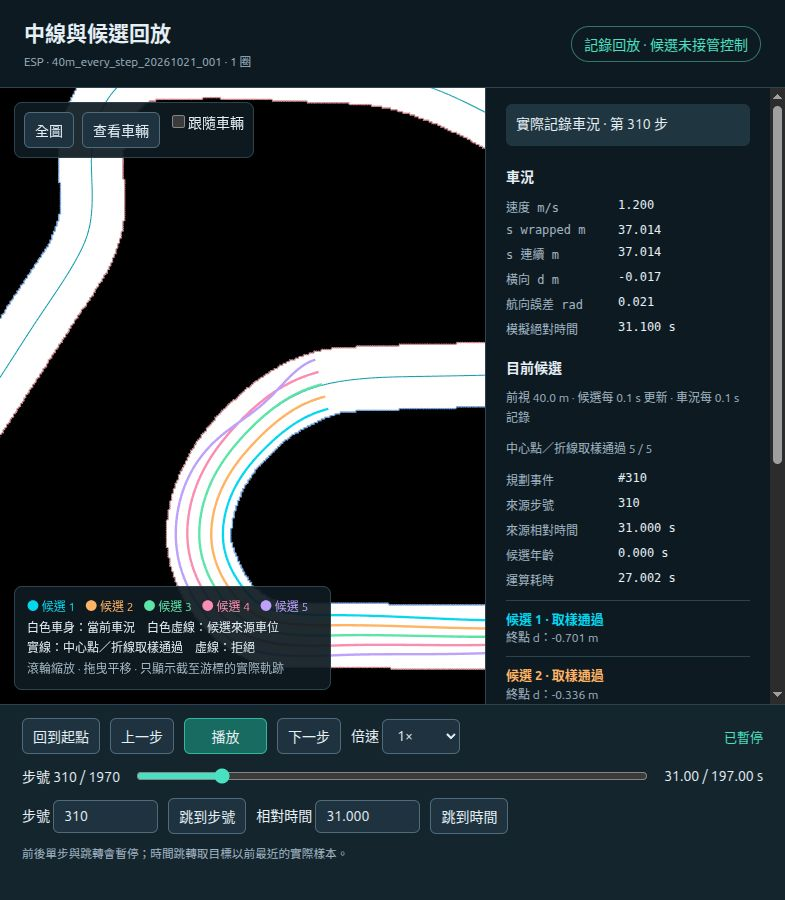
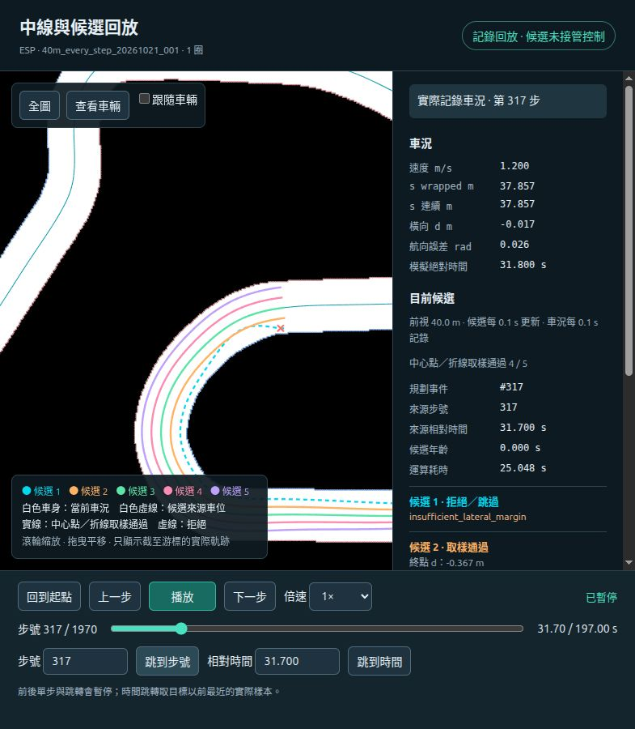

# 路線生成方案與模擬器驗證：整體狀態確認（2026-10-22）

日期：2026-10-22（Asia/Taipei）。範圍為 master 上的 V5.2 與中線候選 session 整合，對照程式、已完成的 40 m 整圈紀錄及第 310／317 步。本文前三節記錄現行程式；第四節已依使用者補充寫入改造需求與參數設計，尚未實作。前視與餘裕比例的數值仍待比較確認。

## 0. 整體狀態與閱讀方式

截至本次核對，已完成「中線行駛＋五候選離線生成＋保存後回放」的接軌。正式 40 m／每 0.1 s 控制步生成已跑完同一次 session 一圈，但尚未完成這份完整資料的獨立物理重播及全量播放驗收。候選沒有接管控制；即時規劃與超車閉迴路仍未完成。

### 0.1 完成狀態

| 項目 | 狀態 | 依據與界線 |
|---|---|---|
| 原有中線 Pure Pursuit | 已完成基礎核對 | 同版本兩圈歷史 session 重驗；共用控制器／圈追蹤已移入 master，與 LMPC 分開 |
| 賽道共用入口 | 已實作並核對 | CSV＋同版本 JSON＋原圖；不代表 CSV 邊界插值已批准 |
| 五候選生成與同步記錄 | 已實作 | 實際位置／yaw 起點、五 ID、來源時間、拒絕原因與索引 |
| 正式設定整圈生成 | 已完成紀錄 | 40 m、0.1 s，1,971 組；progress=complete、無 error，summary 記錄一圈／無碰撞 |
| 完整圈獨立重播 | 待驗收 | 不能以 summary 或既有短預覽的通過結果代替 |
| 瀏覽器回放 | 已實作、已切換完整資料 | 已抽查起點、中段與接縫，310／317 有案例截圖；尚非全量逐幀驗收 |
| 候選形狀品質 | 已確認有問題 | 310 候選五通過但回擺；317 候選一回擺且被拒絕 |
| 牆鐘即時 10 Hz | 未達成 | 每組 median 約 24.93 s，max 約 78.73 s |
| Frenet 快速檢查／跨圈 hash table | 設計已記錄，尚未實作 | 詳第四節；目前仍是重複精確查詢流程 |
| 逾時直接拒絕 | 需求已確認，尚未實作 | 現行同步等待，不具整組 100 ms deadline |
| 前視／餘裕比例 | 參數設計待比較 | L/20 為提議配置、邊界比例未定；目前仍為 40 m／各側 0.2 m |
| 候選選擇、MPC、對手與超車控制 | 尚未整合 | 本次資料不構成上述功能的完成證據 |

### 0.2 現行版本與改造設計分開閱讀

- 第一節：現行程式如何生成、求解與驗證，不含尚未實作的快速流程。
- 第二節：已完成整圈的實際容量／耗時與已量測的重複工作。
- 第三節：310／317 的保存曲線、截圖、求解紀錄及推論界線。
- 第四節：使用者確認的改造要求、比例參數定義，以及仍待討論的數值／品質策略。

先確認上述基準，再討論算法改動。後續比較應分開「運算速度」「形狀品質」「道路／車身驗證程度」；不能把縮短前視、逾時拒絕更多候選或省略檢查，一概記為算法加速成功。

### 0.3 證據與工作樹

本機完整資料位於 `Data/research/overtaking/40m_every_step_20261021_001/`，大型 raw JSONL 未納入 Git。本文附的精簡 JSON、profile 與兩張截圖供閱讀；新 checkout 不必取得 6 GB 資料才能理解分析，但全量重驗仍需原始 session。

工作位於 master，現有兩筆本機程式提交為 `308012e`、`287d191`；本次文件整理、圖片與連結更新一併納入發布；實際提交識別與 GitHub 同步狀態以 Git 紀錄為準。此次未改生成器、未重新求解，也未執行新的完整圈重播；文件檢查僅核對連結、證據格式與保存摘要。

## 1. 現在的路線規劃算法

### 1.1 控制、規劃與播放的關係

車輛仍由 CentrelinePurePursuit 跟隨中線，目標速度 1.2 m/s、PP 前視 0.6 m。五條候選只生成、驗證、保存與顯示，不接管控制。

整合迴圈為：保存實際車況 S_k → 同步生成五候選 → PP 計算控制 → 保存 action_k → 模擬前進 0.1 s。候選計算時模擬時間暫停；每個模擬控制步都有規劃，不代表每 100 ms 牆鐘時間能交付結果。播放只讀紀錄，不重新求解。

目前是幾何路徑最佳化，不是 MPC：沒有在求解中使用車輛狀態轉移模型、速度／加速度預測或未來控制序列。候選點的 `t` 為正規化距離，並非未來秒數。

### 1.2 資料與座標轉換

資料使用同版本 centerline.csv、boundaries.csv、reference_curve.json、manifest 與原始 ESP 地圖。CSV 與 JSON 啟動時核對；連續中線由 JSON spline 提供，任意 s 的道路邊界目前仍從原圖查詢，沒有使用 CSV 邊界插值替代。

| 步驟 | 現行方式 |
|---|---|
| 實際車況定位 | 輸入 x/y/yaw，`to_frenet` 取得 s₀、d₀、航向誤差 eψ、參考曲率 κ；無效來源拒絕 |
| 候選參數 | 以 ξ∈[0,40] m 表示向前距離，s=s₀+ξ；閉合道路查詢時依圈長取模 |
| 道路範圍 | 每個 s 沿參考線左右法向量做原圖格子射線搜尋；以邊界距離扣除 margin |
| 曲線求解 | 在 Frenet 中求五條橫向偏移 d(ξ) |
| 轉回地圖 | p=r(s)+d·n(s)，方向由參考方向加 atan2(d′,1−κd) 得到 |
| 現行完整核驗 | `to_cartesian` 內再次呼叫 `to_frenet`，確認投影與來源一致、有效域等；反向投影又會查邊界 |

目前沒有「重新改成 Frenet」的必要；需要檢討的是已知 s/d 時的重複查詢與核驗，以及曲線本身的品質條件。

### 1.3 五條候選如何分開

令道路可用範圍 lo(s)=d_right(s)+0.2、hi(s)=d_left(s)−0.2。五條候選終點設在前方 40 m 的 lo／hi 之間，比例 f 為 0、0.25、0.5、0.75、1，分別對應候選一至五。

這是五個目標位置、四個間隔，不是整段固定的五條車道。五條都從同一實際位置與 yaw 出發，中途沒有候選間最小間距約束。

目前也有中途偏好，並非只指定終點：起點在道路中的比例為 f₀，令 u=ξ/40、b=3u²−2u³，偏好比例為 (1−b)f₀+bf，再換成該截面的偏好 d。這讓候選逐步展開，但它只是目標函數中的軟偏好，可因其他條件而偏離。

### 1.4 曲線與平滑方式

每條使用五次 B-spline，40 m 時為 20 個係數；內部節點單重，內部具 C4 連續性。這是空間曲線的平滑性，不代表車輛時間軌跡或控制輸入平滑。

固定終點模式的目標函數，忽略不影響求解的常數，可寫成求解取樣點上的平均：

`mean((d−preferred)²) + 2·mean((d″)²) + 0.2·mean((d‴)²)`

因此會抑制空間二階、三階變化，但沒有明確的橫向折返次數、總變化量、候選間分離或相鄰控制步路徑一致性條件。d‴ 是對道路距離的導數，不可直接稱為車輛的時間 jerk。

參考 κ 來自同版本中線；κ′ 目前以 s±0.001 m 的曲率差分估計。路徑曲率使用 d、d′、d″、κ、κ′ 計算 Cartesian 幾何曲率，不是只限制 d″。

### 1.5 邊界條件與限制

| 條件 | 本次實際設定 |
|---|---|
| 前視長度 | 固定 40 m 的參考線 s 前視，不是候選自身精確弧長或時間預測 |
| 起點位置 | d(0)=d₀ |
| 起點方向 | d′(0)=(1−κ₀d₀)tan(eψ₀)，對齊實際 yaw |
| 終點位置 | d(40)=target_d，endpoint_tolerance_m=0，不允許偏離固定目標 |
| 終點方向 | d′(40)=0，終點方向對齊參考中線切線；沒有固定終點曲率條件 |
| 邊界餘裕 | 左右各固定 0.2 m，以路徑中心點量測，不隨速度或彎度改變 |
| 道路限制 | lo(s)≤d(s)≤hi(s) |
| 橫向斜率 | abs(d′)≤1 |
| Frenet Jacobian | J=1−κd≥0.2 |
| 路徑曲率 | abs(κ_path)≤tan(0.4)/0.33≈1.28119 /m |
| 起點獨立閘門 | session 再核對位置誤差≤1e−4 m、yaw 誤差≤1e−5 rad |

最外側終點剛好位於扣除 20 cm 後的上下限，沒有額外終點緩衝。曲率上限取自轉向角／軸距幾何關係，不等於指定速度下的動態可行性證明。

ESP 全圖 4,739 筆有效 CSV 邊界截面的法向總寬約 1.787～2.019 m，平均 1.853 m；扣兩側各 20 cm 後可用中心點範圍約 1.387～1.619 m。這是取樣結果，不是整條道路連續極值證明；法向邊界距離也不是任意方向的最短牆距。

### 1.6 求解幾次、如何修正

每輪以 SciPy SLSQP 最佳化，使用解析目標梯度與約束 Jacobian。三種初值依序為 road_fraction、hermite、road_center；先投影使初值符合端點等式，每輪三種都求解，再依目標值排序，逐一驗證至找到通過者。

| 設定 | 實際值 |
|---|---|
| 初始求解約束位置 | 161 點，40 m 時約每 0.25 m 一點 |
| 每次求解迭代上限 | 150，ftol=1e−9 |
| 求解後接受門檻 | solver success、有限數值、等式最大誤差<1e−6、不等式最小值≥−1e−7 等 |
| 修正上限 | max_refinements=2；第一輪＋最多兩輪修正，共最多三輪 |
| 固定終點模式每條上限 | 三輪×三初值＝最多九次求解；五條合計最多 45 次，不代表必定跑滿 |

若密集驗證失敗，將該曲線的無效取樣位置加入下一輪求解約束。若該輪沒有符合求解器約束的解，便無新驗證點可加入，會提前停止；若新增點沒有擴大集合也停止。這不是每次失敗都固定再嘗試兩輪。

V5.2 另支援 endpoint_tolerance_m>0 的有界終點偏好模式：固定模式失敗後再跑另一組流程，可能增加求解數；本次 tolerance=0，未啟用，不能把九次上限套到所有非預設設定。

### 1.7 密集驗證與結果語意

雖然 requested sample_step=0.25 m，實際驗證間距取 min(requested_step,map_resolution/2,0.05)。ESP 解析度為 0.05 m，因此使用 0.025 m：40 m 共 1,601 點／條。

每點重新核對原圖邊界、margin、座標有效性、斜率、曲率與 J。若點全部通過，再用 grid supercover 掃過輸出 XY 折線各段接觸的格子，unknown／圖外視為阻擋。

`sampled_valid` 只表示現有中心點取樣與輸出折線檢查通過；不表示整段連續 spline、完整車身 swept footprint 或車輛動態安全。拒絕曲線也可能保留 1,601 個點供診斷，畫面上的虛線不能視為可選路徑。

## 2. 實際數據量、計算時間與重複工作

### 2.1 完整圈結果

來源為本機 `Data/research/overtaking/40m_every_step_20261021_001/`；精簡摘要及案例摘錄另存[證據 JSON](planner_cases_20261022.json)。

| 項目 | 保存結果 |
|---|---:|
| 完整圈／reset／碰撞 | 1／1／無碰撞 |
| 狀態／控制區間／候選組 | 1,971／1,970／1,971 |
| 五 ID 結果總數 | 9,855 |
| 取樣通過／拒絕 | 7,726／2,129 |
| 每組通過數 | 2～5 |
| 模擬經過時間 | 約 197 s；圈事件估計時間約 196.93949 s |
| 總牆鐘時間 | 55,436.08 s，約 15 小時 23 分 56 秒 |
| 規劃總耗時 | 55,358.27 s |
| 單組 median／P95／max | 24.9326／47.8493／78.7331 s |
| 拒絕原因 | 邊界餘裕不足 1,559；求解約束未通過 160；平滑度限制 410 |

容器正常退出 0，summary 記錄 recording_complete=true；以上是紀錄完成與摘要核對。完整 40 m session 的獨立物理重播尚未執行，不將短預覽驗收套用到整圈。頁面已切換此資料，抽查起點、985、1969／1970 接縫可載入，不等於全量逐幀播放驗收完成。

### 2.2 為何約 6 GB

`plans.jsonl` 實際為 **6,595,880,965 bytes**，即約 6.596 GB／6.143 GiB；其他狀態約 3 MB、動作約 0.74 MB、索引約 0.66 MB，主要體積明確在候選紀錄。

平均每組約 3,346,464 bytes。若每組五條都有完整 1,601 點，總數為 1,971×5×1,601＝15,777,855 點；這是滿點數計算，不是逐條統計的實際點數，部分失敗可無點。

每點重複保存 sample_index、t、s、s_progress、d、d_prime、curvature、x/y/yaw、多個 valid 旗標、reason 與 lateral_margin，JSON 亦重複欄位名稱並寫出完整精度數值。

抽查第 0 組的完整記錄為 3,393,008 bytes；以同樣緊湊 JSON 方式重新編碼，各候選 points 合計約 3,107,661 bytes，占整筆約 91.6%；result（含 road_sections）約 255,190 bytes。這是代表案例，不是全檔欄位占比統計。完整求解 attempts 有成本，但不是主要資料量來源。

可改善的重複保存包含：每點 JSON 欄名、來源相同時各候選的 s 網格與驗證旗標，以及逐步重存的靜態道路截面資料。相鄰控制步的 s 通常不同，不能未經誤差處理就視為完全相同資料。將道路表、路徑係數與播放點列分開可能減量，但尚未改格式或測壓縮率。

### 2.3 計算瓶頸與重複查詢

[起點 profile](40m_generation_profile_20261021.json)總計 33.5766 s，含分析工具開銷：

| 工作 | 呼叫數／累積時間 |
|---|---|
| `_validate` | 9 次／30.7488 s，約總時間 91.6% |
| 原圖 boundaries | 30,420 次／21.1568 s |
| to_cartesian | 14,409 次／20.3785 s |
| to_frenet | 14,410 次／17.4604 s |
| ray_boundary | 60,840 次／15.2320 s |
| SLSQP | 21 次／0.8525 s |

時間為巢狀 cumulative，不可相加；這也是單點 profile，不能說整圈固定 91.6%。同一組 s 的邊界在截面準備、不同候選、不同修正，以及 XY 往返過程重複計算；參考曲線取樣又包含弧長反解與積分。主要問題是重複工作，不只 Python 迴圈本身。

當時硬體為 Ryzen 9 9950X，16 核心／32 邏輯核心，容器無 CPU 配額、affinity=32；工作使用量約 Docker 100.57%，約一個邏輯核心。現行候選與初值求解依序進行，OPENBLAS_NUM_THREADS=1；沒有候選平行、前一步解 warm start 或 GPU 路徑。

以 median 24.93 s 比較 0.1 s 更新週期，相差約 249 倍；max 更高。平行化只能處理可分配的工作，不能直接保證達標。資料壓縮、減少求解、幾何去重與改善曲線形狀是不同議題，應分別量測。

## 3. 第 310 與 317 步案例

步號為保存的 control_step／plan_id，從 0 起算；相對時間分別為 31.0／31.7 s。以下距離皆為從當次候選起點算起的參考線進度 ξ。

### 3.1 第 310 步，候選五：修正後回擺但通過

來源 s₀≈37.014154 m；終點 s≈77.014154 m，固定 target_d=+0.760805 m，代表最左側可用位置。

| ξ | d（m） |
|---|---:|
| 32 m | +0.686597 |
| 35 m | +0.681728 |
| 38.175 m | **+0.300277**（末段內縮低點） |
| 40 m | **+0.760805** |

初始三種求解都通過求解器約束，但密集驗證在 sample 1595（ξ=39.875 m、距終點 12.5 cm）發現餘裕不足；全曲線最小餘裕約 0.194307 m，比 0.2 m 少約 5.69 mm。

加入違規位置後，約束位置由 161 增至 162，第二輪三種初值均完成求解；排序後選 road_center 並通過密集驗證。共六次求解。最終曲線最小餘裕為 0.2 m，曲率絕對最大值約 1.200783 /m，接近上限 1.281192 /m。

在 ξ=38 m 附近，允許的左側上限仍約 +0.714 m，曲線卻內縮至約 +0.30 m，因此不能把大幅內縮描述為道路要求縮到那麼窄。紀錄支持「補點修正後接受了一條明顯回擺曲線」；固定極端終點、終點零斜率、有限 spline 自由度與目標權重是待檢討因素，但未做單項消融，尚不能證明哪一項是唯一成因。

實際播放頁末段放大截圖（紫色為候選五；畫面為保存結果，沒有重新求解）：

### 3.2 第 317 步，候選一：第一輪已有回擺，修正失敗

來源 s₀≈37.856951 m；終點 s≈77.856951 m，固定 target_d=−0.732512 m，代表最右側可用位置。

| ξ | d（m） |
|---|---:|
| 32 m | −0.6651（約） |
| 34 m | −0.6707（約） |
| 38.15 m | **−0.337826**（末段內縮高點） |
| 40 m | **−0.732512** |

負 d 越接近零，越向中線內縮。這條先退回約 −0.338 m，再往右接回 −0.733 m，確實與 310 有同類回擺，並非只有 margin 違規。

第一輪三種初值均通過求解器約束，但第一個密集驗證失敗點為 sample 1591（ξ=39.775 m、距終點 22.5 cm）：餘裕約 0.198023 m。整條最小餘裕約 0.193936 m，少約 6.06 mm；曲率絕對最大值約 1.27428 /m，亦接近上限。

加入九個違規位置後，約束位置從 161 增至 170。第二輪三種初值皆以 status=8／Positive directional derivative for linesearch 結束，未通過 solver 約束檢查，右側 margin 約束仍有約 5.60 mm 殘差；無可驗證的合格解，也沒有新驗證點可補，因此提前停止，未跑第三輪。共六次求解，最後 `sampled_valid=false`，reason=insufficient_lateral_margin。

保存／顯示的點列是最後保留的第一輪密集驗證診斷曲線，不是第二輪失敗解。這也修正先前口頭分析可能造成的誤解：不能把 317 的回擺歸因為補點後才產生。

起點位置／yaw 數值誤差約 2.27e−14 m／−8.88e−16 rad，並非起點不對齊。該條 `heading_matched=false` 是生成器將此旗標綁定「選中合格解」所致，不能只看此旗標認定 yaw 失配。

實際播放頁末段放大截圖（青色虛線為被拒絕的候選一，紅叉為第一個無效點；不是碰撞位置證明）：

### 3.3 共同問題與不同結果

| 項目 | 310 候選五 | 317 候選一 |
|---|---|---|
| 末段回擺 | 有，最終接受曲線 | 有，保存的第一輪診斷曲線 |
| 終點 | 固定最左可用上限 | 固定最右可用下限 |
| 終點斜率 | 0 | 0 |
| 第一輪密集驗證 | margin 不足 | margin 不足 |
| 補點後 | 通過，但形狀仍回擺 | 三初值失敗、提前停止 |
| 最終結果 | 取樣通過 | 拒絕 |

目前的通過條件沒有單獨限制「不必要回擺」。取樣通過不代表形狀適合超車；求解失敗也不證明道路不存在可行解。不能只放寬幾毫米 margin，就宣稱兩個案例都解決。

## 4. 後續算法改進：確認需求與待定參數

2026-10-22 使用者指定以下方向：CSV／Frenet 優先、正確與錯誤結果都快取並跨圈重用、疑慮才回查 XY、時間步內算不完就拒絕該候選，以及邊界／前視條件參數化。本節是下一版設計，現行保存資料與生成器尚未改變。

### 4.1 先用 CSV 與 Frenet 判斷

以現有 boundaries.csv 的 d_right/d_left 和同版本中線建立查詢表；對輸入 s/d 直接比較道路可用範圍。有效區域內可由 Frenet 檢查取得結果，不要求每個點轉 XY 再反向搜尋。

資料表須提供 checked_valid／checked_invalid／uncertain 等可區分狀態及原因。CSV 兩筆之間的誤差、接縫及投影歧義區域若尚未確認，歸 uncertain，才啟動 XY／原圖確認；確認後回填結果，下次相同條件直接查表。無法在時限內完成確認，就拒絕該候選。不能把「尚未發現錯誤」當成已確認有效。

這一層負責道路中心點及 Frenet 幾何有效性。繪圖所需 XY 可用批次前向轉換；完整車身、動態障礙檢查仍需其相應資料，不能因道路表通過而宣稱已完成。

### 4.2 Hash table 快取與錯誤標記

正確點、錯誤點與疑慮都記錄，跨時間步及多圈重用；既有精確查詢能確認的相同輸入不反覆計算。標記需含 s/d、原因、來源版本、驗證方式與影響範圍；顯示無效點及失敗候選的原因，並保留命中／未命中計數。

| 快取對象 | 建議 key／條件 | 可重用內容 |
|---|---|---|
| 靜態參考線與道路截面 | geometry_id、來源地圖 hash、表版本、wrapped s 的精確值或已定義 sample_id | r/n/κ/κ′、原始左右邊界、區間有效狀態 |
| 特定點的幾何判定 | 上述版本＋s/d、驗證政策；margin 若影響結論亦納入，或由原始邊界重算 | valid／invalid、原因、餘裕與驗證程度 |
| 路徑斜率／曲率、折線或車身檢查 | 曲線／段的完整輸入 hash、相關車輛／驗證參數；動態資料須含版本／時間 | 僅限相同曲線或檢查輸入的結果 |
| 求解失敗與逾時 | 求解輸入／來源車況／參數與算法版本 | 保存該次診斷，不當成永久無效道路點 |

閉合賽道以 s mod L 重用靜態資料，不把圈號納入靜態 key；新一圈車位與候選可能有差異，仍核對新候選自身條件。不同 d、曲線導數或車身方向不能只因 s 相同就共用通過／失敗結論。雜湊索引須核對完整 key；若採量化網格，須記錄精度與區間依據，不任意四捨五入後沿用判定。

道路表／原圖／座標或算法版本改變時，相關快取失效。永久保存前需有 schema、來源 hash、大小控制；記憶體快取不等於目前已實作跨程序持久化。

### 4.3 在控制步內交付答案，逾時就拒絕

目標：每個控制步內完成一組五個 ID 的明確結果。五條全部通過不是要求；通過者必須在預算內完成必要檢查，其他條以 invalid／timeout／unchecked 等原因拒絕，不以未驗證的部分曲線代替。

- `cycle_deadline_s` 以 control_dt 為上限；目前控制步 0.1 s，即整組五條與必要排程／確認工作共用至多 100 ms，不能每條各花 100 ms。
- 起始時建立同一個 monotonic deadline，候選分配使用剩餘預算；`candidate_budget_s` 可配置，但不得越過整組截止。求解 iteration 上限只是輔助，不是牆鐘時限保證。
- 無剩餘預算或未完成檢查者，立刻保存拒絕原因 `planning_deadline_exceeded`，包括未開始的候選；允許 0/5 通過，且本階段 PP 中線控制繼續依原流程運作。
- SLSQP 若在阻塞呼叫內超時，返回後才標記不算達成時限。實作須有可中止／隔離工作、晚到結果丟棄與資源回收策略，避免跨步累積任務。
- 未來若候選接管控制，全部拒絕時的控制行為另定；不能默默重用過期路徑。來源步號、來源時間、截止與完成時間都要記錄。

離線道路表與快取初始化時間單獨量測，不能挪走線上冷查詢或必要驗證來美化延遲；冷快取／熱快取、多圈、回退與全拒絕情況都要驗收。記錄整組 median/P95/P99/max、逾時率、每條狀態、快取命中率與回退率；平均小於 100 ms 仍不代表所有步都準時。

### 4.4 前視、邊界與端點條件參數化

目前程式已提供固定公尺值的 lookahead、margin 等參數，但缺少比例解析政策；下一版改為明確模式，保存原始設定和每次解析後實際值，不把所有參數鎖在程式預設值。

| 參數／模式（設計名稱） | 定義 | 目前／建議討論值 |
|---|---|---|
| `lookahead_mode=meters` | H=lookahead_m | 既有 40 m，保留比較基準 |
| `lookahead_mode=lap_fraction` | H=lookahead_fraction×L，L 是目前 Frenet 中線圈長 | 使用者提出 1/20＝0.05 |
| `margin_mode=meters` | 每側 margin_m | 既有 0.2 m |
| `margin_mode=width_fraction` | W(s)=d_left−d_right；各側 m_left=β_left·W、m_right=β_right·W | 比例尚未選定，可先左右相同 |
| 前視／餘裕上下限 | 可配置 H_min/H_max、margin_min/margin_max；啟用時保存裁切原因 | 數值待定，不隱藏固定常數 |
| 終點條件 | 固定 d／允許目標區間、方向條件、額外終點緩衝及其權重 | 待討論，針對 310／317 回擺驗收 |
| 其他限制 | slope、J、曲率、迭代／輪次／deadline 與起點容差 | 以明確參數或車輛幾何解析，非全部改成道路比例 |

ESP 的 Frenet 圈長 L≈236.907498 m，H=L/20≈**11.845375 m**，與 40 m 並不相同。以 1.2 m/s 恆速換算僅為約 9.87 s 的行駛距離，仍不是車輛動態預測；曲線、成功率與回擺需重新生成比較，不能沿用 40 m 結果認定改善。

邊界比例的分母明確採「該 s 的左右總寬」。例如當地 W=1.85 m，若各側 β=0.10，各側 margin=0.185 m，剩餘中心點範圍為 0.8W=1.48 m；此 10% 僅為說明例子，尚未指定正式比例。須驗證 β_left≥0、β_right≥0 且兩者和<1，剩餘範圍有效；比例不是完整車身與安全距離驗證的替代品。

閉合道路的 H 必須小於 L；開放道路不可假造圈長，應另定參考線長度比例模式並受剩餘長度限制。短賽道、窄路與裁切後起點不在可用區間的處理都需明列。

### 4.5 尚待討論與比較的品質策略

- 前視 1/20 與邊界比例的實際設定、上下限，以及是否依速度／彎度調整。
- 最外側終點是否改成有界區間或額外留白；終點零斜率是否保留。
- 抑制不必要橫向回擺的代價、局部限制或 spline 自由度，不能在所有道路硬鎖全域單調。
- 候選中段展開距離、間距與跨步一致性；五條候選是否仍具有不同選擇意義。
- CPU 平行分工與每條預算分配、儲存壓縮與播放格式。

驗收先用 310／317 的相同車況與完整原資料對照，再擴展至直線、急彎、窄路、接縫及多圈。快取命中、快速查詢或逾時拒絕不能掩蓋形狀品質與驗證程度的改變。

## 依據與重現範圍

- 算法：[robust_adaptive_paths.py](../../../f1tenth_benchmarks/research/overtaking/robust_adaptive_paths.py)、[constrained_adaptive_paths.py](../../../f1tenth_benchmarks/research/overtaking/constrained_adaptive_paths.py)。
- 轉換與原圖邊界：[frenet.py](../../../f1tenth_benchmarks/research/core/geometry/frenet.py)。
- 排程／起點閘門：[session.py](../../../f1tenth_benchmarks/research/overtaking/session.py)、[執行入口](../../../f1tenth_benchmarks/research/run_centerline_candidates.py)。
- 本文對應原始 session summary、byte index 與 plan 310／317；[案例 JSON](planner_cases_20261022.json)保存該兩筆原始 record 的 SHA256、必要點列、約束與求解紀錄，不複製整份 6 GB 檔案。
- 本次只讀取保存資料與程式，未重新求解、修改原始 session 或執行新算法驗收。
