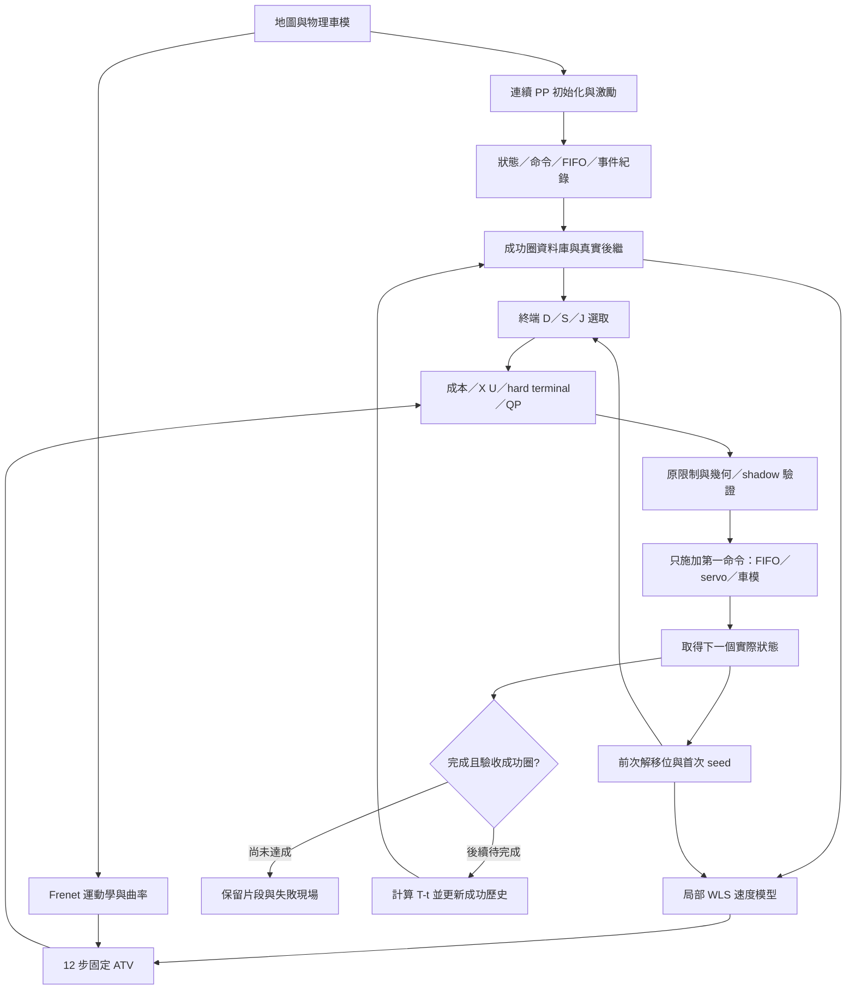

# 實驗總整與作者專案流程比較

整理日期：2026-10-20（Asia/Taipei）。範圍：本工作區已保存的 Continuous、Frenet、LMPC、轉向致動器與 WLS 採樣證據。本文是研究盤點，不新增模擬、模型擬合、QP 求解或性能驗收。

**目前已建立可重播的模擬／幾何／資料／控制研究流程，但尚無成功 LMPC 整圈，也尚無逐圈學習或圈時改善證據。** 已確認的主要問題分布在資料激勵、命令與致動器狀態、局部模型外推／多步放大、QP 數值收斂四個層次，不能用單一原因概括。

本文以實際 session、raw samples、獨立 audit 與固定版本原始碼為證據；舊日誌的「目前」「執行中」「下一步」只代表當時。已完成、未完成及結果相反的批次均保留。數字四捨五入；CSV／JSON 為精確值。

## 閱讀與證據索引

| 內容 | 位置 |
|---|---|
| 現況、流程核心與作者差異 | 本文第 1～4 節 |
| 實驗變因、結果、可比較界線 | 第 5～8 節 |
| 已證實問題、可能錯誤、已排除解釋 | 第 9～10 節 |
| 下一輪如何逐項驗證 | 第 11 節，僅建議 |
| 所有研究批次目錄／session 原欄位盤點 | [批次與 session 清冊](experiment_synthesis_20261020/session_inventory.csv)、[批次清冊](experiment_synthesis_20261020/batch_inventory.csv) |
| 來源檔版本與 SHA256、盤點規則、檢查結果 | [證據清單](experiment_synthesis_20261020/evidence_manifest.json) |

大型 raw 為本機證據，新checkout未必包含；`docs/local/lmpc/`文件由`research/lmpc`分支提供，其他本機筆記不隨Git。本文使用 repository 相對連結，避免把容器 `/workspace` 當成主機目錄。原有 session 統計欄位有不同語意，清冊不將未知值補成 0。

## 1. 現在做到哪裡

| 層次 | 已有成果 | 尚未達成 |
|---|---|---|
| 基礎模擬 | 原 F1TENTH 動力、LiDAR、碰撞與 benchmark 保留；研究入口獨立 | 與 BARC 實車相同物理條件／部署版本 |
| Continuous | 一次 reset 多圈、跨線物理 state／FIFO 延續、圈事件、紀錄及獨立重播 | 不能由 PP 多圈成功推論 LMPC 成功 |
| Frenet | 六圖轉換／截面介面；ESP 幾何供 LMPC 觀測及圈事件使用 | 全道路連續域、任意路線規劃、連續時間掃掠體積認證 |
| 初始化／資料庫 | 多圈 PP、來源 ID、真實 successor、命令與子步 trace、固定歷史 | 新 LMPC 成功圈及持續自動更新 |
| LMPC 元件 | Local Safe Set、共享 λ 的成本與 successor、WLS、ATV、QP、逐動作驗證 | 可靠多步預測、成功整圈、跨圈學習與性能比較 |
| 致動器 | original 與可選 non_overshoot；過衝修正有回歸與配對證據 | 輪角記憶／速率影響在可部署預測模型內完整表示 |
| 數值求解 | 多個固定 QP 有可行見證／KKT 解；Full／Reduced 對照 | 對所有決策皆可靠收斂、完整 100 ms 流程 |

早期 hybrid B3 最長嘗試為 171 步、s=23.886747 m；另有 B2.5 secant 單輪版本 172 步、s=24.048512 m，仍未達其 34 m 首彎目標。不能把「B3 最長 171 步」誤寫成所有歷史實驗的最長紀錄。六維 A 系列原 A5 為 22 步／6.681147 m；最新四格 C00 為 23 步／6.988937 m。這些方法、起步方式與速度限制不同，不作跨方法排名。

## 2. 比較基準：三個作者來源與原 benchmark

「作者專案」在 LMPC 主線指 Rosolia／Borrelli 的論文及其公開實作；另列本研究所依附的 F1TENTH 原 benchmark，避免混淆兩種 upstream。

| 代號 | 固定來源 | 本文使用方式 |
|---|---|---|
| P | [Learning How to Autonomously Race a Car](https://arxiv.org/abs/1901.08184)，Section III／IV／V、Table I | 方法主規格，與現有本機論文查核交叉閱讀 |
| R | [urosolia/RacingLMPC](https://github.com/urosolia/RacingLMPC/tree/b49c95e7795ef6f343efacedb6b90a69c7855b32)，commit `b49c95e7795ef6f343efacedb6b90a69c7855b32` | Python 模擬示範，與論文分列 |
| B | [MPC-Berkeley/barc LMPC.py](https://github.com/MPC-Berkeley/barc/blob/7a481c7044fb85aacd64f2b36df9e29463ea5912/workspace/src/barc/src/ControllersObject/LMPC.py)，commit `7a481c7044fb85aacd64f2b36df9e29463ea5912` | 論文註腳所指公開分支之固定快照 |
| F | [BDEvan5/f1tenth_benchmarks](https://github.com/BDEvan5/f1tenth_benchmarks) | 本地 simulator／maps／raceline／PP 的原始專案；沒有將其宣稱為作者 LMPC 實作 |

R／B 快照未證實是論文當年實車部署 commit；沒有原作者 raw logs、完整啟動設定及當年 OSQP 版本，因此不能精確重現當年的致動器、容差或上層失敗處理。本次沒有執行作者程式。既有三份固定碼副本 SHA256 依 [manifest](../../local/lmpc/sources/r0_20261012/manifest.json) 核對；補充 caller 設定來自 [10/19 原始實作研究](../../local/lmpc/archive/20261020_document_cleanup/qp_implementation_comparison_20261019.md)。本次網路可讀論文摘要頁，固定 GitHub 頁取回失敗；故程式比較以已保存快照及明列的既有 caller 查核為依據，不冒稱重新完整下載遠端專案。

## 3. 全流程：每個大核心如何銜接

三種軌跡須分開：①名義軌跡用來選點／線性化；②QP 軌跡是固定 ATV 內的最佳解；③實際／shadow 軌跡由原物理車模產生。QP 符合自身 ABC，不代表與實際車一致；shadow 不是已執行紀錄，oracle 未來量測也不是可部署名義軌跡。

## 4. 逐核心完整差異表

### 4.1 環境、座標與狀態

| 項目 | 論文／作者公開實作 | 我們目前的做法 | 差異的含義 |
|---|---|---|---|
| 實驗平台 | P 為 BARC 實車；R 為其獨立模擬示範 | F1TENTH ESP、原動力及 raster 碰撞、額外 footprint 檢查 | 圈長、輪胎、車體、控制介面不同；不能直接對照圈時或收斂圈數 |
| Frenet | 同六維 Frenet 狀態；公開碼使用 map 曲率 | 自建平滑中線、精確投影／有效性查詢與連續追蹤 | 原 raceline、legacy 圈追蹤與 core 的 s 不相同 |
| ESP 長度 | 不是作者相同賽道 | raceline≈230.452815、legacy≈237.329933、core≈236.907498 m | 必須保存 geometry ID、s origin 與 cycle，不能直接相減或混用 |
| 預測狀態 | P／R 主體 `[vx,vy,r,eψ,s,ey]`；B 另有 delay 選項 | A 主線六維；B3 hybrid 九維；A7 七維 | 不能從 session 的六維觀測欄斷言所有預測都六維 |
| 車輛觀測 | P 實車量測／估測；部署誤差未取得 | 從 physical state 及同版 core 建立理想模擬觀測 | 尚未比較定位噪聲、時間對齊或真實車外參影響 |

### 4.2 初始化、激勵與無 reset 交接

| 項目 | P／R／B | 我們 | 影響／證據 |
|---|---|---|---|
| 初始成功來源 | P 兩圈定速 path following，參考 1.2 m/s；R main N14、vt=.8，PID 軌跡重複加入四次 | 舊 B1 兩圈 1.2；現行收三圈，前兩圈作來源、第三圈提供真實延伸 | R 的重複軌跡不等於四次獨立採樣；我們第三圈不是第三個 terminal source |
| 激勵 | 作者實驗 raw command 未取得 | A0/A1 無額外擾動；A2 加 δ／a；A2.5 只加 a；NO/A8 另收資料 | 不能推定作者實車必有足夠噪聲／激勵來解釋我們失敗 |
| 交接 | 作者連續 lap/update；初次 seed 細節與 caller 有關 | 現行同 session 跨第三圈後接手，保留 state／FIFO／time／previous_input | 舊 B3 是新實驗靜止起步，與現行 flying 接手不同 |
| 初始 nominal／z | P 最新來源第 N 點、其後 Sλ；B constructor 有固定 z 初始化，caller 是否覆寫未完全確認 | flying 歷史 seed、x0 換實測；首次候選依最新 source xN | 本地設定內 standing seed 舊文字不代表實際路徑 |

A2 激勵：seed=20261015，每 5 控制步保持，δ offset∈±.02 rad、a offset∈±.6 m/s²；PP 2.5 m/s、lookahead=.6 m。總 a_cmd 還包含速度回授，不等於 offset。A2.5 保持相同亂數抽取次數，因此 a offset 序列相同；移除額外轉向擾動後，車輛軌跡與回授命令仍會改變。

### 4.3 資料庫、successor 與成本時序

| 項目 | 作者 | 我們 | 判斷 |
|---|---|---|---|
| x/u 配對 | 保存歷史 state/input/下一步 | logger 命令在目的列：`sample i --sample i+1.command--> sample i+1` | 原始資料有核對；不可使用來源列 incoming command 當 outgoing |
| 跨線延伸 | B/R addPoint 接入下一圈真實資料並平移 s | 現行兩 source 都有實測 continuation；舊 B2 有獨立 approximate periodic tail | periodic seam／重複 prefix 不是新量測，禁止作辨識 transition |
| 成功資格 | 成功圈有 T、J；線上更新歷史 | 初始化成功圈固定；失敗 LMPC 片段保留但不加入成功來源 | 尚無本地新成功 LMPC 圈可更新 |
| 輸入語意 | 六維模型中 δ／a；B 有 delay 索引選項 | 正式 A 系列記錄真正 δ_cmd／a_cmd；target-speed PP 另列 | 區間平均實際加速度不能冒充原本施加的常數 a_cmd |

### 4.4 Local Safe Set 與 Q-function

| 項目 | P | R／B 公開碼 | 我們 |
|---|---|---|---|
| 選哪幾圈 | 實驗最近兩來源 | 依圈時選較快來源；R 設最快四圈 | 最近兩成功來源，首圈實驗期間固定 |
| 每圈選哪些點 | K20，以 s 距離選最近鄰 | 六維未加權 L1 找中心，再取相鄰時間窗口；R 共48點 | 每來源20個 s 最近鄰，共40欄 |
| 終端 | `xN=Dλ, λ≥0, 1ᵀλ=1` | terminal slack 有有限懲罰 | 主線六維硬終端；A7 第七維未納終端 |
| Q-function | 同 λ 最小化 Jλ | 同 λ 線性歷史成本，但 terminal slack 改變可匹配域 | 同 λ 決定 terminal、成本及 successor `Sλ` |
| 下一候選 | Sλ | 核心相同 | 核心相同，保留每欄來源與真實後繼 |

**這是與作者公開碼最顯著的最佳化差異之一。** 加 slack 會改問題，不是單純數值修正；作者沒有 λ 二次 regularization，不能把其成功歸因於此。已有 terminal 欄／successor 不代表非線性 plant 一定能在 1.2 s 內達到該凸組合。

### 4.5 速度辨識：距離、樣本、kernel 與回歸

| 項目 | P／本地 paper 解讀 | R | B | A5／NO／C 組 |
|---|---|---|---|---|
| 距離 | `d²=.01Δvx²+Δvy²+Δr²` | 含 `[vx,vy,r,δ,a]` 的縮放 L1 | 含輸入縮放 L1 | `.1 abs(Δvx)+abs(Δvy)+abs(Δr)+abs(Δδcmd)+abs(Δa)` |
| 點數 | pooled P80 | 每來源最多7 | 每來源最多10、使用6來源的分支 | pooled 80，沒有完整採作者每來源配額 |
| bandwidth | h10，kernel 引數 d²/10 | h5 | h15 | h15，引數 L1 距離/15 |
| 速度模型 | 每通道五係數，vx 用 a、vy/r 用 δ | 相同主要 features | 無額外 idDelay 時同主體 | 同五欄，回歸仍 δcmd |
| 求解 | WLS | MᵀWM，無 ridge | MᵀWM，λ_reg=0 | sqrt(w) 後 SVD、rcond=1e-8，無 ridge |

A6 只把「選點距離」中的角度換成起點 actual；回歸仍 command。M1 的預測平均角是另一路離線對照。不能把 A5、A6、M1 合稱「都用實際輪角」。A5 明確偏離 PDF 距離／h；它也不是完整作者 controller 的移植。

定速資料無法辨識縱向輸入增益時，本地使用 `dt*cos(beta)` 並條件重擬合其他係數；這是工程初始化。report_only 容許缺秩診斷繼續，最低有效權重不足仍停止。滿秩或 80 筆正權重僅是局部數值資訊，不能證明外推與 12 步預測可靠。

### 4.6 運動學、線性化與固定 ATV

P/R/B 的骨架是回歸速度三列，加 Frenet Euler 位置三列；沿前次解移位後的 nominal 建整段 A/B/C，固定後求解，再只施加 u0。本地六維主線沿用這個順序，N12、dt=.1 s，不要求每步做兩輪 SQP。

差異在於作者公開 gradient 假定分段常曲率；本地 ESP 為平滑變曲率，以中央差分對同一 Frenet 函數線性化。B 快照有 `ds_ey` 分母 `den*2` 與函數推導 `den**2` 不一致的一行，本地沒有盲抄；不能從單行判定當年實驗因此錯誤。B3／B2.5 使用物理先驗、surrogate/secant、core 幾何更新與額外狀態，是另列工程變體。

已核對 A3 特定 ABC 代入與 A5 原模型重建，未見算術或 nominal 移位錯誤；真正風險是 QP 最適點可離開辨識 nominal／局部資料支持。下一輪雖以實測作 x0，WLS nominal 仍來自前解，模型誤差可繼續沿查詢與 ATV 傳播。

### 4.7 目標函數與跨終點

| 項目 | P／作者 | 我們 | 界線 |
|---|---|---|---|
| Stage cost | P `h(x)=1(s<L)`；V 加小 input-rate cost | 現行 literal finish 分支；原 B3 曾凍結 nominal h | 凍結 h 不普遍等價原狀態相依 indicator，已有反例 |
| 圈內 J | T−t | 相同 | 插值圈時與離散步數成本分開 |
| 終點後 J | 作者 signed suffix＋按前次預測跨線調整各來源 offset | 原 signed 資料保留；active-goal 終點後 cost=0 | 未證明所有循環情況與作者 offset 等價；不同來源 offset 不能當單一常數刪去 |
| 其他成本 | R Q/R=0，dR=[5,50]；terminal／lane slack penalty | 六維主線 rate=[.5,.01]、無一般 state tracking、無 terminal slack | 不能把更換 penalty 當作等價 solver 修正 |
| QP 次數 | 公開碼固定分支的單 QP | 跨線不確定時多凸 QP 分支，能證明 h 固定時才簡化 | 全域不能稱永遠只解一次普通 QP |

此處是完整復現差異，卻不能解釋所有起點直線的早期停止：多組失敗在剛接手數公尺，尚未到跨線區域。

### 4.8 約束、QP 數值表示與接受標準

| 項目 | R／B 公開碼 | 本地主線／變體 | 影響 |
|---|---|---|---|
| 道路／terminal | lane slack、terminal slack；輸入硬限制 | heading±.5、ey±.25、六維 hard terminal | 本地更改了可行域與可行性難度 |
| 數值界限 | R δ±.5、a±10、lane=map halfWidth；B 由 caller 決定 | δ±.4189、a±9.51，速度cap8、vx≥0、32邊內接速度多邊形 | 平台／工程設定不同 |
| 探索限制 | 不是作者相同設定 | A3 全歷史 vx×1.2；A4 後各stage80點的 vx／最大絕對轉向×1.2 | 對稱包絡不保證有符號或聯合支持 |
| 原 QP | 完整 state/input/slack/λ 直接送 OSQP | 原 Reduced：terminal SVD、外部尺度、LP reference、null-space、近零列正規化、speed facet generation | 數學等價不保證有限精度下相同收斂 |
| Full physical | 相似於完整變數表示，但問題仍有 slack 等差異 | 診斷 backend 保留142變數、85等式、605原始限制，無外部消去 | 只重現表示策略，沒有變成作者相同 controller |
| Solver | wrapper 只明訂 polish、verbose；未固定當年版本 | OSQP .6.3、eps_abs/rel=1e-7、max100000、scaling10、rho.1、adaptive interval50 | 作者未明訂的預設不可猜為已知 |
| 接受失敗解 | R flag只認solved，但 simulator 未查 flag 直接取 u；B wrapper 甚至接受 max iterations | 非 solved 停止；原限制／terminal 等再驗證；C 組共同 KKT、raw λ 不投影 | 作者程式繼續不代表都收斂；不能以接受失敗解取得表面完成圈 |

production 成功 λ 有 roundoff 後處理；最新 C 組四格均採相同 raw 解協議，不裁切／normalize λ、不投影輸入。這個共同協議也會使 C00 不能直接當成舊 A5 的重複執行。

### 4.9 第一命令到車輪：最關鍵的 plant 接軌

本地原轉向路徑為：`δcmd → 兩格 physics FIFO（.02 s）→ 以誤差符號取 ±3.2 rad/s → .01 s Euler 更新 actual angle → 車輛側向動力`。deadband=1e-4 rad，而每 tick 可移動 .032 rad，小命令可能跨目標反向。

non_overshoot 保留 FIFO／deadband／最大速率，只限制本 tick 不跨過有效目標，另有合法限幅與 roundoff 保護。它不保證 .1 s 內達到新命令，也不補齊六維狀態中缺的 actual angle／FIFO。A8 去 FIFO 仍保留有限轉向速率，仍有狀態記憶。B 有 steeringDelay／idDelay 配置，當年實車實際啟用值未確認，不能聲稱作者完全忽略低層控制。

本地 a 介面用原 PID 逐子步反解 target_speed，保留原高速／加速度限制；target-speed PP 與 acceleration-mode PP 的 logs 不互換。

### 4.10 驗證、計時與學習迴圈

本地另做原單位 residual、幾何／車身、第一動作 shadow、物理重播、hash 及來源審計；這些是研究可追溯性增補，不是作者算法性能本身。核心 geometry 的 planning/domain/continuous 全域旗標未因有限行車通過而改為 true。

作者有成功圈 addTrajectory／addPoint 及歷史更新；本地仍停在固定初始化資料的首圈嘗試。模型擬合、單次 QP、完整 cycle、整圈、持續學習五種通過條件必須分列。計時受診斷／logging 範圍影響，C 組 timer 外仍有最後 control JSON write/flush；不能宣稱完整系統 worst-case deadline 已驗收。

## 5. 基礎與早期實驗：已完成什麼、後來改了什麼

### 5.1 Continuous／Frenet

| 批次 | 變因／目的 | 保存結果 | 對 LMPC 的意義 |
|---|---|---|---|
| Stage1 closed profile | 補閉合段、backward 煞車段對齊 | ESP 1153點／1153段，230.452815m，預估40.098769s，combined constraint零違規 | 修正在 research adapter；不是 LMPC 模型驗收 |
| Stage2～5 | 圈追蹤、一次reset、post-step紀錄、重播 | 三圈41.577166／41.066844／41.063010s；partial、timeout、collision測試保存 | 驗證生命週期及紀錄 |
| manual_run_001 | 既有 raceline GlobalPP 五圈 | 5148樣本、一次reset、無碰撞；flying平均41.071484s，較profile多2.4258% | 不是1.2／2.5m/s中線初始化，不作LMPC圈時基準 |
| Frenet C／D | 精確投影、低J、歧義、往返、插值 | ESP密集有效查詢117405；123插值區間未達.025m，保留精確射線 | 已知有效域限制明確回報，不等於整圖不可用 |
| 六圖 ranges | ESP/AUT/GBR/MCO/CornerHall/my_map | 六圖介面及數值旗標通過；my_map 5204主賽道格中心通過 | 不等於任意連續軌跡或實車已驗收 |

證據：[基礎完成總結](../status.md)、[五圈報告](manual_run_001_report.md)、[六圖資料](../../../maps/frenet/README.md)。`status.md` 等 10/07 文件中「LMPC只有目錄」是歷史狀態，已被本文件後續實驗更新；原 Continuous PP 仍與 LMPC 的 core Frenet 接線分別看待。

### 5.2 B0／B1／B2／B3／B2.5

| 階段 | 方法／變因 | 保存結果／停止 | 判讀 |
|---|---|---|---|
| B0 | 觀測、速度／加速度介面與重播 smoke | 短程介面驗收 | 非整圈 |
| B1 | 1.2m/s 中線PP兩圈 | 約196.93949／196.72221s；39380 ticks重播通過 | 低速成功初始化，不代表局部輸入充分激勵 |
| B2 observed | 原始圈、共享λ、successor及Q-function | 最後無真實後繼的窗口明確拒絕 | 缺後繼不是任意改選更遠點的理由 |
| B2 periodic | 另加128既有prefix點、近似seam | 423窗口通過選點／成本／後繼檢查 | approximate seam／virtual不可參與辨識；後來改真實三圈 |
| B3 probes 001～008 | 原PID／平滑先驗、SQP數、速度cap等獨立嘗試 | 依次0／0／1／5／5／76／32／100步 | 有QP、數值gate及shadow拒絕；100步probe非整圈 |
| B3 pilot001 | hybrid九維、六維硬終端 | 63步，舊縮放lambda gate問題停止 | 原單位核對後保留原片段 |
| B3 pilot002 | smoothed_servo＋物理prior／residual | 171步、23.886747m；第二輪SQP primal infeasible；平均cycle250.66ms | 0圈，非純paper復現，100ms未通過 |
| B3 pilot003 | original_pid名義值＋surrogate敏感度 | 1步後infeasible inaccurate | 政名義值未解決持續可行性 |
| B3 final probes | 最終設定短程複核 | `_002`20步通過有限probe | 不是成功圈 |
| B2.5 offline | 原PID／core幾何 vs smoothed／Frenet Euler | 原PID＋core位置誤差約1e-10；平滑版12步heading／ey超原門檻 | 同一PP窗口預測改善不代表新控制可行 |
| B2.5 frozen003 | 固定171步故障QP、HiGHS對照 | 首輪可行、重新線性化第二輪限制共同不相容 | 已有獨立不可行證據，與10/20迭代超限不同 |
| B2.5 short001／002 | measured reroll、原PID名義／幾何，兩輪／單輪 | 各1步，下一QP infeasible | 減少SQP未修好 |
| B2.5 short003 | 原PID secant＋core幾何、兩輪 | **最終168步、s23.436068m，QP primal infeasible** | 舊報告的「執行中」已過時，以落盤session為準 |
| B2.5 short004 | 同類secant、單輪 | **172步、s24.048512m，shadow_state_limit** | 真實未到34m；不是實際已越界或完成首彎 |

B2.5 003／004 的最終值本次直接查 session／最後 sample，補足舊摘要缺口，沒有重跑。完整 session 路徑與 hash 見清冊。早期批次細節見 [B3原報告](../../local/lmpc/archive/b3_report_20261012.md)、[B2.5原報告](../../local/lmpc/archive/b2_5_report_20261012.md)。

### 5.3 10/13～10/14：paper 模式重整

| 實驗族 | 做了什麼 | 結果／限制 |
|---|---|---|
| R0 finish audit001～003 | 四固定窗口，比current／作者cost-only／literal h與J變體 | 4/4有原殘差合格解；作者offset可改λ與後段預測，第一u近同不等於目標相同；曾約282ms |
| 跨線反例 | 隔離凍結h與decision-dependent h | 證明非全域等價；不是證明作者當年實驗失敗 |
| R3 identifiability | 5903 transitions、99 query | 定速資料起步外幾乎無a，局部無獨立a資訊；原plant仍能加速 |
| R3 gain／sideways／tie | dt*cos(beta)初始化、SVD係數與同距離選樣核對 | 係數重算吻合約1e-16；正確WLS仍可嚴重病態／外推 |
| R3 fixed ATV | 第一圈train、第二圈99個12步窗口 | 99/99完成計算，但誤差驗收失敗 |
| R4 QP setup／literal／speed | 原單位gate、X索引、literal分支、尺度／消去、workspace共用／facet生成 | 四窗口各5次共20次QP<100ms，解與baseline一致；完整cycle仍有約100～289ms |
| R4 handoff001／002／003 | 真實三圈PP後連續接手 | 前兩版0步（solved inaccurate／shadow拒絕）；003施加1步後下一ATV無支持 | 

證據：[10/14進度](../../local/lmpc/archive/20261020_document_cleanup/progress_20261014.md)、[固定ATV驗證](../../../Data/research/lmpc/r3_fixed_atv_20261014_001/validation.json)、[跨線反例](../../local/lmpc/checks/cross_finish_counterexample.json)。較早的 solver tuning、reuse、screened、facets 批次一併列於 batch 清冊，不將它們當成額外獨立閉迴路成功。

## 6. A 系列：變因與閉迴路結果

共同骨架：ESP core L≈236.907498m、control_dt=.1、physics_dt=.01、N12、兩來源各20 terminal點、同λ、原單位gate。除另述外回歸為五欄command WLS；每列表示獨立已保存的控制片段。距離是停止s扣handoff s；yaw RMSE是已施加動作的一步誤差，**樣本數與命令不同，不作公平排名**。全部 LMPC 成功圈數為0。

| 組／日期 | 主要變因（相對基準） | history／plant | 步數 | 距離m | yaw RMSE rad/s | 直接停止 |
|---|---|---|---:|---:|---:|---|
| A0 10/15 | 1.2m/s 無額外擾動 | 新三圈／original | 1 | .132172 | 4.9451 | 第2次ATV正權重不足 |
| A1 10/15 | 改2.5m/s，無擾動 | 新三圈／original | 1 | .271082 | .0929 | 第2次QP無可行分支，另有LP不可行證據 |
| A2 10/15 | 2.5m/s＋δ/a激勵 | 新三圈／original | 2 | .627885 | .4754 | 第3次ATV正權重不足 |
| A2.5 10/16 | 相對A2只移除額外δ激勵 | 新三圈／original | 3 | 1.030約 | 1.654546 | 第4次ATV k6支持0，未進QP |
| A3 10/15 | A2＋全歷史vx×1.2 cap | 重用A2／original | 4 | 1.156390 | .7468 | 第5次ATV正權重不足 |
| A4 10/15 | 各stage80點vx／absδ×1.2 cap | 重用A2／original | 7 | 2.0665 | .7421 | 第8次QP迭代上限 |
| A5 10/15 | A4＋input-aware L1、h15 | 重用A2／original | 22 | 6.681147 | .513765 | 第23次QP迭代上限；重建原限制LP可行 |
| A6 10/15 | A5選點角改actual_start，回歸仍cmd | 重用A2／original | 20 | 6.0511 | .5962 | 第21次solver primal infeasible |
| A5歸零 10/15 | QP後 abs(δcmd)<.005→0 | 重用A2／original | 19 | 5.7557 | .7052 | 第20次無可行分支 |
| A7 10/15 | 七維actual角、平均角WLS、近似servo轉移 | 重用A2／original | 7 | 2.0758 | .3744 | 第8次QP迭代上限；採`_002` |
| A8 10/15 | 移FIFO，保留rate與六維cmd WLS | 新三圈／no-FIFO | 6 | 1.7687 | .3006 | 第7次QP迭代上限 |
| A9 10/16 | A5選點＋探索限制，history換A2.5 | 重用A2.5／original | 17 | 5.134約 | .348512 | 第18次無可行分支／primal infeasible |
| A5-NO 10/19 | A5完整流程改non_overshoot | 新NO三圈／NO | 1 | .262588392 | .003675713 | 第2次QP迭代上限；原限制已證可行 |
| NO-S1 10/19 | 同NO，僅OSQP scaling=0 | 重用NO／NO | 0 | 0 | 無資料 | 首QP100000次；未施加命令 |
| NO-FULL 10/20 | 同NO，Full physical QP | 重用NO／NO | 6 | 1.772930026 | 1.092546 | 第7次QP迭代上限；30步目標未通過 |

上述不是每列都新收三圈PP；多組只是重播既有命令恢復同一接手狀態。A7 `_001` 是前次失敗紀錄，不能和 `_002` 相加。A9 比 A2.5 同時更換選點與探索限制，不能把17步全部歸因於kernel。舊A5 vs A5-NO的history／接手state／plant同時不同，不能視為單因素致動器對照。

A2條件數改善：同185個保留點，側向cond中位約1.08e10→9.16e3；仍兩步停止。A3的 r=-6.507121 是未執行的QP未來節點，實際停止 r=+.948933；ABC代入差約3.46e-14，沒有算錯。A2.5失敗 nominal r=7.1916、vx=6.3172也不是實際車速／yaw。

來源：[10/15總表](../../local/lmpc/archive/20261020_document_cleanup/progress_20261015.md)、[A0～A3細節](../../local/lmpc/archive/20261020_document_cleanup/experiments_A0_A3_1005.md)、[A2.5報告](../../../Data/research/lmpc/experiments/A2_5_lmpc_20261016_001/report.md)、[A9報告](../../../Data/research/lmpc/experiments/A9_lmpc_20261016_001/report.md)、[10/19](../../local/lmpc/archive/20261020_document_cleanup/progress_20261019.md)。

## 7. 離線診斷、致動器與資料採樣

### 7.1 預測與外推診斷

| 實驗 | 控制變因／驗證方式 | 結果 | 能推論／不能推論 |
|---|---|---|---|
| A1 replay／QP location | 固定資料／權重重算WLS、檢查第二QP | 正規方程成立；窄vx區間係數互抵，外推輸出可達數千；LP不可行 | 是局部資料／模型與約束問題；不是WLS算術必然錯誤 |
| A3 trust區域 | 同state/FIFO，限制δ或vy/r/vx，最多8個shadow動作 | 原4步；各trust版本0～2步後QP無解 | 沒有通用通過設定，限制離線，不當成正式修正 |
| M1 actuator／WLS | 精確純量servo；第一圈948 train、第二圈947 test | 28470 ticks與170邊界例角度誤差0；causal mean角一步yaw .072118→.032097，actual_start .226818 | 一步改善；不能拿未來measured mean部署 |
| M1 多步 | 48個PP窗口×12步、原nominal | 平均角模型聚合yaw RMSE841.15 | 模型發散數字，不是實車yaw；多步未通過 |
| T1 oracle | 固定模型的查詢位置換未來真實軌跡 | PP yaw .09842、A3 .54982；仍有窗口超.3預算 | nominal偏差及誤差傳播均存在；oracle不可上線 |
| A5/A6 kernel修正版002 | 同80點規則改距離，187 heldout、28窗口 | 一步A4/A5/A6約.06934/.06597/.07000；第12步約4.46e11/3.10e6/2.94e9 | 單步小誤差不代表多步穩定；001因同改regressor已被取代 |
| A5歸零配對 | 相同首步原plant副本，微命令改0 | yaw -.14121→-.00150，仿射模型幾乎不變；19步後仍停止 | deadband切換有真實影響；不證明較大filter改善整圈 |
| A7固定命令 | A3四組12步，原模型vs七維 | yaw RMSE四組均惡化，首組約847；δnext=cmd是近似 | 加一維不等於精確含FIFO／離散servo模型 |
| A8 no-FIFO audit | 新plant、新history、六組固定命令shadow | delayed target確等當前cmd；12步yaw約.398～1.014 | 拿掉FIFO仍有速率記憶；不足以宣稱延遲是唯一根因 |
| A5 full-horizon 10/16 | 22次原解、264原ABC、23輪來源／terminal核對 | 最初QP j1已超資料vx上界.21309；k3首次超診斷yaw/vy；第23重建QP LP可行 | 早期失配確實存在；未證明某一失配必然造成最後未收斂 |

證據：[M1](../../../Data/research/lmpc/actuator_wls_m1_20261015_001/report.md)、[T1](../../../Data/research/lmpc/atv_error_diagnosis_20261015_001/report.md)、[A7對照](../../../Data/research/lmpc/actuator7_comparison_20261015_001/report.md)、[A5完整horizon](../../../Data/research/lmpc/a5_full_horizon_diagnosis_20261016_001/report.md)。後者只分析／重建、未新跑plant或QP optimizer；276模型選點／係數核對與264原ABC重建相符，不能把重建當runtime矩陣快照。

### 7.2 non_overshoot 與 WLS 資料資格

| 批次 | 實際變因／工作 | 結果與限制 |
|---|---|---|
| NO致動器回歸10/19 | 新可選積分規則，original預設保留 | 53測試保存通過；3000步original bitwise一致；原A5 28660ticks重播誤差0；固定命令跨目標0 |
| original／NO PP兩圈 | target-speed=2.5、無額外A2激勵 | 直線yaw RMS .148698→.0160743、vy .010134→.000919；max abs(ey) .081538→.092844，並非全性能改善 |
| data_readiness | 盤點以上PP供A5 WLS是否可用 | 狀態可重建，但輸入第二欄是target_speed，缺真實a_cmd／持續a激勵；未擬合WLS |
| supplement short | δ/a真命令、匹配offset；12s內2.5→3.0 | original／NO各120 transitions短驗證通過；不是正式train/test |
| supplement高速資格 | original 3.0＋預定激勵，全圈資格 | 12.5s、s36.715409，abs(eψ)=.613431>.5停止；125 raw、124 valid transitions；無碰撞 |
| supplement正式採樣 | 預定每模式2圈train＋獨立reset1圈test | **全部未執行；NO高速全圈也未執行；WLS未擬合，LMPC未執行** |

補採樣短驗證有最低激勵事件，不等同充分局部可辨識；a feedback 會在保持 offset 期間抵銷偏移。完整3680物理ticks獨立重播誤差0。高速原session的 alignment=false 為報告旗標問題，independent audit 已分開澄清；現collector修正報告邏輯後未重新採樣。不得把pilot／資格失敗資料充作正式六圈資料集。證據：[NO報告](../../../Data/research/steering_actuator/non_overshoot_20261019_001/report.md)、[資料資格](../../../Data/research/steering_wls/data_readiness_20261019_001/report.md)、[補採樣](../../../Data/research/steering_wls/supplement_sampling_20261019_001/report.md)。

### 7.3 QP 數值診斷：離線可解與線上可持續分開

| 批次 | 固定問題／唯一改動 | 結果 | 更新的結論 |
|---|---|---|---|
| A4 frozen | 原問題與診斷移除局部探索限制 | LP有可行點；去速度cap可收斂，去δcap仍超限 | 數值收斂與局部限制有關，不直接取消限制當修正 |
| 原A5第23次 | 10/16重建全部605原限制 | HiGHS可行點最大違反4.19e-15 | 原A5停止不能稱已證明infeasible |
| A5-NO QP2 | 10/19離線重建 | 原限制LP可行；主要負λ≈-1.179e-4；scaling0於3325次成功、固定rho另可成功 | 原QP可行，未收斂不等於無解 |
| NO-S1 | 同NO history，仅scaling=0進live | 保存QP2成功，但live QP1失敗100000次、0命令 | 關scaling不是通用修正 |
| QP-D1 | 固定QP1 runtime與QP2重建，四表示×兩題 | 下表；原限制／KKT／PSD另行證書驗證 | 表示敏感已證實，尚未隔離單一變換為根因 |

| QP-D1表示／iterations | QP1 | QP2 |
|---|---:|---:|
| Reduced saved（原136列） | solved 7550 | max100000 |
| Reduced all（520列） | solved3100 | solved3625 |
| Full assembled（保留terminal SVD，605列） | solved1325 | solved1250 |
| Full physical（原物理terminal，605列） | solved1575 | solved1050 |

Full原限制最大違反約5.20e-16／5.55e-16，KKT通過；成功解成本一致。Reduced all也成功，因此不能說已證明null-space、terminal SVD或近零列是唯一故障。NO QP2 reduced Hessian rank24/57、正曲率比約8.39e7；近零列正規化可產生2.366e14 bound；這些是數值疑點，不是非凸／不可行證明。

QP-D1之後的 NO-FULL 實際只施加6步，第7次失敗，30步目標未過。首步後曾因inf JSON記錄中止；修正後 exact checkpoint 重播，沿用原QP1解、不重求，首transition只算一次。六次成功cycle均值60.85ms，但失敗451.06ms。此批與下節四組全新run分開，不能重複計數或混作同一組。證據：[QP-D1](../../../Data/research/lmpc/experiments/QP_D1_20261020_001/report.md)、[NO-FULL](../../../Data/research/lmpc/experiments/A5_NO_FULL_20261020_001/report.md)。

## 8. 最新四格實驗：公平比較 actuator × QP

四組皆全新獨立執行，固定同一已驗收 NO history、state／FIFO／time；只在接手後切 original／NO、Reduced／Full。未重收PP。上限預先登錄3000命令／300s；四組均提前在QP停止、0圈、無實際碰撞／安全超限。每格只有一次 deterministic run，不估計統計顯著性。

| 組 | actuator／QP | 已施加 | 距離m | 停止 | 共同6步yaw RMSE | 共同6步cycle平均ms |
|---|---|---:|---:|---|---:|---:|
| C00 | original／Reduced | 23 | 6.988937067 | QP24 max100000 | 1.074282 | 117.166 |
| C01 | original／Full | 6 | 1.774284864 | QP7 max100000 | 1.074282 | 59.924 |
| C10 | NO／Reduced | 6 | 1.772930026 | QP7 max100000 | 1.092546 | 135.780 |
| C11 | NO／Full | 6 | 1.772930026 | QP7 max100000 | 1.092546 | 62.323 |

四格首輪物理QP／ATV／WLS／Safe Set一致，同backend首輪solver矩陣也逐位一致。每次只solve一次，所有已施加解回原限制與共同KKT通過，raw λ未投影。正式四組沒有logging中斷，也沒有沿用前次NO-FULL的live結果。

**只改actuator：**共同60ticks跨目標17→0、輪角rate反向19→5；第一個同state／同command的yaw誤差.030865→.003676，但六步yaw／vy／ey預測RMSE略升。NO仍42/60ticks速率飽和，命令反向仍在。可以說消除本批過衝，不能說已修好模型或跑得更遠。

**只改QP：**同actuator前六步命令／state幾乎相同，Full共同cycle平均大致減半；original卻23→6步，NO皆6步。Full沒有在此批證明更可靠的持續收斂。Full失敗cycle仍約443～445ms；整段100ms未通過。

**限制：**original兩格使用NO history，屬接手點切plant；不是original模式完整重新初始化。C00全23步yaw RMSE=.623005不能與別格6步的1.09直接比好壞。四個新失敗QP尚未另解LP證可行或不可行；主要是負λ／local限制與dual未收斂，不能寫「全部infeasible」。

證據：[完整四格報告](../../../Data/research/lmpc/experiments/A5_COMPARE_20261020_001/report.md)、[summary.csv](../../../Data/research/lmpc/experiments/A5_COMPARE_20261020_001/summary.csv)、[comparison.json](../../../Data/research/lmpc/experiments/A5_COMPARE_20261020_001/comparison.json)。

## 9. 我們推測的可能錯誤：證據分級與驗證方法

「確定存在某缺口」與「確定造成最後停止」是兩種命題。以下不把相關現象升級成單一因果。

| ID／層次 | 問題或假說 | 證據等級 | 已知事實／反證 | 下一個最小驗證 |
|---|---|---|---|---|
| H1 資料 | 定速／閉環相關資料不足以辨識input effect | **部分批次已證實** | R3局部a無資訊；A1病態；A2激勵改善cond但仍失敗 | 同來源holdout及分層input獨立性，不能只看全池範圍 |
| H2 plant | 六維cmd模型缺actual輪角與FIFO context | **結構缺口已證實** | 不同隱藏context可有不同下一步；NO未消除記憶；A7／A8未解決 | 同六維state／cmd固定，只改合法context的配對plant測試，量化影響 |
| H3 servo | 原離散固定速率造成小目標過衝／不連續 | **已證實，NO消除本批過衝** | .032rad tick遠大於deadband；四格17→0；六步模型RMSE未改善 | 用現有tick trace分開過衝、延遲、速率飽和誤差 |
| H4 selection | nominal鄰近不代表QP應用點有資料支持 | **已證實存在外推** | A3／A5在滿權重時仍出界；對稱δ包絡可跨符號 | 同一保存ABC，比query、QP點、實際點與聯合支持，不先加限制 |
| H5 propagation | ATV局部矩陣放大小誤差／查詢誤差 | **已證實多步不可靠；機制貢獻未完全分離** | M1/T1與kernel多步發散；oracle仍可失敗 | 固定ABC／U對plant自由rollout；逐步拆局部殘差與傳播 |
| H6 QP | 外部縮放／消去／近零列及送入限制影響收斂 | **表示敏感已證實；唯一根因未定** | QP-D1同原問題不同表示有成敗；Reduced all也成功；Full新QP7仍失敗 | 固定C00成功QP7與C01失敗QP7，原限制見證／KKT與等價表示對照 |
| H7 terminal | 硬terminal與學得動態／局部限制可能共同不相容 | **部分固定問題已證實，不能普遍化** | B2.5第二輪／A1有不可行診斷；原A5與NO QP2可行 | 新失敗QP先原始LP，再分組約束診斷；加slack另列方法變體 |
| H8 cost | 本地active-goal／literal與作者offset不完全相同 | **差異已知，全面等價未證** | 凍結h反例；各來源offset可改λ | 在相同D/S/J／ABC下核對跨線目標；不能用它解釋全部直線停止 |
| H9 code | 命令索引、ABC排列、nominal移位可能算錯 | **已查特定案例未發現，非全程無bug證明** | A3乘法及A5重建／來源／尾端input吻合；原plant重播通過 | 只針對新矛盾追查，避免忽視已核對證據 |
| H10 timing | 單QP快但整個控制超時 | **已證實** | 多組失敗cycle>100ms；diagnostics計時範圍有差 | 固定版本完整端到端cycle分解，包含失敗與logging外成本 |

### 9.1 目前最合理的工作解釋

初始化資料只覆蓋有限閉環狀態／輸入；辨識出的局部仿射模型雖能很好擬合附近資料，QP仍可能利用外推方向。實際轉向又受隱藏輪角、FIFO及速率限制影響，使下一步與預測分離；下一輪以實測固定x0，但nominal仍由舊預測移位，可能持續選錯局部區域或放大誤差。同時硬terminal／探索限制及低曲率、冗餘λ方向形成數值敏感QP。

這是一條與現有證據相容的鏈，**尚未證明每一環都必然造成最後失敗**。有些案例在建模前停止、有些原限制不可行、有些原限制可行但OSQP未收斂，必須分案。

## 10. 必須修正的舊結論與比較陷阱

| 容易產生的說法 | 本次統整採用的結論 |
|---|---|
| 「原作者方法就是我們A5」 | A5只借用了含輸入L1／h15方向，來源圈、點配額、Safe Set、slack、成本、plant與solver皆有差異 |
| 「沒有80點／缺Safe Set所以失敗」 | A5/A6/A9停止建模仍有80正權重，terminal來源／successor完整；不是同A3 kernel斷供 |
| 「max iterations就是infeasible」 | 原A5與NO QP2有原限制LP可行見證；最新四格可行性尚未另證 |
| 「關scaling已修好」 | 只解NO QP2，NO-S1首QP失敗 |
| 「Full已解決QP問題」 | 固定QP1/2與短時耗時改善；新QP7仍失敗，original/Full較Reduced更早停止 |
| 「NO已改善辨識／模型」 | 過衝消除；共同六步預測未改善，正式WLS獨立資料與評分仍缺 |
| 「A7已完整表示致動器」 | 七維未含FIFO，QP轉移近似，terminal僅六維 |
| 「A8沒有記憶」 | 只拿掉FIFO，有限轉向速率仍依actual角 |
| 「B2.5仍執行中」 | 003已168步QP停止、004已172步shadow停止，以最終session為準 |
| 「補採樣已完成六圈」 | 只有短驗證與original高速資格片段；正式train/test均0圈 |
| 「passed／completed_full_laps=true表示LMPC成功」 | 有些統計含PP三圈；判LMPC要看completed_lmpc_laps與handoff後資料 |
| 「測試數相加就是總數」 | 不同日期套件大量重疊；本次不重跑也不加總 |
| 「所有文件的目前都同一時間」 | 根README／status及research README有歷史文字；本文截至10/20落盤證據較新 |

目前沒有足夠證據把 Frenet 投影、命令錯列、ABC乘法或 nominal 移位認定為上述主線共同根因；這不代表所有未測路徑皆無錯。

## 11. 接下來應如何逐核心收斂（尚未執行）

| 順序 | 固定現有證據 | 要回答的單一問題 | 通過條件／交付 |
|---|---|---|---|
| 1 QP線 | C00 QP7成功、C01 QP7失敗、C10/C11 QP7失敗 | 同原問題的數值表示是否造成不同收斂？新失敗原限制是否可行？ | 原始單位見證／KKT、矩陣差異與設定完整；區分近似可行與精確證書 |
| 2 plant線 | 四格共同6步完整tick | cmd／延遲target／actual／區間有效角各差多少？ | signed輸入覆蓋、飽和與誤差配對；不把measured mean當線上可用 |
| 3 模型線 | 原A5、M1/T1固定窗口及保存U/ABC | 誤差主要來自局部殘差、nominal選點還是有限步放大？ | heldout一步＋固定ATV12步、因果資訊、共同支持分層及失敗窗口完整保留 |
| 4 資料線 | 已失敗3.0m/s採樣資格 | 如何在固定安全門檻內取得足夠獨立δ/a資料？ | 先解資格失敗原因，才另立採樣設計；不將pilot當正式train/test |
| 5 方法對照 | P、R、B分開配置 | 是重現論文數學、作者工程碼，或改善ESP控制？ | 預先列明差異；slack、歷史來源、cost、模型每次只改明列因素 |
| 6 閉迴路 | 已通過上述局部驗證的固定版本 | 是否能持續控制、整圈及100ms？ | 先固定短程，再完整圈；成功圈才可進歷史與多圈學習 |

最優先不是再依最長片段挑「勝出參數」，而是讓預測與QP兩條問題各自有固定資料的可重現結論。後續只有取得成功LMPC圈，才談最近兩成功來源更新、每10圈評估、圈時改善或與raceline比較。

## 12. 本次統整做了哪些查核

本次直接讀取日誌、報告、原始session與特定最後sample；清冊涵蓋 **100個研究批次目錄、79份session.json**，其中包含初始化、重播、封存片段及空目錄，不能解讀為99個獨立控制實驗。證據manifest收錄184份來源的SHA256；固定作者三份快照雜湊皆吻合，最新四格步數／零LMPC圈與文件相對連結核對通過。補上A2.5／A9、WLS資料資格／補採樣，以及B2.5 003／004最終狀態。未執行模擬、WLS、QP、plant replay或單元測試；文中驗收結果均標示為既有保存證據。本次只新增統整文件與證據索引，並更新文件入口及對應Git納入規則，不修改歷史raw或控制器。

要重現歷史數值，應使用各session當時保存的程式／設定／環境hash及原始報告命令；現工作樹與歷史hash不同時，不可用新版重跑冒稱原版本逐位重現。完整盤點規則及實際檔案檢查結果以隨附manifest為準。

10/20後續文件整理註記：LMPC核心文件已收斂為完成狀態、方法與當日進度；舊日進度及QP細部對照移至封存區，本文連結同步更新，證據清冊依搬移後位置刷新。原始實驗與程式未修改，原結論未因文件搬移改變。
