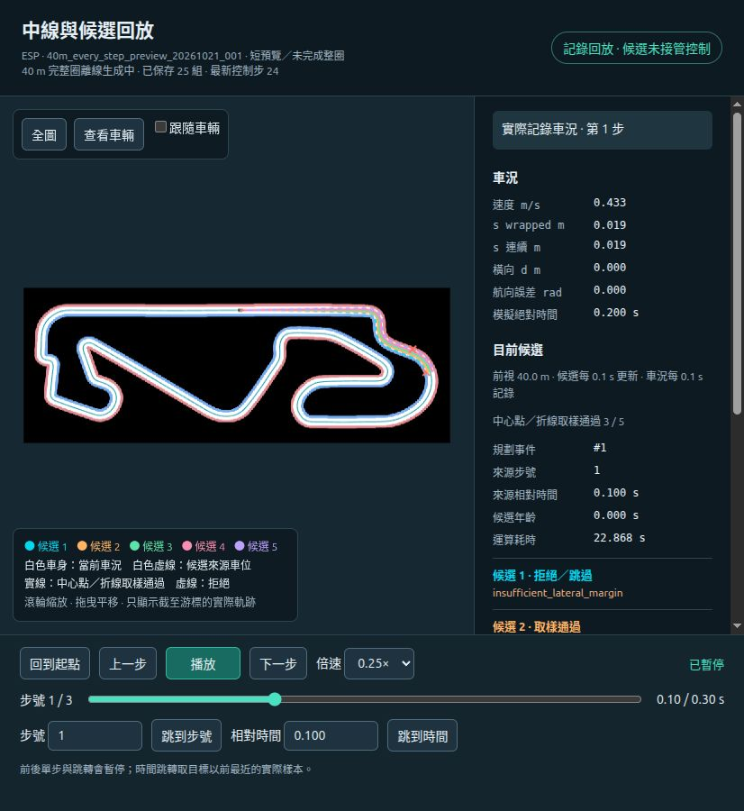

# 第三階段：記錄播放與 40 m 每步生成修正

日期：2026-10-21（Asia/Taipei）。播放功能已完成；正式的 **40 m／每 0.1 秒控制步生成**已啟動完整圈離線工作，尚未完成該設定的整圈最終驗收。

後續更新（2026-10-22）：正式 40 m 每步整圈已生成完成、播放服務已切換完整資料；本篇背景運算敘述保留為當日歷史紀錄。最新現況、案例截圖與改進設計見[路線生成方案與模擬器驗證](2026-10-22_路線生成方案與模擬器驗證.md)。

## 實作與介面

- 新增 `research/overtaking/playback.py`、`playback.html`、`playback.js`，重用既有 `MapInspector` 的地圖座標轉換與 occupancy 圖片；原幾何檢視器維持既有功能。
- 只綁定 `127.0.0.1:8766`；依游標逐組讀取候選，只傳繪圖與診斷必要欄位，不把整份 solver attempts 塞入瀏覽器，也不重新求解。
- 支援播放／暫停、前後單步、步號與相對時間跳轉、時間軸、0.25×／0.5×／1×／2×／4×、縮放／平移／跟隨車輛及圖層切換。結尾停止，保存原終止原因。
- 顯示候選來源步號、來源時間、年齡、來源車身、五個 ID、失敗原因與首個無效點。候選固定在原 map 座標；軌跡只到游標為止。
- 載入時核對 geometry_id、CSV／manifest／地圖來源。缺失或損壞的索引可由 JSONL 重建，不修改原始 session。
- 播放請求有取消與序號保護；暫停會使尚未回來的自動播放請求失效，慢的未來結果不能覆蓋較新的向後跳轉。等待手動跳轉期間不從舊游標啟動播放。

## 正式規格修正

先前 `stage2_esp_20261021_002` 是 **3 m／2 秒**整合測試，不等同使用者要求的前視與更新規格。使用者明定 **40 m／每控制步 0.1 秒**後，已恢復 SessionConfig 與 CLI 正式預設，保留舊 session 作為歷史證據，不修改其 metadata。

40 m 是 Frenet 弧長前視，不是 40 秒的時間預測；中線 PP 自己的控制前視仍是 0.6 m。每步保存候選與牆鐘即時 10 Hz 是不同要求，目前只有離線處理。

`40m_every_step_preview_20261021_001` 是短預覽：3 個控制區間、4 筆車況、4 組五候選、總模擬時間 0.3 秒。每筆都有對應候選，來源步號為 0／1／2／3；刻意在控制步上限停止，**未完成整圈**。

- [物理／控制／Frenet／每步記錄核對](40m_preview_verification_20261021.json)：通過。
- [逐筆正反向 HTTP 核對](playback_40m_20261021.json)：4 筆正向、4 筆反向均通過，來源 pose／時間、五 ID、候選年齡、拒絕原因與過去軌跡一致。
- 4 組候選取樣通過數為 3、3、5、3；6 條拒絕原因保存為 insufficient_lateral_margin，不保證全部五條成功。
- 短預覽單組耗時約 22.7～27.0 秒，recording_complete=false。畫面顯示「短預覽／未完成整圈」，不能以此代替 E 驗收。

正式完整圈在 `Data/research/overtaking/40m_every_step_20261021_001/` 背景生成，容器名稱 `f1tenth-candidates-40m-every-step`。每完成一組會 flush 原始串流並原子更新 progress.json；播放頁可另顯示此工作進度，但不播放尚未完成的即時車況。完成後仍需獨立重播及同場整圈回放驗收，不能先標為完成。

## 即時性瓶頸

[單點 40 m profile](40m_generation_profile_20261021.json)對實際起點 pose 量測：1,601 點／條、21 次 solver attempts；3 條取樣通過。含 profiler 開銷的總時間 33.5766 秒，其中 `_validate` 累積 30.7488 秒（約 91.6%），21 次 SLSQP 合計約 0.8525 秒。邊界查詢 30,420 次、Cartesian 轉換 14,409 次、Frenet 投影 14,410 次。

這些 cumulative 時間互相包含，不可相加。未加 profiler 的起點短測約 22.2 秒，亦不可直接與 profile 相減當作某階段耗時。現有診斷型完整驗證流程是主要瓶頸，不能直接歸因於幾何路線算錯，也不是播放問題。

尚未做即時化改造：後續應分開靜態幾何預計算／快取、執行期必要檢查與離線完整核驗，再處理求解 warm start／固定結構等；0.85 秒求解合計本身亦超過 0.1 秒。沒有刪除檢查、降低限制或宣稱車身／動態安全。

## 測試與實際操作

- Python 回歸（playback／session／既有 inspector）：**44 passed，38.94 s**。
- 最後的 API／進度／座標批次轉換／每步 session 重驗：**28 passed，32.96 s**，與上一批部分重複。
- `node tests/research/playback_client.test.cjs`：**4 passed**，涵蓋延遲結果競態、暫停中的請求、手動跳轉與播放競態、五種倍率的記錄時間間隔及結尾不循環。
- 以實際瀏覽器操作舊一圈資料的 20→19 步，規劃由 #1 正確回到 #0；時間 1.99 s 定位第 19 步；超範圍步號顯示錯誤而不移動游標；1969→1970 與返回時，接縫候選 #98／#99 切換正確。
- 以 40 m 短預覽確認每步候選 #0／#1 切換、0.25× 播放後暫停、時間軸 Home／End，以及結尾「短預覽結束（未完成整圈）」；每步候選年齡為零。

代表畫面（短預覽第 1 步，背景進度為截圖當時數值）：



## 重現

```bash
python -B -m f1tenth_benchmarks.research.overtaking.playback \
  --session Data/research/overtaking/40m_every_step_preview_20261021_001 \
  --progress-session Data/research/overtaking/40m_every_step_20261021_001 --port 8766
python -B tests/research/check_playback_session.py \
  Data/research/overtaking/40m_every_step_preview_20261021_001
node tests/research/playback_client.test.cjs
```

上述 raw session 留在本機，未納入 Git；程式、精簡證據及畫面保存在 master。完整 40 m 整圈尚在計算；瀏覽器沒有實作候選接管、對手預測或超車決策。
