# 雙車同步模擬與候選軌跡生成環境規劃書 (Two-Car Synchronous Simulation & Candidate Trajectory Planning)

> **歷史設計（Phase 1）**：以下保留原始規劃。Phase 2 已實作前車預測與規則式超車；加權成本函數尚未實作。現行行為見[雙車決策](interfaces.md#雙車候選與超車決策)，重跑見[操作指南](usage.md#phase-2-前車預測減速跟車與超車)。

---

## 1. 背景與本階段目標

### 1.1 最終研究目標
- **前車（Lead Car, `car_id = 1`）**：以穩定目標速度（例如 `0.8 ~ 1.0 m/s`）沿賽道參考中線行駛（使用 `CentrelinePurePursuit`）。
- **後車（Ego Car, `car_id = 0`）**：
  1. 預設完全得知前車的即時位置 `[x, y, yaw]`、速度 `v` 與 Frenet 座標狀態 `(s, d, e_psi, s_unwrapped)`。
  2. 不使用光達（LiDAR），直接沿用現有的 **1mm 離線安全域（`MillimetreDomain`）+ 直接 Hermite + 40ms 協作預算 B-spline 修正（`BudgetedDomainGenerator`）+ 三圓車體邊界檢查（`check_candidate_footprints`）**，於每個控制週期同步生成 5 條候選軌跡（`C1 ~ C5`）。
  3. 透過候選軌跡成本評估（Cost Evaluation）選擇最佳軌跡跟隨並超越前車。

### 1.2 本階段實作範圍（Phase 1：基礎環境與同步軌跡生成）
- **本階段不做複雜超車成本評估（Cost Evaluation）**：先將雙車前進、無光達物理與碰撞檢查、前車真實狀態傳遞、後車 5 條候選軌跡生成與跟隨控制完整串接於模擬器中，並預留乾淨的 `select_candidate(...)` 選擇器介面供下一階段實作 Cost Function。

---

## 2. 現有程式碼資產與復用原則（必讀）

實作時**嚴禁重新發明輪子或破壞既有單車實驗契約**，請直接復用以下模組：

| 功能模組 | 檔案路徑 | 關鍵類別／函式 | 復用說明 |
|---|---|---|---|
| 三圓車體與地圖碰撞 | `f1tenth_benchmarks/research/collision/discs.py` | `ThreeDiscBody`, `OccupancyMap`, `pair_intersects`, `sweep_samples` | 車長 `0.51m`、車寬 `0.27m`，三圓半徑 `0.15953m`，牆面與車間餘量 `0.05m`。參考 `footprint_validation.py` 第 22 行：直接以 `OccupancyMap(np.flipud(raster.occupancy != 0), raster.resolution, raster.origin)` 從 `MapRaster` 建立碰撞網格，無需 `ScanSimulator2D`。 |
| 雙車同步物理模擬 | `f1tenth_benchmarks/research/collision/multi_car.py` | `MultiCarSim` | 10ms 物理步（`timestep=0.01s`）、100ms 控制步（`control_dt=0.1s`, `substeps=10`）。每物理步執行 `sweep_samples` 檢查牆面與雙車三圓接觸／餘量事件。 |
| 賽道幾何與載入 | `f1tenth_benchmarks/research/overtaking/track_data.py` | `TrackData` | 載入 `maps/frenet/<map>/geometry` 與 `maps/<map>.yaml`，提供 `geometry`（`TrackGeometry`）與 `control_path`（閉合中線折線）。 |
| 連續 Frenet 定位追蹤 | `f1tenth_benchmarks/research/core/frenet_lap_tracking.py` | `CoreLapTracker` | 結合 `ContinuousLapTracker` 與 `FrenetTracker`，追蹤每台車的 `s_wrapped`, `d`, `e_psi`, `s_unwrapped`, `completed_full_laps`。 |
| 中線 Pure Pursuit | `f1tenth_benchmarks/research/core/centreline_control.py` | `CentrelinePurePursuit` | 閉合路徑追蹤器。用於前車穩定巡航，亦可作為後車的基礎或 fallback 控制器。 |
| 開放候選軌跡 PP | `f1tenth_benchmarks/research/run_recorded_candidate_pp.py` | `OpenCandidatePP` | 追蹤單條開放式候選點列 `[(x, y), ...]`（`wrap=False`），回傳 `[steer, speed]` 與追蹤誤差診斷。 |
| 1mm 離線安全域 | `f1tenth_benchmarks/research/overtaking/millimetre_domain.py` | `MillimetreDomain`, `vehicle_clearance_profile` | 載入離線預計算的 1mm 安全域（位於 `Data/research/geometry/` 或指定目錄），執行快速 Hermite 生成與由外而內邊界檢查。 |
| 40ms 協作預算 B-spline 修正 | `f1tenth_benchmarks/research/overtaking/mm_bspline_repair.py` | `BudgetedDomainGenerator` | 繼承 `DomainGenerator`，在時間預算（如 `budget_s=0.04`）內對失敗候選（`repair_candidates=(1, 2, 4, 5)`）進行 5 階 8 控制點 B-spline SLSQP 修正。 |
| 規劃工作階段與三圓車體檢查 | `f1tenth_benchmarks/research/overtaking/session.py`<br>`f1tenth_benchmarks/research/overtaking/footprint_validation.py` | `SessionConfig`, `make_plan`, `check_candidate_footprints` | `make_plan` 統一執行生成、起點姿態閘門、`C3` 參考中線檢查與 `check_candidate_footprints`（每 `1cm` 檢查三圓車體加 `5cm` 牆面餘量），並更新 `sampled_valid` 與 `valid_ids`。 |

---

## 3. 系統架構與資料流

```mermaid
flowchart TD
    subgraph Sim["1. 無光達雙車物理核心 (MultiCarSim, enable_lidar=False)"]
        Car0["後車 Ego (car_id=0)\nDynamicsSimulator"]
        Car1["前車 Lead (car_id=1)\nDynamicsSimulator"]
        Sweep["10ms 物理步掃掠檢查\n牆面 (OccupancyMap) + 車間 (pair_intersects)"]
    end

    subgraph Tracking["2. 雙車獨立 Frenet 狀態追蹤"]
        Tracker0["Ego CoreLapTracker\n(s, d, e_psi, s_unwrapped)"]
        Tracker1["Lead CoreLapTracker\n(s, d, e_psi, s_unwrapped)"]
    end

    subgraph LeadLoop["3. 前車控制迴路"]
        LeadPP["CentrelinePurePursuit\n固定速度 v_lead (如 0.9 m/s)"]
    end

    subgraph EgoLoop["4. 後車規劃與控制迴路 (每 0.1s)"]
        StateBundle["建立雙車完整狀態包\nego_state + lead_state (含相對弧長 delta_s)"]
        Plan["make_plan()\nBudgetedDomainGenerator (1mm 域 + 40ms B-spline)\n+ check_candidate_footprints (3-disc 1cm 檢查)"]
        Selector["select_candidate(plan_event, ego_state, lead_state)\n(目前預設選安全軌跡 / 預留 Cost 評估介面)"]
        Sampler["sample_candidate_xy(geometry, candidate_path)\n將 B-spline 轉為密集全局 (x, y) 點列"]
        EgoPP["OpenCandidatePP / CentrelinePurePursuit\n目標速度 v_ego (如 1.2 m/s)"]
    end

    Car1 --> Tracker1 --> LeadPP -->|"[steer_1, v_lead]"| Car1
    Car0 --> Tracker0 --> StateBundle
    Tracker1 -->|"前車真實位置/速度/Frenet"| StateBundle
    StateBundle --> Plan --> Selector --> Sampler --> EgoPP -->|"[steer_0, v_ego]"| Car0
```



---

## 4. 詳細實作規格（Step-by-Step Implementation Specs）

### Step 1：升級 `discs.py` 與 `multi_car.py`（支援無光達與地面真值觀測）

#### 1.1 `f1tenth_benchmarks/research/collision/discs.py`
在 `OccupancyMap` 新增 `from_raster` 類別方法，使其不依賴 `ScanSimulator2D`：
```python
@classmethod
def from_raster(cls, raster):
    """Build OccupancyMap directly from MapRaster (treating occupied and unknown as blocked)."""
    return cls(np.flipud(raster.occupancy != 0), raster.resolution, raster.origin)
```
> **注意**：`ScanSimulator2D` 只將像素值 `<= 128` 視為障礙物，而規劃器的 `MapRaster` 將 `UNKNOWN (-1)` 與 `OCCUPIED (1)` 均視為不可行駛（`raster.occupancy != 0`）。若需要與舊有 `run_two_car.py` 測試完全相容，當傳入 `raster` 時使用 `from_raster(raster)`，否則維持舊有模式或以 `enable_lidar` 區分。

#### 1.2 `f1tenth_benchmarks/research/collision/multi_car.py`
擴充 `MultiCarSim.__init__` 參數，保留 `tests/research/test_three_disc_multi_car.py` 的既有行為。
```python
class MultiCarSim:
    def __init__(self, map_name, count=2, control_dt=.1, wall_clearance=.05,
                 pair_clearance=.05, max_sweep_motion=.01, extra_params=None,
                 enable_lidar=True, occupancy_map=None):
```
- **無光達支援（`enable_lidar=False`）**：
  - 當 `enable_lidar=False` 時，`self.scanners = [None] * count`。
  - 若外部傳入 `occupancy_map`（例如 `OccupancyMap.from_raster(track.geometry.raster)`），直接使用該 `occupancy_map`；若未傳入且 `enable_lidar=False`，則透過 `load_map(f'maps/{map_name}.yaml')` 建立 `OccupancyMap.from_raster(...)`（或只建立單一背景地圖讀取器而不執行光束掃描）。
  - 在 `observe()` 中，若 `not self.enable_lidar` 或 `scanner is None`，則 `scan = None`，完全跳過 `scanner.scan(...)` 與 `opponent_scan(...)`。
- **對車完整狀態暴露**：
  - 在 `observe()` 回傳的每個 `observations[i]` 字典中，新增 `other_vehicles`（以及針對雙車的 `opponent` 快捷欄位）：
    ```python
    other_vehicles = [
        dict(
            car_id=j,
            pose=poses[j].copy(),
            vehicle_state=self.cars[j].state.copy(),
            vehicle_speed=float(self.cars[j].state[3]),
        )
        for j in range(len(self.cars)) if j != i
    ]
    ```
  - 既有欄位（`car_id`, `pose`, `vehicle_state`, `vehicle_speed`, `scan`, `simulation_time`, `events`）保持不變，確保所有現有單元測試 100% 通過。

---

### Step 2：建立雙車規劃與控制核心模組 `f1tenth_benchmarks/research/overtaking/two_car_env.py`

新增 `f1tenth_benchmarks/research/overtaking/two_car_env.py`，封裝雙車 Frenet 定位、候選軌跡生成、B-spline 轉笛卡兒點列採樣，以及候選軌跡選擇器介面。

#### 2.1 候選軌跡 B-spline 轉 `(x, y)` 點列工具函式
`BudgetedDomainGenerator` 輸出的候選軌跡採用 `output_representation='analytic_spline_and_single_start_point'`，其 `path['points']` 預設只含起點 `1` 個點，完整幾何儲存於 `path['spline']`（`knots`, `coefficients`, `degree`）與 `reference_s_origin`。
因此必須提供標準採樣函式供 `OpenCandidatePP` 與視覺化使用：
```python
def sample_candidate_xy(geometry, path, length_m, step_m=0.02) -> np.ndarray:
    """Sample a candidate path's analytic B-spline into dense global (N, 2) [x, y] points."""
```
- 若 `len(path.get('points', [])) >= 3`（如 V5.2 生成器），可直接取 `[[p['x'], p['y']] for p in path['points']]`。
- 若包含 `path['spline']`，則使用 `scipy.interpolate.BSpline(spec['knots'], spec['coefficients'], spec['degree'], extrapolate=False)`，在 `distance = np.linspace(0.0, length_m, int(math.ceil(length_m / step_m)) + 1)` 上計算：
  - `origin = float(spec.get('source_s_origin', path.get('reference_s_origin')))`
  - `xy, tangent, heading, curvature = geometry.curve.sample(origin + distance)`
  - `lateral = spline(distance)`
  - `positions = xy + lateral[:, None] * np.column_stack([-tangent[:, 1], tangent[:, 0]])`
  - 回傳 `positions`（shape `(N, 2)`），並可選擇一併寫回 `path['sampled_xy']` 方便紀錄與繪圖。

#### 2.2 預留候選軌跡選擇器（Cost Evaluation Hook）
定義清楚的選擇器協定，讓後續 Agent 實作成本評估時只需替換或擴充此函式／類別：
```python
def select_candidate_default(plan_event: dict, ego_state: dict, lead_state: dict,
                             preferred_order=(3, 2, 4, 1, 5)) -> dict:
    """
    Default candidate selector (placeholder before Cost Evaluation is implemented).

    Parameters
    ----------
    plan_event : dict
        Output of session.make_plan(), containing 5 paths in plan_event['paths']
        with 'sampled_valid', 'footprint_sampled_valid', and 'spline'.
    ego_state : dict
        Full state of the ego vehicle (pose, speed_mps, physical_state, frenet).
    lead_state : dict
        Full state of the lead vehicle (pose, speed_mps, physical_state, frenet,
        plus relative track progress delta_s_m).

    Returns
    -------
    dict with keys:
        'selected_candidate_id': int or None
        'selected_path': dict or None
        'selection_reason': str
        'costs': dict (empty or placeholder per-candidate cost breakdown)
    """
```
- **預設行為**：依 `preferred_order`（預設 `(3, 2, 4, 1, 5)`，也可由 CLI 指定固定偏好 ID 如 `1` 或 `5` 測試變道跟隨）挑選第一個 `sampled_valid == True` 的候選軌跡。若無任何有效候選（`sampled_valid_count == 0`），回傳 `selected_candidate_id = None`。

#### 2.3 後車軌跡追蹤控制器（`EgoCandidateController`）
- 當 `selected_path` 存在時：
  - 呼叫 `sample_candidate_xy(geometry, selected_path, config.lookahead_m, step_m=0.02)` 取得 `(N, 2)` 座標點列。
  - 使用 `OpenCandidatePP(points_xy, speed=ego_speed_mps, lookahead=pp_lookahead_m, wheelbase=wheelbase, max_steer=max_steer).plan(ego_pose)` 計算控制命令 `[steer, ego_speed_mps]`。
- 無合格候選，或開放軌跡的 PP 無法取得前視點時，後車下達 `[0., 0.]`，並在診斷標記 `fallback_used = True`。

#### 2.4 雙車環境封裝（`TwoCarOvertakingEnv`）
整合以下組件並提供乾淨的 `reset()` 與 `step()` 迴圈：
- **車輛編號約定**：
  - `car_id = 0`：**後車（Ego Car）**，起始於弧長 `s = ego_start_s`（預設 `0.0 m`）。
  - `car_id = 1`：**前車（Lead Car）**，起始於弧長 `s = (ego_start_s + gap_m) % L`（預設 `gap_m = 2.0 m`）。
- **雙車獨立 `CoreLapTracker`**：
  - `self.ego_tracker = CoreLapTracker(track.geometry, track.control_path, frenet_options=tracking_options)`
  - `self.lead_tracker = CoreLapTracker(track.geometry, track.control_path, frenet_options=tracking_options)`
- **每個控制步（`0.1 s`）的狀態快照格式**：
  - `ego_state`：與單車 `run_centerline_candidates.py::snapshot()` 相容（包含 `control_step`, `sim_time_s`, `pose`, `speed_mps`, `physical_state`, `valid`, `frenet`, `completed_full_laps`），確保可直接傳入 `session.make_plan(track.geometry, ego_state, config, plan_id, generator=generator)`。
  - `lead_state`：包含相同結構的 `pose`, `speed_mps`, `physical_state`, `valid`, `frenet`, `completed_full_laps`，並額外計算相對關係：
    - `delta_s_wrapped_m = (lead_s - ego_s) % track_length_m`（前車領先後車的正向弧長距離）
    - 依兩車的出生弧長對齊 tracker 的圈偏移，再相減得到 `delta_s_unwrapped_m`。前車跨起終點出生時，起始差仍為 `gap_m`。
    - `euclidean_distance_m = hypot(lead_x - ego_x, lead_y - ego_y)`

---

### Step 3：更新／新增執行入口與視覺化腳本

可選擇擴充 `f1tenth_benchmarks/research/run_two_car.py` 或新增專用腳本 `f1tenth_benchmarks/research/run_two_car_candidates.py`（建議保留原 `run_two_car.py` 的向後相容性，或透過參數支援候選規劃模式）。

#### 3.1 CLI 參數設計
- `--output`：輸出資料夾路徑（必填，不可覆寫既有目錄）。
- `--map`：`my_map` 或 `esp`（預設 `my_map`）。
- `--domain-dir`：1 mm 離線安全域目錄。省略時先核對該圖的既有實驗安全域，缺少相容資料就重建並存入本次輸出目錄的 `domain/`。中心預篩餘量為半車寬加牆面餘量，預設 0.185 m。
- `--seconds`：模擬秒數（預設 `12.0` 秒）。
- `--gap`：前後車初始沿中線弧長間距（預設 `2.0` m）。
- `--ego-speed`：後車目標速度（預設 `1.2` m/s）。
- `--lead-speed`：前車穩定中線速度（預設 `0.9` m/s，若設為 `1.2` m/s 則為等速跟車）。
- `--budget-ms`：預設 40 ms 的生成器共用協作預算，含基礎生成及 C1／2／4／5 修正。三圓檢查及控制各自位於生成器之外。
- `--preferred-candidate`：預設優先選擇的候選 ID（預設 `3` 代表中線優先，也可指定 `1, 2, 4, 5` 測試跟隨特定側向候選軌跡）。
- `--wall-clearance` / `--pair-clearance`：預設皆為 `0.05` m。

#### 3.2 輸出產物（Output Artifacts）
在 `--output` 目錄下輸出：
1. `report.json`：
   - 記錄雙車設定、`lidar='disabled'`、`candidate_control_enabled=True`、總步數、終止原因（`duration_reached` 或 `envelope_event`）、碰撞事件、每步規劃耗時統計（`p50`, `p95`, `max`）、有效候選數量統計，以及各候選 ID 被選中的次數。
2. `frames.json`（或 `states.jsonl` + `plans.jsonl`）：
   - 每步記錄 `time_s`、`ego_state`、`lead_state`、`actions`、`selected_candidate_id`、當步 5 條候選軌跡摘要與 `events`。
3. `preview.png`（視覺化檢查圖）：
   - 繪製賽道地圖、中線、前車與後車的歷史行駛軌跡、三圓車體包絡（實線圓為車體、虛線圓為 `5cm` 安全餘量），以及**後車生成的 5 條候選軌跡（實線代表通過安全域與三圓檢查，虛線代表被拒絕，並高亮標示當步被選中跟隨的軌跡）**。

---

## 5. 驗證與測試計畫（Verification Plan）

實作完成後，執行 Agent 應建立單元測試 `tests/research/test_two_car_candidates.py` 並驗證以下項目：

1. **無光達雙車物理與三圓碰撞測試**：
   - `MultiCarSim(map_name='my_map', enable_lidar=False)` 初始化不建立 `ScanSimulator2D`（或 `observe()[i]['scan'] is None`）。
   - `observe()[0]['other_vehicles'][0]` 正確回傳前車（`car_id=1`）的即時 `pose`、`vehicle_state` 與 `vehicle_speed`。
   - 使用同一份 `OccupancyMap` 比較兩種模式的牆面與車間事件。無光達預設圖另驗證未知格為障礙。
2. **雙車同步前進與後車候選生成測試**：
   - 在 `my_map` 上以兩車 `1.2 m/s`、初始間距 `2.0 m` 驗證等速跟隨。另以前車 `0.9 m/s` 驗證追近後觸發車間餘量終止。
   - 每個控制步（`0.1 s`）：
     - 前車穩定沿中線前進，速度與橫向誤差維持正常範圍。
     - 後車正確獲得前車笛卡兒與 Frenet 狀態（包含 `delta_s_wrapped_m`）。
     - 後車成功呼叫 `make_plan`（含 `BudgetedDomainGenerator` 與 `check_candidate_footprints`），產生 5 條候選軌跡，且透過 `OpenCandidatePP` 依據所選候選軌跡順利推進車輛。
3. **既有測試套件回歸驗證**：
   - 執行 `pytest tests/research/test_two_car_candidates.py tests/research/test_three_disc_multi_car.py tests/research/test_candidate_footprint.py tests/research/test_mm_bspline_repair.py`。

---

## 6. 下一階段銜接指南（Phase 2：成本評估與超車決策）

當本規劃書（Phase 1）實作完成後，下一位負責「成本評估（Cost Evaluation）與超車決策」的 Agent 只需針對 `two_car_env.py` 中的 `select_candidate(...)` 進行擴充：
- **輸入已就緒**：
  1. `plan_event['paths']`：含五個候選欄位及各自的通過狀態。`sampled_valid == True` 表示通過 1 mm 靜態道路安全域、曲率採樣及三圓車體採樣檢查。車輛跟隨時的實際掃掠由模擬步檢查。
  2. `ego_state`：後車當前位置、速度、轉向角與 Frenet `(s, d, e_psi)`。
  3. `lead_state`：前車當前位置、速度与 Frenet `(s, d, e_psi)`。
- **Phase 2 只需實作**：
  1. **前車動態軌跡預測（Lead Prediction）**：利用前車穩定沿中線行駛的特性，預測未來時域 $t \in [0, T]$ 前車在中線上的位置序列 $\hat{s}_{\text{lead}}(t) = s_{\text{lead}}(0) + v_{\text{lead}} t, \; \hat{d}_{\text{lead}}(t) = 0$，並轉為三圓車體中心。
  2. **動態車間碰撞／安全距離評估**：對每條靜態合格候選軌跡 $C_k$，依後車預計速度 $v_{\text{ego}}$ 展開時空採樣，使用 `pair_intersects` 檢查與預測前車的三圓車間距離，剔除或重罰會撞上前車的軌跡（例如當前車在前方阻擋時，`C3` 中線將因車間距離不足而被淘汰或賦予極高成本）。
  3. **多目標成本函數（Cost Function）**：綜合評估縱向超車進度收益、與前車的最小安全距離、橫向偏移成本 $|d|$、曲率平滑度，以及與上一步所選軌跡的一致性（Hysteresis），選出最低成本的候選軌跡交由 `OpenCandidatePP` 跟隨，完成自主超車。
